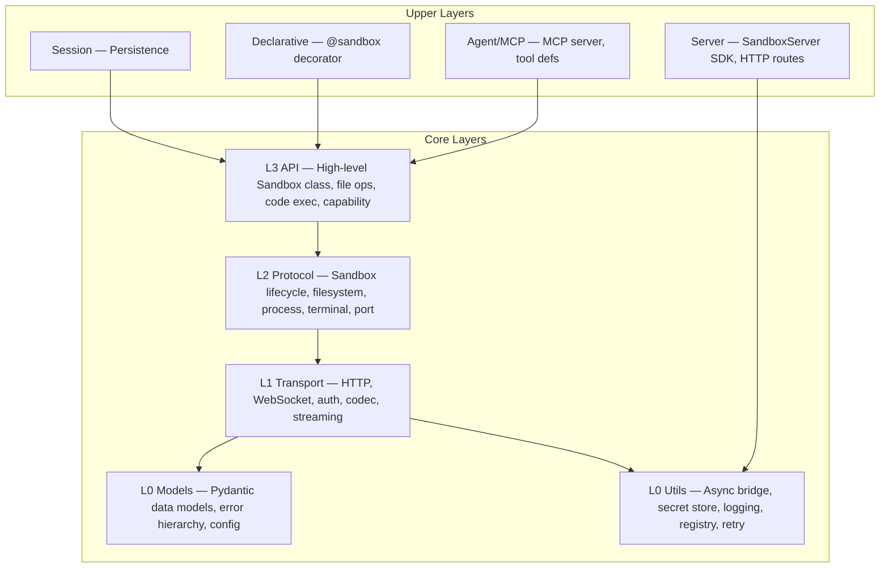

# AGENTS.md — AI Contributor Entry Point

> **For AI coding assistants** (Cursor, Copilot, Codex, Qoder, etc.).
> Human contributors: see [CONTRIBUTING.md](.github/CONTRIBUTING.md).

## Project Overview

**Agent Sandbox** (distribution name `agent-sandbox-client`, import `agent_sandbox`) provides standard synchronous/asynchronous Express clients and the explicit asynchronous `ProviderSandbox` for provider/server extensions. Standard entries follow the pinned Alibaba-supported E2B contract; conditional capabilities still depend on the actual account/function. Templates are built and deployed with `abx template build|deploy`; read `docs/en/guide/migrate-from-e2b.md` before changing either surface.

This repository (`python-sdk`) holds the **Python SDK only**, split into two distributions that share the `agent_sandbox` namespace and are **versioned in lockstep** (same version number):

| Folder | PyPI distribution | Import path | Source |
|--------|-------------------|-------------|--------|
| `client-sdk/` | `agent-sandbox-client` | `agent_sandbox` | `client-sdk/src/agent_sandbox/` |
| `server-sdk/` | `agent-sandbox-server` | `agent_sandbox.server` | `server-sdk/src/agent_sandbox/server/` (container-side runtime; no `agent_sandbox/__init__.py` of its own) |

The `abx` CLI is **not** part of this repository: it is a Node.js/TypeScript project (`@agent-sandbox/cli`) that lives in the [`cli` repository](https://github.com/alibaba-agent-sandbox/agent-sandbox). There is no `agent_sandbox.cli` module, no `[cli]`/`[binary]` extra and no `abx` console script in the Python packages.

- **Language:** Python 3.10+
- **Build system:** Hatchling (one `pyproject.toml` per package)
- **Packages:** `client-sdk/src/agent_sandbox/`, `server-sdk/src/agent_sandbox/server/`
- **Entry point:** none (library only).

---

## Directory Structure

```
python-sdk/
├── client-sdk/                # PyPI: agent-sandbox-client (import agent_sandbox)
│   ├── pyproject.toml
│   ├── src/agent_sandbox/      # SDK source
│   │   ├── models/                # Data models: config, errors, sandbox, template, session, filesystem, process
│   │   ├── transport/             # HTTP/WS transport, auth, codec, retry, streaming
│   │   ├── protocol/              # Protocol abstractions: sandbox, filesystem, process, terminal, port, code_interpreter
│   │   ├── _standard/             # Pinned standard sync/async wire clients
│   │   ├── code_interpreter/      # Pinned interpreter models and clients
│   │   ├── api/                   # High-level API and server client; provider-neutral lifecycle/session contracts
│   │   ├── providers/             # Backend/session adapters; shared envd wire; external Node engine client
│   │   ├── agent/                 # AI agent tooling: MCP server, tool definitions
│   │   ├── declarative/           # @sandbox decorator, config, serializer
│   │   ├── session/               # Session persistence: local (LocalSessionStore)
│   │   └── utils/                 # Async bridge, secret store, logging, registry, retry
│   ├── tests/                 # Mirrors src/ structure (test_api/, test_models/, …) + test_packaging.py
│   └── benchmarks/            # Import-time and sandbox-create benchmarks (run manually)
├── server-sdk/                # PyPI: agent-sandbox-server (import agent_sandbox.server)
│   ├── pyproject.toml
│   ├── src/agent_sandbox/server/   # SandboxServer SDK: HTTP routes, registry, browser, PTY, devtools
│   └── tests/                 # test_server/ + test_packaging.py
├── docs/
│   ├── en/
│   │   ├── design/            # Public design documents (English)
│   │   ├── guide/             # User tutorials & how-to guides
│   │   ├── reference/         # API/error-code/config reference
│   │   ├── explanation/       # Conceptual explanations
│   │   └── DESIGN.md          # Design topic index (links to design/)
│   └── zh/
│       ├── design/            # Public design documents (Chinese mirror)
│       ├── guide/             # User tutorials & how-to guides
│       ├── reference/         # API/error-code/config reference
│       ├── explanation/       # Conceptual explanations
│       └── DESIGN.md          # Design topic index (links to design/)
├── examples/
│   ├── agents/                # AI agent integration examples
│   ├── compat-demos/          # E2B/Modal migration demos
│   ├── quickstart/            # Quick start demos (5 demos)
│   └── templates/             # Sandbox template examples (python-hello, codex, qoder, …)
├── .agents/
│   ├── notes/                 # Architecture Decision Records (ADR) — see below
│   ├── design/                # Design documents and analysis
│   ├── evidence/              # Research / verification evidence
│   └── research/              # Research & competitor analysis notes
├── scripts/                   # Repo tooling (dist checks, health check, e2e janitor)
└── Makefile                   # Dev commands (operate on both packages)
```

CLI documentation (CLI design / tutorial / reference, binary installation, `SKILL.md`) and the `abx` source live in the [`cli` repository](https://github.com/alibaba-agent-sandbox/agent-sandbox); this repository's docs describe only the Python SDK (see [Related: the abx CLI](README.md#related-the-abx-cli)).

---

## Architecture Layers

The SDK follows a strict layered architecture — **lower layers never import upper layers**:



The former CLI upper layer (Click commands, formatters) is no longer part of this repository: the `abx` CLI is a Node.js project in the `cli` repository and consumes the same envd wire protocol and `agent_sandbox.server` HTTP API.

---

## Development Commands

### Setup

```bash
# Install both packages with all dev dependencies (test + lint + all extras)
pip install -e ./server-sdk -e "./client-sdk[dev]"     # or: make dev

# Or just the container-side runtime
pip install -e "./server-sdk[dev]"
```

### Day-to-Day

| Command              | What it does                           |
|----------------------|----------------------------------------|
| `make test`          | `pytest tests/ -v --tb=short` in `server-sdk/` and `client-sdk/` |
| `make test-cov`      | Tests with coverage report             |
| `make lint`          | `ruff check src/ tests/` in both packages |
| `make format`        | `ruff format src/ tests/` in both packages |
| `make typecheck`     | `mypy src/agent_sandbox/` (client) and `mypy src/agent_sandbox/server/` (server) |
| `make build`         | Build sdist + wheel of both packages into `dist/<package>/` |
| `make dist-check`    | `twine check`, `py.typed` in both wheels, combined-install import check |
| `make ci`            | Local CI equivalent (lint, format-check, typecheck, tests, build, dist-check) |
| `make clean`         | Remove build artifacts and caches      |

### Running a Specific Test

```bash
# from client-sdk/
pytest tests/test_api/test_sandbox.py -v
pytest -k "test_capability" -v

# from server-sdk/
pytest tests/test_server/test_router.py -v
```

---

## Key Conventions

### Error Code System

All SDK errors live in [`models/errors.py`](client-sdk/src/agent_sandbox/models/errors.py). Error codes follow `E{category}{sequence}`:

| Range   | Category       | Base Class               |
|---------|----------------|--------------------------|
| E1xxx   | Authentication | `AuthenticationError`    |
| E2xxx   | Creation       | `SandboxCreationError` (`SandboxNotFoundError`, E2009, inherits `SandboxError` directly) |
| E3xxx   | Execution      | `ExecutionError`         |
| E4xxx   | Filesystem     | `FileOperationError`     |
| E5xxx   | Network        | `NetworkError`           |
| E6xxx   | Session        | `SessionError`           |

Every exception carries: `code`, `message`, `suggestion`, `docs_url` (populated when documentation is available).

### Capability Model

Defined in [`models/template.py`](client-sdk/src/agent_sandbox/models/template.py), resolved by [`api/capability.py`](client-sdk/src/agent_sandbox/api/capability.py).

- **`STANDARD_CAPABILITIES`** = `{shell, files, code, terminal, ports}` — all recognised tokens
- **`DEFAULT_CAPABILITIES`** = `{shell, files, code}` — applied when a template declares nothing
- `terminal` and `ports` **must** be declared explicitly in the template's `template.yaml`
- **Capability declaration:** capabilities are declared in `template.yaml` and resolved by `resolve_capabilities()` (fail-closed). All API methods are callable; capability tokens are used at template resolution / model validation layer only
- **Fail-closed:** if a matched template's YAML is malformed, the resolver raises `TemplateParseError` (E2004) rather than silently falling back to defaults

### Capability Resolution Priority

1. Explicit `local_yaml_path` (programmatic override)
2. Local template cache scan (`~/.abx/templates/`)
3. *(Phase 2, TODO)* Online fallback — `GET /templates/{id}`
4. Fall back to `DEFAULT_CAPABILITIES` + warning

### Template Definition

Templates use `template.yaml` (not `manifest.yaml` for capability purposes). Key fields: `name`, `capabilities`, `server`, `alias`/`aliases`. The client rejects `custom_commands`; named commands are registered in the sandbox server (`@sandbox.register`) and called with `sandbox.run(name, **kwargs)`.

---

## Testing Conventions

### Standard Tests

- Framework: **pytest** + **pytest-asyncio** (mode: `auto`)
- Each package's `tests/` mirrors its `src/`: `client-sdk/tests/test_api/`, `client-sdk/tests/test_models/`, `server-sdk/tests/test_server/`, etc. (CLI tests live in the `cli` repository)
- Integration tests marked with `@pytest.mark.integration` — skip with `-m "not integration"`
- Type annotations enforced: `mypy --strict`

---

## Contributing References

| Resource                | Path                                                                 |
|-------------------------|----------------------------------------------------------------------|
| Contributing guide      | [`.github/CONTRIBUTING.md`](.github/CONTRIBUTING.md)                 |
| PR template             | [`.github/PULL_REQUEST_TEMPLATE.md`](.github/PULL_REQUEST_TEMPLATE.md) |
| Security policy         | [`.github/SECURITY.md`](.github/SECURITY.md)                        |
| Architecture decisions  | [`.agents/notes/`](.agents/notes/README.md) (ADR system)            |
| Design documents (EN) | [`docs/en/design/`](docs/en/design/)                                |
| Design documents (ZH) | [`docs/zh/design/`](docs/zh/design/)                                |
| Design index (EN)     | [`docs/en/DESIGN.md`](docs/en/DESIGN.md)                            |
| Design index (ZH)     | [`docs/zh/DESIGN.md`](docs/zh/DESIGN.md)                            |
| Changelog               | [`CHANGELOG.md`](CHANGELOG.md)                                      |

### ADR System (`.agents/notes/`)

Architecture Decision Records follow a `proposed → implemented | rejected` lifecycle:

```
.agents/notes/
├── proposed/          # Under review
│   ├── architecture/
│   ├── feature/
│   └── process/
├── implemented/       # Accepted and active
│   ├── architecture/
│   ├── feature/
│   └── process/
└── rejected/          # Considered but not adopted (flat directory, no subdirectories)
    ├── .gitkeep
    └── *.md
```

See [`.agents/notes/README.md`](.agents/notes/README.md) for the full template and process.

---

## AI Assistant Guardrails

**MUST follow:**

1. **Never auto-commit.** Make changes; let the human review and commit.
2. **Respect template capability declarations.** If `resolve_capabilities()` fails or a capability is missing, the fix is to declare it in the template YAML — not to bypass the resolution.
3. **Never fabricate FC/envd API endpoints.** If you're unsure about a real backend API, flag it as a TODO rather than inventing a placeholder.
4. **Run the full test suite** (`make test && make lint && make typecheck`) before claiming a task is done. These targets cover both `client-sdk` and `server-sdk`.
5. **Secret scanning** is enforced via `.githooks/check-secrets.sh`. Never commit API keys, tokens, or passwords. Use `REPLACE_ME` or `placeholder` for examples.
6. **Conventional Commits** for all commit messages: `feat:`, `fix:`, `docs:`, `chore:`, `test:`, `refactor:`, `perf:`.
7. **Minimize changes.** Touch only the files necessary for the task. Don't refactor unrelated code.
8. **Type annotations** on all public APIs. Google-style docstrings.
9. **Layer dependency constraint.** Lower layers must never import upper layers (L0 must not import L1+, L1 must not import L2+, etc.). If you need a type from a higher layer, refactor it downward or use dependency injection.
10. **Maintain `__all__` exports.** When adding or removing any public symbol in a module's `__init__.py`, update the `__all__` list to match.
11. **Pydantic alias convention.** Model fields that map to camelCase API responses use `Field(alias="camelCaseName")`. Always use `model_config = ConfigDict(populate_by_name=True)` so both the alias and the Python snake_case name work.


## Public API and maintained standard sources

Root Sandbox/AsyncSandbox and code_interpreter expose the pinned standard clients.
ProviderSandbox is the explicit asynchronous provider/server extension. Preserve
both contracts and document which one each example uses. The active generated
standard Connect messages use protobuf; the retired Python engine and grpcio stay
removed. Keep original source hashes, patch descriptions and license attribution.

Live source-install recipes must pin a tested implementation with the documented
public entry shape. Verify the displayed paired archives in a fresh environment,
including standard sync/async, ProviderSandbox and server imports plus pip check.
A documentation-only follow-up does not require inventing a new package release.

## Provider command ownership

Common code owns configuration isolation, schema validation, transport and generic discovery/dispatch. Keep vendor API mappings, resource identifiers and admission conditions in the owning Provider. Prefer the existing `provider-commands/1` contract for provider-specific operations: the CLI `provider command` namespace and Python `agent_sandbox.providers.commands` discover the same engine catalog. Do not add a backend switch or duplicate cloud implementation in each consumer. Stable typed APIs may be thin wrappers; registration does not generate language methods or establish live-account readiness. Express is bundled in the CLI provider tree; catalog plugin source remains in awesome-providers. Standard compatibility clients keep their existing contract.
