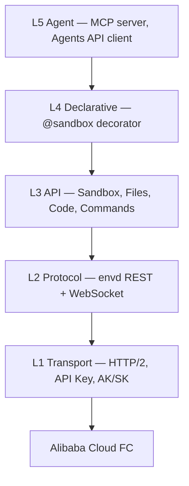

# Agent Sandbox

**English** | [中文](README.zh-CN.md)

<!-- badges -->
[](https://github.com/alibaba-agent-sandbox/python-sdk/actions/workflows/ci.yml)
[](https://pypi.org/project/agent-sandbox/)
[](https://pypi.org/project/agent-sandbox/)
[](LICENSE)

> Cloud sandboxes for AI agents — create, execute, and manage isolated environments in seconds.

**Agent Sandbox** is a Python SDK for the Alibaba Cloud FC Agent Sandbox service. It is the
**runtime** client: create, use and kill sandboxes. Building and deploying templates is done with
`abx template build|deploy` from the CLI. The SDK uses E2B-shaped method names so that E2B code
ports with few changes; it is not a drop-in replacement (see [Migrate from E2B](docs/en/guide/migrate-from-e2b.md)).

This repository (`python-sdk`) contains the **Python SDK**, published as two lock-step PyPI
distributions. The `abx` command-line tool is a separate Node.js project that lives in the
[`cli`](https://github.com/alibaba-agent-sandbox/agent-sandbox) repository (see [Related: the abx CLI](#related-the-abx-cli)).

| Folder | PyPI distribution | Import path | Purpose |
|--------|-------------------|-------------|---------|
| [`client-sdk/`](client-sdk/) | `agent-sandbox` | `agent_sandbox` | Async client SDK: `Sandbox`, files, commands, code interpreter, named commands, declarative `@sandbox`, Agents API client, MCP server, E2B migration helper |
| [`server-sdk/`](server-sdk/) | `agent-sandbox-server` | `agent_sandbox.server` | Container-side runtime: the persistent HTTP service (default port 9000) that runs *inside* a sandbox image |

Both distributions share the `agent_sandbox` namespace (the client owns `agent_sandbox/__init__.py`,
the server only ships `agent_sandbox/server/`) and are **released in lockstep** with the same version number.

---

## Features

- **Async-first SDK** — `Sandbox.create()`, shell execution, code interpretation, file I/O, port forwarding, and WebSocket streaming.
- **Three execution primitives** — `sandbox.commands.run()` (bare shell), `sandbox.run_code()` (code interpreter), `sandbox.run("name", **kwargs)` (a command registered in the sandbox server).
- **Templates** — reusable sandbox images (Python, Node, browser automation, AI agent harnesses, …), built and deployed with `abx template build|deploy`.
- **MCP server** — expose sandbox operations as MCP tools for LLM agents.
- **Declarative decorator** — `@sandbox` turns a plain function into a remote sandbox execution with automatic serialisation.
- **Session persistence** — save and restore sandbox state across runs.
- **E2B migration helper** — E2B-shaped methods and `agent_sandbox.compat`; partial, see [Migrate from E2B](docs/en/guide/migrate-from-e2b.md).
- **Agents API** — in-sandbox HTTP sessions. Codex and Qwen Code are supported today. Install a CLI when you call it; the base image does not carry both. Guide and complete case: [Agents API](docs/en/guide/agents-api.md).

## Installation

```bash
# Core client SDK only
pip install agent-sandbox

# Everything (MCP + fast JSON + sessions + declarative + server)
pip install "agent-sandbox[all]"

# Container-side runtime (install this inside your sandbox image)
pip install agent-sandbox-server
pip install playwright                       # only if you enable the browser capability group

# Development (from the repository root; includes test & lint tooling for both packages)
pip install -e ./server-sdk -e "./client-sdk[dev]"
```

`agent-sandbox` depends on `agent-sandbox-server` of the same version, so `pip install agent-sandbox` also provides `agent_sandbox.server` (needed locally by the `@sandbox` decorator's server proxy). The `[server]` extra is kept as a harmless alias.

The `abx` CLI is no longer part of the Python package (there is no `[cli]` extra and no `abx`
console script); it is distributed from the [`cli`](https://github.com/alibaba-agent-sandbox/agent-sandbox) repository
(see [Related: the abx CLI](#related-the-abx-cli)).

## Quick Start

```python
import asyncio
from agent_sandbox import Sandbox

async def main():
    async with await Sandbox.create(template="python-base") as sandbox:

        # 1. Bare shell — sandbox.commands.run(cmd)
        proc = await sandbox.commands.run("echo 'Hello from sandbox!'")
        print(proc.stdout)          # Hello from sandbox!
        print(proc.exit_code)       # 0

        # 2. Code interpreter — sandbox.run_code(code)
        result = await sandbox.run_code("print(2 ** 10)")
        print(result.text)          # 1024

        # 3. Named command — sandbox.run(name, **kwargs)
        #    POST /commands/hello on the in-sandbox SandboxServer
        greeting = await sandbox.run("hello", name="Alice")
        print(greeting)             # the registered function's return value

        # 4. File operations
        await sandbox.files.write("/tmp/data.txt", "content")
        content = await sandbox.files.read("/tmp/data.txt")

        # 5. Port access
        url = sandbox.network.get_url(3000)

asyncio.run(main())
```

## Execution API

Three execution methods, each for a distinct use case:

| Method | Purpose | Returns |
|--------|---------|---------|
| `sandbox.commands.run(cmd)` | Execute a bare shell command (raw exec) | `ProcessResult` — `.stdout`, `.stderr`, `.exit_code` |
| `sandbox.run_code(code)` | Execute code via the code interpreter | `CodeResult` — `.text`, `.stdout`, `.stderr` |
| `sandbox.run(name, **kw)` | Call a command registered in the sandbox server | the registered function's JSON return value |

**Named commands** have one mechanism: server-side registered commands. A command is registered with
`@sandbox.register` (or `CommandRegistry`) inside the template, and `sandbox.run("name", **kwargs)` sends
`POST /commands/name` to the in-sandbox SandboxServer. An unknown name raises `CommandNotFoundError`;
`await sandbox.list_commands()` lists what the server has registered. See
[Declarative Usage](docs/en/guide/declarative-usage.md).

> **Environment variables:** envd uses direct exec — shell features (`$VAR`, pipes, redirects) require `sh -c '...'`. Use `printenv VAR` to read a variable. See the [Environment Variables guide (EN)](docs/en/guide/environment-variables.md) | [环境变量指南 (中文)](docs/zh/guide/environment-variables.md) for details.

## Templates

Official and community templates live in the
[`alibaba-agent-sandbox/awesome-templates`](https://github.com/alibaba-agent-sandbox/awesome-templates)
repository — the single source of truth for template content, the index, and
publishing. The index is consumed by the `abx template search|install` commands
([Related: the abx CLI](#related-the-abx-cli)); the `template.yaml` contract that
templates follow is defined in the [Template YAML Spec](docs/en/reference/template-yaml-spec.md).

[`examples/templates/`](examples/templates/) only keeps a minimal
`python-hello` **fixture** for offline tests — it is not a publishing source.
See [examples/templates/README.md](examples/templates/README.md) for the
fixture contract and index behaviour (caching, offline fallback, pinned refs).

## Architecture



Lower layers never import upper layers. Full design: [`docs/en/design/architecture.md`](docs/en/design/architecture.md).

## Documentation

> Full documentation index: [`docs/README.md`](docs/README.md) (bilingual navigation)

### Tutorials & Guides

| Guide | Link |
|-------|------|
| Getting Started | [Getting Started](docs/en/guide/getting-started.md) |
| Best Practices | [Best Practices](docs/en/guide/best-practices.md) |
| Accessibility | [Accessibility](ACCESSIBILITY.md) |
| File and command controls | [File and command controls](docs/en/guide/file-and-command-controls.md) |
| Hosted agents | [Hosted agents](docs/en/guide/hosted-agents.md) |
| SDK Usage | [SDK Usage](docs/en/guide/sdk-usage.md) |
| Authentication | [Authentication](docs/en/guide/authentication.md) |
| Environment Variables | [Environment Variables](docs/en/guide/environment-variables.md) |
| Authoring Templates | [Authoring Templates](docs/en/guide/authoring-templates.md) |
| Build & Deploy (CLI) | [Build & Deploy](docs/en/guide/build-and-deploy.md) |
| Declarative Usage | [Declarative Usage](docs/en/guide/declarative-usage.md) |
| MCP Integration | [MCP Integration](docs/en/guide/mcp-integration.md) |
| Session Persistence | [Session Persistence](docs/en/guide/session-persistence.md) |
| Migrate from E2B | [Migrate from E2B](docs/en/guide/migrate-from-e2b.md) |
| Troubleshooting | [Troubleshooting](docs/en/guide/troubleshooting.md) |

### Reference

| Document | Link |
|----------|------|
| API Reference | [API Reference](docs/en/reference/api-reference.md) |
| Configuration | [Configuration](docs/en/reference/configuration.md) |
| Error Codes | [Error Codes](docs/en/reference/error-codes.md) |
| Template YAML Spec | [Template YAML Spec](docs/en/reference/template-yaml-spec.md) |

### Design & Architecture

| Document | Link |
|----------|------|
| Design Index | [Design Index](docs/en/DESIGN.md) |
| Architecture | [Architecture](docs/en/design/architecture.md) |
| SDK API Design | [SDK API Design](docs/en/design/sdk-api-design.md) |
| Template System | [Template System](docs/en/design/template-system.md) |

### Other Resources

| Resource | Link |
|----------|------|
| Changelog | [CHANGELOG.md](CHANGELOG.md) |
| Contributing Guide | [CONTRIBUTING.md](.github/CONTRIBUTING.md) |
| License | [Apache-2.0](LICENSE) |
| Examples | [examples/](examples/) |

## Related: the abx CLI

The `abx` command-line tool (`@agent-sandbox/cli`, Node.js) is developed in the
[`cli`](https://github.com/alibaba-agent-sandbox/agent-sandbox) repository. It shares sandboxes, templates and
credentials with this SDK. Its installation, command reference, tutorials, MCP server
commands and the Agent Skill (`SKILL.md`) are documented there:

- [CLI README](https://github.com/alibaba-agent-sandbox/agent-sandbox/blob/main/README.md) — installation (`npm install -g @agent-sandbox/cli`)
- [CLI Tutorial](https://github.com/alibaba-agent-sandbox/agent-sandbox/blob/main/docs/en/guide/cli-tutorial.md) · [CLI Reference](https://github.com/alibaba-agent-sandbox/agent-sandbox/blob/main/docs/en/reference/cli-reference.md)
- [Agent Skill Installation & Distribution](https://github.com/alibaba-agent-sandbox/agent-sandbox/blob/main/docs/en/guide/agent-skill-installation.md)

## Contributing

We welcome contributions! Please read the [Contributing Guide](.github/CONTRIBUTING.md) to get started.

## License

[Apache-2.0](LICENSE) — see [`NOTICE`](NOTICE) for copyright information.
