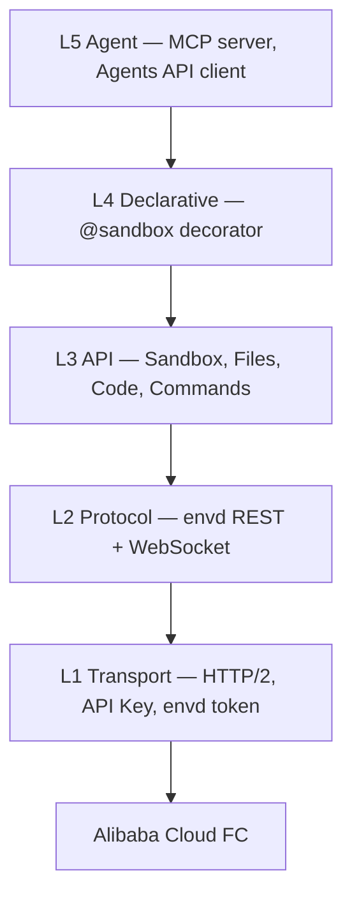

# Agent Sandbox

[Launch templates](docs/en/guide/template-workflows.md): start the complete template and access all declared services.

**English** | [中文](README.zh-CN.md)

[Standard E2B migration contract](docs/en/guide/migrate-from-e2b.md)

<!-- badges -->
[](https://github.com/alibaba-agent-sandbox/python-sdk/actions/workflows/ci.yml)
[](LICENSE)

> Cloud sandboxes for AI agents — create, execute, and manage isolated environments in seconds.

**Agent Sandbox** is a Python SDK for sandboxes. The default provider is Alibaba Cloud Express (`alicloud-express`, Function Compute). OpenSandbox, the container edition, CubeSandbox, and E2B are catalog `node` plugins in `awesome-providers` (`provider.mjs`). Install one with `abx provider install alibaba-agent-sandbox/awesome-providers//<id> --allow-unpinned --yes` (or `python -m agent_sandbox.providers install registry:<id> --yes`). After that, both `abx --provider <id>` and `ProviderSandbox.create(provider="<id>")` use it. The Python SDK reaches a `node` provider through the local engine (`abx provider engine serve`; `abx` on `PATH` or `ABX_BIN`). The CLI loads Express plus installed `node`, `exec` and `rest` plugins. It is the
standard sync/async runtime and Template client. Project provider/server template launches use
`abx template launch <reference>` from the CLI; advanced image preparation uses
`abx template build|deploy`. The SDK uses E2B-shaped method names so that E2B code
ports with few changes; the standard API follows Alibaba-supported E2B behavior (see [Migrate from E2B](docs/en/guide/migrate-from-e2b.md)).

This repository (`python-sdk`) contains the **Python SDK**, packaged as two lock-step distributions. The `abx` command-line tool is a separate Node.js project that lives in the
[`agent-sandbox`](https://github.com/alibaba-agent-sandbox/agent-sandbox) repository (see [Related: the abx CLI](#related-the-abx-cli)).

| Folder | Distribution | Import path | Purpose |
|--------|-------------------|-------------|---------|
| [`client-sdk/`](client-sdk/) | `agent-sandbox-client` | `agent_sandbox` | Sync/async client SDK: `Sandbox`, `AsyncSandbox`, `ProviderSandbox`, files, commands, code interpreter, named commands, declarative `@sandbox`, Agents API client, MCP server, E2B migration helper |
| [`server-sdk/`](server-sdk/) | `agent-sandbox-server` | `agent_sandbox.server` | Container-side runtime: the persistent HTTP service (default port 9000) that runs *inside* a sandbox image |

Both distributions share the `agent_sandbox` namespace (the client owns `agent_sandbox/__init__.py`,
the server only ships `agent_sandbox/server/`) and are **versioned in lockstep** with the same version number.

**Client SDK** runs on your machine: create a sandbox and use it. Guide: [Client SDK](docs/en/guide/client-sdk.md). Examples: `examples/quickstart/`, `examples/compat-demos/`, `examples/agents/`, `examples/scenarios/`.

**Server SDK** runs inside the sandbox image: the HTTP service the image starts. Guide: [Server SDK](docs/en/guide/server-sdk.md). Examples: `examples/templates/python-hello/commands.py`, `examples/templates/agents-cli/commands.py`.

## Sites

| Site | URL |
|---|---|
| Official site | https://www.agent-sandbox.cn |
| Provider registry | https://registry.agent-sandbox.cn |

The installer fetches the catalog index at `https://registry.agent-sandbox.cn/providers/index.json`. `ABX_PROVIDER_REGISTRY` overrides that URL.

---

Provider management operations are available through `agent_sandbox.providers.commands`; see the [provider command guide](docs/en/guide/provider-commands.md).

## Client SDK

- **Sync and async standard clients** — `Sandbox.create()` and `AsyncSandbox.create()`, shell execution, code interpretation, file I/O, port forwarding, and WebSocket streaming.
- **Explicit execution entry points** — process execution, the standard interpreter client, and template application commands have separate runtime requirements (see Execution API below).
- **MCP server** — expose sandbox operations as MCP tools for LLM agents.
- **Declarative decorator** — `@sandbox` turns a plain function into a remote sandbox execution with automatic serialisation.
- **Standard sync/async clients** — `agent_sandbox` exports the standard Sandbox and AsyncSandbox; see [Migrate from E2B](docs/en/guide/migrate-from-e2b.md).

## Server SDK

- **In-image HTTP service** — `commands.py` imports `agent_sandbox.server` and calls `start(9000)`.
- **Registered commands** — `@command` functions become routes the Client SDK calls with `sandbox.run`.
- **Agents API** — Codex and Qwen Code HTTP sessions inside the sandbox. Install a CLI when you call it. Guide: [Agents API](docs/en/guide/agents-api.md).
- **Templates** — start the complete template with `abx template launch <reference>`; use `template build` / `template deploy` for advanced image preparation.

## Installation

Use Python 3.10 or newer in a virtual environment. The client installs its matching server dependency automatically. See the [installation guide](docs/en/guide/install-python.md) for a pinned version, optional extras and development setup.

```bash
python -m pip install --index-url https://pypi.org/simple --upgrade --pre agent-sandbox-client
python -m pip check
```

`--pre` opts into alpha releases. The command-line tool is installed separately: see [the abx CLI](https://github.com/Alibaba-Agent-Sandbox/agent-sandbox).

Do not run `pip install agent-sandbox`; that PyPI name belongs to an unrelated project.

## Quick Start

Configure `ABX_SANDBOX_API_KEY`, `ABX_SANDBOX_BASE_URL`, `ABX_SANDBOX_DOMAIN`. Replace E2B imports as described in the [migration guide](docs/en/guide/migrate-from-e2b.md).

```python
from agent_sandbox.code_interpreter import Sandbox

sandbox = Sandbox.create(template="code-interpreter-v1")
try:
    print(sandbox.commands.run("printf hello").stdout)
    print(sandbox.run_code("1 + 1").text)
finally:
    sandbox.kill()
```

## Provider and server extensions

Set `ABX_SANDBOX_API_KEY`, `ABX_SANDBOX_BASE_URL` and `ABX_SANDBOX_DOMAIN`, then create a native instance and execute a process with `ProviderSandbox`:

```python
import asyncio
from agent_sandbox import ProviderSandbox

async def main():
    sandbox = await ProviderSandbox.create(template="base", provider="alicloud-express")
    try:
        result = await sandbox.commands.run("python3 -c 'print(2 ** 10)'")
        print(result.stdout)  # 1024
    finally:
        try:
            await sandbox.kill()
        finally:
            await sandbox.close()

asyncio.run(main())
```

This `python3` invocation is a process, not a persistent interpreter. Interpreter operations absent from a provider return `E8004`; the standard `code_interpreter.Sandbox` above is a separate entry point. `close()` releases client connections; `kill()` deletes the instance.

## Execution API

| Entry point | Purpose | Requirement |
|---|---|---|
| `ProviderSandbox.commands.run()` | Execute a process and read stdout, stderr and exit code | Provider implements process operations |
| Standard `code_interpreter.Sandbox.run_code()` | Execute interpreter code | A matching native runtime such as `code-interpreter-v1` |
| `ProviderSandbox.application_client()` | Call application commands registered by a template HTTP service | Start the template service and supply the correct port and application token |

Named application commands are registered by the in-sandbox server. Follow [template startup](docs/en/guide/template-workflows.md) to create or connect to that application, preserving provider gateway headers, URL prefixes and query parameters; do not assume `base` registers `hello`. See [Providers](docs/en/guide/providers.md) for cross-language plugin execution.

## Templates

Official and community templates live in the
[`alibaba-agent-sandbox/awesome-templates`](https://github.com/alibaba-agent-sandbox/awesome-templates)
repository — the single source of truth for template content, the index, and
publishing. The index is consumed by the `abx template search|install` commands
([Related: the abx CLI](#related-the-abx-cli)); the `template.yaml` contract that
templates follow is defined in the [Template YAML Spec](docs/en/reference/template-yaml-spec.md).

[`examples/templates/`](examples/templates/) only keeps a minimal
`python-hello` **fixture** for offline tests — it is not a publishing source.
See [examples/templates/README.md](examples/templates/README.md) for the
fixture contract and index behaviour (caching, offline fallback, pinned refs).

## Architecture



Lower layers never import upper layers. Full design: [`docs/en/design/architecture.md`](docs/en/design/architecture.md).

## Documentation

> Full documentation index: [`docs/README.md`](docs/README.md) (bilingual navigation)

### Tutorials & Guides

| Guide | Link |
|-------|------|
| Getting Started | [Getting Started](docs/en/guide/getting-started.md) |
| Best Practices | [Best Practices](docs/en/guide/best-practices.md) |
| Accessibility | [Accessibility](ACCESSIBILITY.md) |
| File and command controls | [File and command controls](docs/en/guide/file-and-command-controls.md) |
| Hosted agents | [Hosted agents](docs/en/guide/hosted-agents.md) |
| SDK Usage | [SDK Usage](docs/en/guide/sdk-usage.md) |
| Authentication | [Authentication](docs/en/guide/authentication.md) |
| Environment Variables | [Environment Variables](docs/en/guide/environment-variables.md) |
| Authoring Templates | [Authoring Templates](docs/en/guide/authoring-templates.md) |
| Build & Deploy (CLI) | [Build & Deploy](docs/en/guide/build-and-deploy.md) |
| Declarative Usage | [Declarative Usage](docs/en/guide/declarative-usage.md) |
| Binary MCP files | [Upload/download](docs/en/guide/mcp-binary-files.md) |
| Background MCP tasks | [Reconnectable tasks](docs/en/guide/mcp-background-tasks.md) |
| MCP Integration | [MCP Integration](docs/en/guide/mcp-integration.md) |
| Session Persistence | [Session Persistence](docs/en/guide/session-persistence.md) |
| Migrate from E2B | [Migrate from E2B](docs/en/guide/migrate-from-e2b.md) |
| Troubleshooting | [Troubleshooting](docs/en/guide/troubleshooting.md) |

### Reference

| Document | Link |
|----------|------|
| API Reference | [API Reference](docs/en/reference/api-reference.md) |
| Configuration | [Configuration](docs/en/reference/configuration.md) |
| Error Codes | [Error Codes](docs/en/reference/error-codes.md) |
| Template YAML Spec | [Template YAML Spec](docs/en/reference/template-yaml-spec.md) |

### Design & Architecture

| Document | Link |
|----------|------|
| Design Index | [Design Index](docs/en/DESIGN.md) |
| Architecture | [Architecture](docs/en/design/architecture.md) |
| SDK API Design | [SDK API Design](docs/en/design/sdk-api-design.md) |
| Template System | [Template System](docs/en/design/template-system.md) |

### Other Resources

| Resource | Link |
|----------|------|
| Changelog | [CHANGELOG.md](CHANGELOG.md) |
| Contributing Guide | [CONTRIBUTING.md](.github/CONTRIBUTING.md) |
| License | [Apache-2.0](LICENSE) |
| Examples | [examples/](examples/) |
| SDK skill | [agent-sandbox-sdk/SKILL.md](agent-sandbox-sdk/SKILL.md) — how an agent writes a client and a template |

## Related: the abx CLI

The `abx` command-line tool (`@agent-sandbox/cli`, Node.js) is developed in the
[`agent-sandbox`](https://github.com/alibaba-agent-sandbox/agent-sandbox) repository. It shares sandboxes, templates and
credentials with this SDK. Its installation, command reference, tutorials, MCP server
commands and the Agent Skill (`SKILL.md`) are documented there:

- [CLI README](https://github.com/alibaba-agent-sandbox/agent-sandbox/blob/main/README.md) — installation ([CLI binary installation](https://github.com/Alibaba-Agent-Sandbox/agent-sandbox/blob/main/docs/en/guide/binary-installation.md))
- [CLI Tutorial](https://github.com/alibaba-agent-sandbox/agent-sandbox/blob/main/docs/en/guide/cli-tutorial.md) · [CLI Reference](https://github.com/alibaba-agent-sandbox/agent-sandbox/blob/main/docs/en/reference/cli-reference.md)
- [Agent Skill Installation & Distribution](https://github.com/alibaba-agent-sandbox/agent-sandbox/blob/main/docs/en/guide/agent-skill-installation.md)

Named commands support native `list[str]` JSON arguments. See the [server API guide](docs/en/guide/template-server-api.md#string-array-command-arguments) for validation and server compatibility.

## Contributing

We welcome contributions! Please read the [Contributing Guide](.github/CONTRIBUTING.md) to get started.

## License

[Apache-2.0](LICENSE) — see [`NOTICE`](NOTICE) for copyright information.

[Builtin runtime architecture and Python engine migration](docs/en/design/builtin-data-plane.md).

Provider-owned pause/resume and Snapshot commands share one implementation across CLI and SDK; see the [registration and usage guide](docs/en/guide/provider-commands.md).

Current API / 当前接口: [development contract](docs/en/guide/current-api.md).
