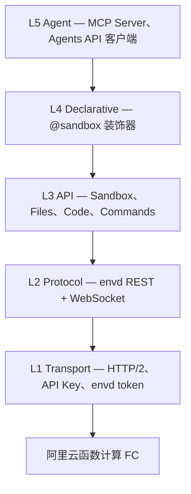

# Agent Sandbox

[English](README.md) | **中文**

[标准 E2B 迁移契约](docs/zh/guide/migrate-from-e2b.md)

<!-- badges -->
[](https://github.com/alibaba-agent-sandbox/python-sdk/actions/workflows/ci.yml)
[](LICENSE)

> 为 AI Agent 打造的云沙箱 —— 秒级创建、执行、管理隔离环境。

**Agent Sandbox** 是沙箱的 Python SDK。默认提供方是阿里云极速版（`alicloud-express`，函数计算）。OpenSandbox、容器版、CubeSandbox 和 E2B 都是 `awesome-providers` 里的目录 `node` 插件（`provider.mjs`）。用 `abx provider install alibaba-agent-sandbox/awesome-providers//<id> --allow-unpinned --yes`（或 `python -m agent_sandbox.providers install registry:<id> --yes`）安装。装好之后，`abx --provider <id>` 和 `ProviderSandbox.create(provider="<id>")` 都能用。Python SDK 通过本机引擎（`abx provider engine serve`；`abx` 在 `PATH` 里或由 `ABX_BIN` 指定）使用 `node` 提供方。CLI 加载极速版，以及已安装的 `node`、`exec` 和 `rest` 插件。标准接口包含同步／异步运行时和 Template 客户端；项目 Provider／Server 模板流程通过 CLI 的 `abx template build|deploy` 完成。SDK 的方法名参考了 E2B，
方便 E2B 代码迁移，标准接口遵循阿里云支持版本的行为契约（见[从 E2B 迁移](docs/zh/guide/migrate-from-e2b.md)）。

本仓库（`python-sdk`）包含 **Python SDK**，以两个版本同步的分发包提供。命令行工具 `abx` 是独立的
Node.js 项目，位于 [`agent-sandbox`](https://github.com/alibaba-agent-sandbox/agent-sandbox) 仓库（见[相关：abx CLI](#相关abx-cli)）。

| 目录 | PyPI 分发包 | 导入路径 | 用途 |
|------|-------------|----------|------|
| [`client-sdk/`](client-sdk/) | `agent-sandbox-client` | `agent_sandbox` | 同步/异步客户端 SDK：`Sandbox`、`AsyncSandbox`、`ProviderSandbox`、文件、命令、代码解释器、命名命令、声明式 `@sandbox`、Agents API 客户端、MCP Server、E2B 迁移辅助 |
| [`server-sdk/`](server-sdk/) | `agent-sandbox-server` | `agent_sandbox.server` | 容器侧运行时：运行在沙箱镜像*内部*的常驻 HTTP 服务（默认端口 9000） |

两个分发包共享 `agent_sandbox` 命名空间（client 提供 `agent_sandbox/__init__.py`，server 只包含
`agent_sandbox/server/`），并以相同版本号**同步发布**。

**Client SDK** 跑在你的机器上：创建沙箱并使用它。说明见 [Client SDK](docs/zh/guide/client-sdk.md)。示例在 `examples/quickstart/`、`examples/compat-demos/`、`examples/agents/`、`examples/scenarios/`。

**Server SDK** 跑在沙箱镜像里面：镜像启动的 HTTP 服务。说明见 [Server SDK](docs/zh/guide/server-sdk.md)。示例是 `examples/templates/python-hello/commands.py` 和 `examples/templates/agents-cli/commands.py`。

## 网站

| 网站 | 地址 |
|---|---|
| 官网 | https://www.agent-sandbox.cn |
| 提供方注册站 | https://registry.agent-sandbox.cn |

安装器拉取的目录索引是 `https://registry.agent-sandbox.cn/providers/index.json`。`ABX_PROVIDER_REGISTRY` 可以改这个地址。

---

提供方管理操作通过 `agent_sandbox.providers.commands` 调用，参阅[提供方命令指南](docs/zh/guide/provider-commands.md)。

## Client SDK

- **同步与异步标准客户端** —— `Sandbox.create()` 与 `AsyncSandbox.create()`，Shell 执行、代码解释、文件读写、端口转发与 WebSocket 流；Provider／Server 扩展使用异步 `ProviderSandbox`。
- **三种执行原语** —— `sandbox.commands.run()`（裸 Shell）、`sandbox.run_code()`（代码解释器）、`sandbox.run("name", **kwargs)`（调用 Server SDK 注册的命令）。
- **MCP Server** —— 将沙箱操作暴露为 MCP 工具，供 LLM Agent 调用。
- **声明式装饰器** —— `@sandbox` 将普通函数变为远程沙箱执行，自动序列化。
- **会话持久化** —— 跨运行保存和恢复沙箱状态。
- **E2B 风格方法名** —— `agent_sandbox.compat` 导出标准 Sandbox 与 AsyncSandbox，见[从 E2B 迁移](docs/zh/guide/migrate-from-e2b.md)。

## Server SDK

- **镜像内 HTTP 服务** —— `commands.py` 导入 `agent_sandbox.server` 并调用 `start(9000)`。
- **注册命令** —— `@command` 函数变成路由，Client SDK 用 `sandbox.run` 调用。
- **Agents API** —— 沙箱里的 Codex 与 Qwen Code HTTP 会话。CLI 按需安装。说明见 [Agents API](docs/zh/guide/agents-api.md)。
- **模板** —— 镜像和 `template.yaml` 用 `abx template build|deploy` 构建和部署。

## 安装

当前0.3.0尚未上 PyPI，使用[配套源码安装指南](docs/zh/guide/install-python.md)，两个源码 URL 必须固定同一提交。

```bash
# 仅核心客户端 SDK
python -m pip install \
  "agent-sandbox-server @ https://github.com/Alibaba-Agent-Sandbox/python-sdk/archive/08c51248bb3c1a6f1380bdb3d33126cda23bb7ec.tar.gz#subdirectory=server-sdk" \
  "agent-sandbox-client @ https://github.com/Alibaba-Agent-Sandbox/python-sdk/archive/08c51248bb3c1a6f1380bdb3d33126cda23bb7ec.tar.gz#subdirectory=client-sdk"

# 完整安装（MCP + 快速 JSON + 会话 + 声明式 + server）
python -m pip install \
  "agent-sandbox-server @ https://github.com/Alibaba-Agent-Sandbox/python-sdk/archive/08c51248bb3c1a6f1380bdb3d33126cda23bb7ec.tar.gz#subdirectory=server-sdk" \
  "agent-sandbox-client[all] @ https://github.com/Alibaba-Agent-Sandbox/python-sdk/archive/08c51248bb3c1a6f1380bdb3d33126cda23bb7ec.tar.gz#subdirectory=client-sdk"

# 容器侧运行时（安装到你的沙箱镜像内）
python -m pip install "agent-sandbox-server @ https://github.com/Alibaba-Agent-Sandbox/python-sdk/archive/08c51248bb3c1a6f1380bdb3d33126cda23bb7ec.tar.gz#subdirectory=server-sdk"
pip install playwright                       # 仅在启用 browser 能力组时需要

# 开发环境（在仓库根目录执行；含两个包的测试与 lint 工具）
pip install -e ./server-sdk -e "./client-sdk[dev]"
```

不要执行 `pip install agent-sandbox`。PyPI 上的 `agent-sandbox` 是另一个无关项目。安装本客户端请使用 [配套源码安装指南](docs/zh/guide/install-python.md)。

`agent-sandbox-client` 依赖同版本的 `agent-sandbox-server`，因此 [配套源码安装指南](docs/zh/guide/install-python.md) 同样会提供 `agent_sandbox.server`（`@sandbox` 装饰器的 server 代理在本地需要它）。`[server]` extra 作为无害的别名保留。

`abx` CLI 不再属于 Python 包（不再有 `[cli]` extra，也没有 `abx` 控制台脚本），由
[`agent-sandbox`](https://github.com/alibaba-agent-sandbox/agent-sandbox) 仓库分发（见[相关：abx CLI](#相关abx-cli)）。

## 快速开始

配置 `ABX_SANDBOX_API_KEY`、`ABX_SANDBOX_BASE_URL`、`ABX_SANDBOX_DOMAIN`，按[迁移指南](docs/zh/guide/migrate-from-e2b.md)替换 E2B 导入。

```python
from agent_sandbox.code_interpreter import Sandbox

sandbox = Sandbox.create(template="code-interpreter-v1")
try:
    print(sandbox.commands.run("printf hello").stdout)
    print(sandbox.run_code("1 + 1").text)
finally:
    sandbox.kill()
```

## Provider 与 Server 扩展


第一次创建之前先设置 `ABX_SANDBOX_API_KEY`。SDK 读取这三个标准连接变量。下面的例子用 `python-base`，因为这张镜像注册了 `hello`。不传 template 的 `Sandbox.create()` 使用 `base`。

```python
import asyncio
from agent_sandbox import ProviderSandbox as Sandbox

async def main():
    async with await Sandbox.create(template="python-base") as sandbox:

        # 1. 裸 Shell —— sandbox.commands.run(cmd)
        proc = await sandbox.commands.run("echo 'Hello from sandbox!'")
        print(proc.stdout)          # Hello from sandbox!
        print(proc.exit_code)       # 0

        # 2. 代码解释器 —— sandbox.run_code(code)
        result = await sandbox.run_code("print(2 ** 10)")
        print(result.text)          # 1024

        # 3. 命名命令 —— sandbox.run(name, **kwargs)
        #    向沙箱内 SandboxServer 发送 POST /commands/hello
        greeting = await sandbox.run("hello", name="Alice")
        print(greeting)             # 注册函数的返回值

        # 4. 文件操作
        await sandbox.files.write("/tmp/data.txt", "content")
        content = await sandbox.files.read("/tmp/data.txt")

        # 5. 端口访问
        url = sandbox.network.get_url(3000)

asyncio.run(main())
```

## 执行 API

三种执行方法，分别对应不同场景：

| 方法 | 用途 | 返回类型 |
|------|------|----------|
| `sandbox.commands.run(cmd)` | 执行裸 Shell 命令（原始 exec） | `ProcessResult` —— `.stdout`, `.stderr`, `.exit_code` |
| `sandbox.run_code(code)` | 通过代码解释器执行代码 | `CodeResult` —— `.text`, `.stdout`, `.stderr` |
| `sandbox.run(name, **kw)` | 调用注册在沙箱 server 里的命令 | 注册函数的 JSON 返回值 |

**命名命令**只有一种机制：服务端注册命令。在模板里用 `@sandbox.register`（或 `CommandRegistry`）注册，
`sandbox.run("name", **kwargs)` 向沙箱内 SandboxServer 发送 `POST /commands/name`。名字不存在抛
`CommandNotFoundError`；`await sandbox.list_commands()` 列出 server 已注册的命令。见[声明式用法](docs/zh/guide/declarative-usage.md)。

> **环境变量：** envd 使用直接执行（direct exec）—— Shell 特性（`$VAR` 展开、管道、重定向）需要 `sh -c '...'`。用 `printenv VAR` 读取变量值。详见[环境变量指南（中文）](docs/zh/guide/environment-variables.md) | [Environment Variables (EN)](docs/en/guide/environment-variables.md)。

## 模板

官方与社区模板统一维护在
[`alibaba-agent-sandbox/awesome-templates`](https://github.com/alibaba-agent-sandbox/awesome-templates)
仓库——模板内容、索引与发布的唯一真源。该索引由 `abx template search|install` 命令使用
（见[相关：abx CLI](#相关abx-cli)）；模板遵循的 `template.yaml` 契约见
[Template YAML 规范](docs/zh/reference/template-yaml-spec.md)。

[`examples/templates/`](examples/templates/) 仅保留一个最小的 `python-hello`
**测试夹具（fixture）**用于离线测试，并非模板发布真源。夹具契约与索引行为
（缓存、离线回退、锁定版本）详见 [examples/templates/README.md](examples/templates/README.md)。

## 架构



低层不引用高层。完整设计文档：[`docs/zh/design/architecture.md`](docs/zh/design/architecture.md)。

## 文档

> 完整文档索引：[`docs/README.md`](docs/README.md)（双语导航）

### 教程与指南

| 指南 | 链接 |
|------|------|
| 快速入门 | [快速入门](docs/zh/guide/getting-started.md) |
| 最佳实践 | [最佳实践](docs/zh/guide/best-practices.md) |
| 无障碍 | [无障碍说明](ACCESSIBILITY.md) |
| 文件与命令控制 | [文件与命令控制](docs/zh/guide/file-and-command-controls.md) |
| 托管代理 | [托管代理](docs/zh/guide/hosted-agents.md) |
| SDK 使用 | [SDK 使用](docs/zh/guide/sdk-usage.md) |
| 认证配置 | [认证配置](docs/zh/guide/authentication.md) |
| 环境变量 | [环境变量](docs/zh/guide/environment-variables.md) |
| 编写模板 | [编写模板](docs/zh/guide/authoring-templates.md) |
| 构建与部署（CLI） | [构建与部署](docs/zh/guide/build-and-deploy.md) |
| 声明式用法 | [声明式用法](docs/zh/guide/declarative-usage.md) |
| MCP 后台任务 | [可重连任务](docs/zh/guide/mcp-background-tasks.md) |
| MCP 二进制文件 | [上传/下载](docs/zh/guide/mcp-binary-files.md) |
| MCP 集成 | [MCP 集成](docs/zh/guide/mcp-integration.md) |
| 会话持久化 | [会话持久化](docs/zh/guide/session-persistence.md) |
| 从 E2B 迁移 | [从 E2B 迁移](docs/zh/guide/migrate-from-e2b.md) |
| 故障排查 | [故障排查](docs/zh/guide/troubleshooting.md) |

### 参考手册

| 文档 | 链接 |
|------|------|
| API 参考 | [API 参考](docs/zh/reference/api-reference.md) |
| 配置说明 | [配置说明](docs/zh/reference/configuration.md) |
| 错误码 | [错误码](docs/zh/reference/error-codes.md) |
| Template YAML 规范 | [Template YAML 规范](docs/zh/reference/template-yaml-spec.md) |

### 设计与架构

| 文档 | 链接 |
|------|------|
| 设计索引 | [设计索引](docs/zh/DESIGN.md) |
| 架构设计 | [架构设计](docs/zh/design/architecture.md) |
| SDK API 设计 | [SDK API 设计](docs/zh/design/sdk-api-design.md) |
| 模板系统 | [模板系统](docs/zh/design/template-system.md) |

### 其他资源

| 资源 | 链接 |
|------|------|
| 更新日志 | [CHANGELOG.md](CHANGELOG.md) |
| 贡献指南 | [CONTRIBUTING.md](.github/CONTRIBUTING.md) |
| 许可证 | [Apache-2.0](LICENSE) |
| 示例代码 | [examples/](examples/) |
| SDK skill | [agent-sandbox-sdk/SKILL.md](agent-sandbox-sdk/SKILL.md) — agent 如何写客户端和模板 |

## 相关：abx CLI

命令行工具 `abx`（`@agent-sandbox/cli`，Node.js）在 [`agent-sandbox`](https://github.com/alibaba-agent-sandbox/agent-sandbox) 仓库中开发，
与本 SDK 共享沙箱、模板与凭证。其安装方式、命令参考、教程、MCP Server 命令以及 Agent Skill（`SKILL.md`）
均在该仓库中维护：

- [CLI README](https://github.com/alibaba-agent-sandbox/agent-sandbox/blob/main/README.zh-CN.md) —— 安装（[CLI binary installation](https://github.com/Alibaba-Agent-Sandbox/agent-sandbox/blob/main/docs/en/guide/binary-installation.md)）
- [CLI 教程](https://github.com/alibaba-agent-sandbox/agent-sandbox/blob/main/docs/zh/guide/cli-tutorial.md) · [CLI 参考](https://github.com/alibaba-agent-sandbox/agent-sandbox/blob/main/docs/zh/reference/cli-reference.md)
- [Agent Skill 安装与分发](https://github.com/alibaba-agent-sandbox/agent-sandbox/blob/main/docs/zh/guide/agent-skill-installation.md)

## 贡献

欢迎贡献！请阅读 [贡献指南](.github/CONTRIBUTING.md) 了解详情。

## 许可证

[Apache-2.0](LICENSE) —— 版权信息见 [`NOTICE`](NOTICE)。

[内置运行通道与 Python 引擎迁移](docs/zh/design/builtin-data-plane.md).
