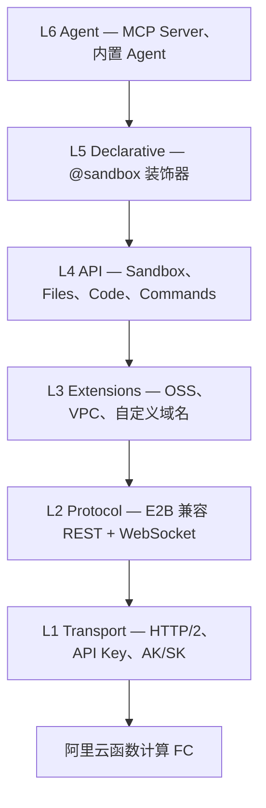

# Easy Sandbox

[English](README.md) | **中文**

<!-- badges -->
[](https://github.com/Easy-Sandbox/python-sdk/actions/workflows/ci.yml)
[](https://pypi.org/project/easy-sandbox/)
[](https://pypi.org/project/easy-sandbox/)
[](LICENSE)

> 为 AI Agent 打造的云沙箱 —— 秒级创建、执行、管理隔离环境。

**Easy Sandbox** 是基于阿里云函数计算（FC）Agent Sandbox 服务的 Python SDK。
兼容 **E2B 协议**，同时扩展了阿里云生态能力（OSS、VPC、自定义域名）。

本仓库（`python-sdk`）包含 **Python SDK**，以两个版本同步发布的 PyPI 分发包提供。命令行工具 `ebx` 是独立的
Node.js 项目，位于 [`cli`](https://github.com/Easy-Sandbox/easy-sandbox) 仓库（见[相关：ebx CLI](#相关ebx-cli)）。

| 目录 | PyPI 分发包 | 导入路径 | 用途 |
|------|-------------|----------|------|
| [`client-sdk/`](client-sdk/) | `easy-sandbox` | `easy_sandbox` | 异步客户端 SDK：`Sandbox`、文件、命令、代码解释器、模板 API、声明式 `@sandbox`、MCP Server、E2B 兼容层 |
| [`server-sdk/`](server-sdk/) | `easy-sandbox-server` | `easy_sandbox.server` | 容器侧运行时：运行在沙箱镜像*内部*的常驻 HTTP 服务（默认端口 9000） |

两个分发包共享 `easy_sandbox` 命名空间（client 提供 `easy_sandbox/__init__.py`，server 只包含
`easy_sandbox/server/`），并以相同版本号**同步发布**。

---

## 特性

- **异步优先 SDK** —— `Sandbox.create()`，Shell 执行、代码解释、文件读写、端口转发、WebSocket 流。
- **三种执行原语** —— `sandbox.run()`（裸 Shell）、`sandbox.run_code()`（代码解释器）、`sandbox.custom()`（命名命令 A/B 解析）。
- **模板系统** —— 可复用的沙箱镜像（Python、Node、浏览器自动化、AI Agent Harness……）。
- **MCP Server** —— 将沙箱操作暴露为 MCP 工具，供 LLM Agent 调用。
- **声明式装饰器** —— `@sandbox` 将普通函数变为远程沙箱执行，自动序列化。
- **会话持久化** —— 跨运行保存和恢复沙箱状态。
- **E2B 兼容层** —— 已使用 E2B SDK 的项目可直接替换。

## 安装

```bash
# 仅核心客户端 SDK
pip install easy-sandbox

# + 阿里云模板 API（模板部署/创建）
pip install "easy-sandbox[alicloud]"

# 完整安装（MCP + 快速 JSON + 会话 + 声明式 + alicloud + server）
pip install "easy-sandbox[all]"

# 容器侧运行时（安装到你的沙箱镜像内）
pip install easy-sandbox-server
pip install playwright                       # 仅在启用 browser 能力组时需要

# 开发环境（在仓库根目录执行；含两个包的测试与 lint 工具）
pip install -e ./server-sdk -e "./client-sdk[dev]"
```

`easy-sandbox` 依赖同版本的 `easy-sandbox-server`，因此 `pip install easy-sandbox` 同样会提供 `easy_sandbox.server`（`@sandbox` 装饰器的 server 代理在本地需要它）。`[server]` extra 作为无害的别名保留。

> **从 0.2.x 升级？** 原地执行 `pip install -U easy-sandbox` 可能导致 `easy_sandbox.server` 损坏；请执行 `pip install --force-reinstall --no-deps easy-sandbox-server`（见[从 0.2 迁移](docs/zh/guide/migrating-from-0.2.md)）。

`ebx` CLI 不再属于 Python 包（不再有 `[cli]` extra，也没有 `ebx` 控制台脚本），由
[`cli`](https://github.com/Easy-Sandbox/easy-sandbox) 仓库分发（见[相关：ebx CLI](#相关ebx-cli)）。

## 快速开始

```python
import asyncio
from easy_sandbox import Sandbox

async def main():
    async with await Sandbox.create(template="python-base") as sandbox:

        # 1. 裸 Shell —— sandbox.run(cmd)
        proc = await sandbox.run("echo 'Hello from sandbox!'")
        print(proc.stdout)          # Hello from sandbox!
        print(proc.exit_code)       # 0

        # 2. 代码解释器 —— sandbox.run_code(code)
        result = await sandbox.run_code("print(2 ** 10)")
        print(result.text)          # 1024

        # 3. 命名命令 —— sandbox.custom(name, **kwargs)
        #    先查 template custom_commands (A)，再查 SandboxServer (B)
        cmd = await sandbox.custom("hello", name="Alice")
        print(cmd.value)            # 命令返回值
        print(cmd.source)           # "template" 或 "server"

        # 4. 文件操作
        await sandbox.files.write("/tmp/data.txt", "content")
        content = await sandbox.files.read("/tmp/data.txt")

        # 5. 端口访问
        url = sandbox.network.get_url(3000)

asyncio.run(main())
```

> **E2B 兼容：** `sandbox.commands.run(cmd)` 是 `sandbox.run()` 的底层入口。已有 E2B 代码调用 `sandbox.commands.run()` 可直接使用。

## 执行 API

Easy Sandbox 提供三种执行方法，分别对应不同场景：

| 方法 | 用途 | 返回类型 |
|------|------|----------|
| `sandbox.run(cmd)` | 执行裸 Shell 命令 | `ProcessResult` —— `.stdout`, `.stderr`, `.exit_code` |
| `sandbox.run_code(code)` | 通过代码解释器执行代码 | `CodeResult` —— `.text`, `.stdout`, `.stderr` |
| `sandbox.custom(name, **kw)` | 执行命名命令（模板 A / 服务器 B） | `CommandResult` —— `.value`, `.source`, `.exit_code` |

**`sandbox.custom()` —— A/B 解析：**

1. **模板**（机制 A）：从 `template.yaml` 的 `custom_commands` 中查找，用 kwargs 填充 `{placeholder}` 占位符（shlex 转义），作为 Shell 命令执行。
2. **服务器**（机制 B）：模板未找到时，向沙箱内 SandboxServer 发送 `POST /commands/{name}`。

```python
# 模板命令 (A) —— 在 template.yaml 中定义
result = await sandbox.custom("greet", name="World")
print(result.value)     # stdout 输出（已 strip）
print(result.source)    # "template"

# 服务器命令 (B) —— 在 SandboxServer 上注册
result = await sandbox.custom("analyze", data="input.csv")
print(result.value)     # Python 函数返回值（JSON）
print(result.source)    # "server"
```

> **环境变量：** envd 使用直接执行（direct exec）—— Shell 特性（`$VAR` 展开、管道、重定向）需要 `sh -c '...'`。用 `printenv VAR` 读取变量值。详见[环境变量指南（中文）](docs/zh/guide/environment-variables.md) | [Environment Variables (EN)](docs/en/guide/environment-variables.md)。

## 模板

官方与社区模板统一维护在
[`Easy-Sandbox/awesome-templates`](https://github.com/Easy-Sandbox/awesome-templates)
仓库——模板内容、索引与发布的唯一真源。该索引由 `ebx template search|install` 命令使用
（见[相关：ebx CLI](#相关ebx-cli)）；模板遵循的 `template.yaml` 契约见
[Template YAML 规范](docs/zh/reference/template-yaml-spec.md)。

[`examples/templates/`](examples/templates/) 仅保留一个最小的 `python-hello`
**测试夹具（fixture）**用于离线测试，并非模板发布真源。夹具契约与索引行为
（缓存、离线回退、锁定版本）详见 [examples/templates/README.md](examples/templates/README.md)。

## 架构



低层不引用高层。完整设计文档：[`docs/zh/design/architecture.md`](docs/zh/design/architecture.md)。

## 文档

> 完整文档索引：[`docs/README.md`](docs/README.md)（双语导航）

### 教程与指南

| 指南 | 链接 |
|------|------|
| 快速入门 | [快速入门](docs/zh/guide/getting-started.md) |
| 最佳实践 | [最佳实践](docs/zh/guide/best-practices.md) |
| 文件与命令控制 | [文件与命令控制](docs/zh/guide/file-and-command-controls.md) |
| 托管代理 | [托管代理](docs/zh/guide/hosted-agents.md) |
| SDK 使用 | [SDK 使用](docs/zh/guide/sdk-usage.md) |
| 认证配置 | [认证配置](docs/zh/guide/authentication.md) |
| 环境变量 | [环境变量](docs/zh/guide/environment-variables.md) |
| 编写模板 | [编写模板](docs/zh/guide/authoring-templates.md) |
| 构建与部署 | [构建与部署](docs/zh/guide/build-and-deploy.md) |
| 声明式用法 | [声明式用法](docs/zh/guide/declarative-usage.md) |
| MCP 集成 | [MCP 集成](docs/zh/guide/mcp-integration.md) |
| 会话持久化 | [会话持久化](docs/zh/guide/session-persistence.md) |
| 从 E2B 迁移 | [从 E2B 迁移](docs/zh/guide/migrate-from-e2b.md) |
| 故障排查 | [故障排查](docs/zh/guide/troubleshooting.md) |

### 参考手册

| 文档 | 链接 |
|------|------|
| API 参考 | [API 参考](docs/zh/reference/api-reference.md) |
| 配置说明 | [配置说明](docs/zh/reference/configuration.md) |
| 错误码 | [错误码](docs/zh/reference/error-codes.md) |
| Template YAML 规范 | [Template YAML 规范](docs/zh/reference/template-yaml-spec.md) |

### 设计与架构

| 文档 | 链接 |
|------|------|
| 设计索引 | [设计索引](docs/zh/DESIGN.md) |
| 架构设计 | [架构设计](docs/zh/design/architecture.md) |
| SDK API 设计 | [SDK API 设计](docs/zh/design/sdk-api-design.md) |
| 模板系统 | [模板系统](docs/zh/design/template-system.md) |

### 其他资源

| 资源 | 链接 |
|------|------|
| 更新日志 | [CHANGELOG.md](CHANGELOG.md) |
| 贡献指南 | [CONTRIBUTING.md](.github/CONTRIBUTING.md) |
| 许可证 | [Apache-2.0](LICENSE) |
| 示例代码 | [examples/](examples/) |

## 相关：ebx CLI

命令行工具 `ebx`（`@easy-sandbox/cli`，Node.js）在 [`cli`](https://github.com/Easy-Sandbox/easy-sandbox) 仓库中开发，
与本 SDK 共享沙箱、模板与凭证。其安装方式、命令参考、教程、MCP Server 命令以及 Agent Skill（`SKILL.md`）
均在该仓库中维护：

- [CLI README](https://github.com/Easy-Sandbox/easy-sandbox/blob/main/README.zh-CN.md) —— 安装（`npm install -g @easy-sandbox/cli`）
- [CLI 教程](https://github.com/Easy-Sandbox/easy-sandbox/blob/main/docs/zh/guide/cli-tutorial.md) · [CLI 参考](https://github.com/Easy-Sandbox/easy-sandbox/blob/main/docs/zh/reference/cli-reference.md)
- [Agent Skill 安装与分发](https://github.com/Easy-Sandbox/easy-sandbox/blob/main/docs/zh/guide/agent-skill-installation.md)

## 贡献

欢迎贡献！请阅读 [贡献指南](.github/CONTRIBUTING.md) 了解详情。

## 许可证

[Apache-2.0](LICENSE) —— 版权信息见 [`NOTICE`](NOTICE)。
