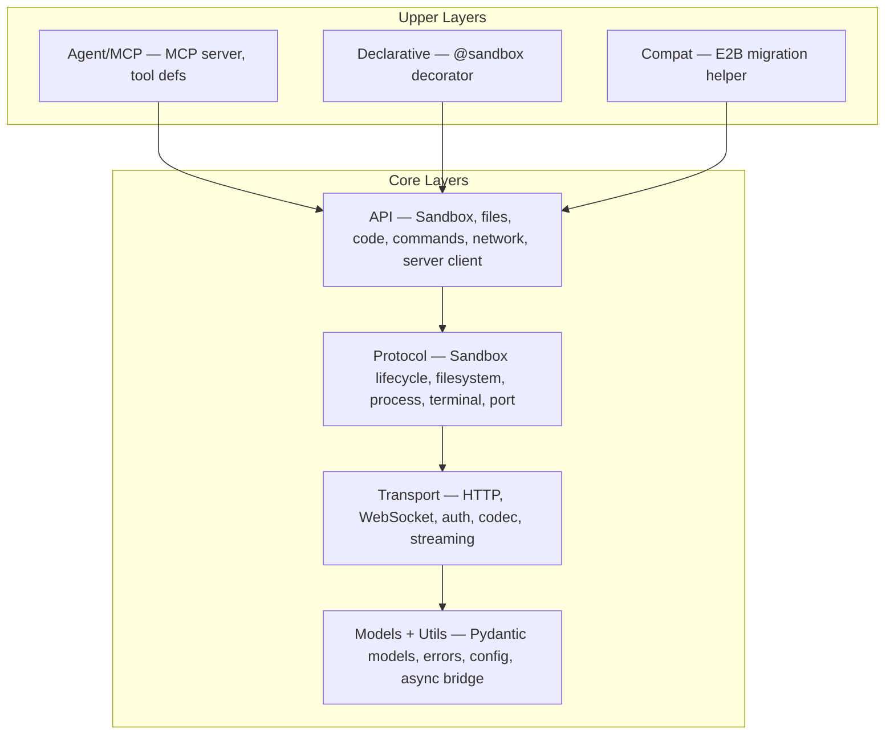

# Agent Sandbox — Design Document Index

> **Version**: v2.0 | **Last Updated**: 2026-09-24
>
> This document serves as the entry point and index for all Agent Sandbox design documentation. Detailed designs live in the specialized topic documents under [`design/`](design/).

---

## Project Overview

**Agent Sandbox** (`agent-sandbox` on PyPI) is a Python SDK for the Alibaba Cloud FC Agent Sandbox service. It is the runtime client: create, use and kill sandboxes. Templates are built and deployed with `abx template build|deploy`. Method names are E2B-shaped to ease migration; it is not a drop-in replacement (see [Migrate from E2B](guide/migrate-from-e2b.md)).

This repository holds the Python SDK as two lock-step PyPI distributions — `agent-sandbox` (`client-sdk/`, import `agent_sandbox`) and `agent-sandbox-server` (`server-sdk/`, import `agent_sandbox.server`, the container-side runtime). The `abx` CLI is a Node.js/TypeScript project in the `cli` repository, which holds the CLI's own design and guide documents (see [Related: the abx CLI](#related-the-abx-cli)).

### Core Principles

1. **E2B-shaped, not E2B-compatible** — E2B-style method names and a small migration helper (`from agent_sandbox.compat import Sandbox`) ease migration for existing E2B users; the wire protocol and configuration are the platform's own
2. **AI-First** — MCP Server as a first-class citizen, coding agents hosted through the Agents API
3. **Zero Configuration Defaults** — Works out of the box; from install to first sandbox in ≤ 3 lines of code

### Quick Start

```bash
pip install agent-sandbox
export ABX_SANDBOX_API_KEY=your-api-key
```

```python
from agent_sandbox import Sandbox

async with await Sandbox.create(template="base") as sb:
    result = await sb.run_code("print('Hello, Agent Sandbox!')")
    print(result.text)
```

---

## Architecture Overview

The SDK follows a strict layered architecture — lower layers never import upper layers:



For the full architecture breakdown, see [Architecture Design](design/architecture.md).

---

## Design Topic Index

Each topic below has its own dedicated design document with complete specifications.

### Core Design

| Topic | Document | Summary |
|-------|----------|---------|
| **System Architecture** | [architecture.md](design/architecture.md) | Five-layer architecture, inter-layer dependencies, dual API layers (Platform API vs Sandbox envd API) |
| **SDK API Design** | [sdk-api-design.md](design/sdk-api-design.md) | Sandbox class, file operations, code execution, commands, network, session management |
| **Sandbox Type System** | [sandbox-types.md](design/sandbox-types.md) | Ephemeral sandboxes (implemented), persistent sandboxes (future), sandbox lifecycle |
| **Providers and Credentials** | [providers-and-credentials.md](design/providers-and-credentials.md) | One environment variable per configuration key, precedence, provider plugins (`abx provider ...`), install/trust model, EPP/1 protocol, E8xxx errors; review log in [providers-and-credentials-review.md](archive/providers-and-credentials-review.md) |

### Templates

| Topic | Document | Summary |
|-------|----------|---------|
| **Template System** | [template-system.md](design/template-system.md) | Template tiers, GitHub tarball distribution, `template.yaml` specification, versioning, marketplace architecture |

### AI & Agent Integration

| Topic | Document | Summary |
|-------|----------|---------|
| **MCP Server** | [mcp-server.md](design/mcp-server.md) | 7 P0 MCP tools, STDIO + Streamable HTTP transports, FC deployment artifact, session binding |
| **Agents API** | [guide/agents-api.md](guide/agents-api.md) | The one way to run an agent in a sandbox: `/v1/agents/**`. The base image does not preinstall a CLI |

### Server & Infrastructure

| Topic | Document | Summary |
|-------|----------|---------|
| **Server API** | [server-api.md](design/server-api.md) | Sandbox Server SDK routes, capability groups, browser instance architecture |

### Maintainer Design Documents (English only)

Working design documents for the provider, capability, server-v2 and agents-API workstreams. They have no Chinese counterpart.

| Topic | Document | Summary |
|-------|----------|---------|
| **Agents API** | [agents-api.md](design/agents-api.md), [review](archive/agents-api-review.md) | Hosting coding agents in Agent Sandbox |
| **Fine-grained capabilities** | [fine-grained-capabilities.md](design/fine-grained-capabilities.md), [review](archive/fine-grained-capabilities-review.md) | Capability scoping and permissions in `agent-sandbox-server` and `template.yaml` |
| **Client / server alignment** | [client-server-alignment.md](design/client-server-alignment.md) | Gap matrix of every server route against the client |
| **Base image and server SDK** | [base-image-and-server-sdk.md](design/base-image-and-server-sdk.md), [CLI follow-ups](archive/cli-followups.md) | The official FC Agent Sandbox base image and the server SDK; the exact `abx` CLI changes it needs |
| **Server SDK v2** | [server-sdk-v2/](archive/server-sdk-v2/README.md) | Target operation-model design for the server SDK (status and not-implemented list on the first page) |
| **OpenSandbox provider research** | [provider-opensandbox-mapping.md](design/provider-opensandbox-mapping.md) | API mapping, config keys and test plan for an OpenSandbox provider |
| **Repository layout** | [repository-layout.md](design/repository-layout.md) | Layout review of the `python-sdk` and `cli` repositories |

---

## Implementation Status

| Feature | Status | Notes |
|---------|--------|-------|
| SDK core (Sandbox, files, commands, code) | **Implemented** | |
| MCP Server (STDIO) | **Implemented** | 7 P0 tools |
| MCP Server (Streamable HTTP) | **Implemented** | `mcp_http.py` |
| FC deployment artifact application | **Implemented** | `agent_sandbox.agent.mcp_http:asgi_app`; the artifact is generated by `abx mcp deploy` in the CLI. See [mcp-server.md](design/mcp-server.md#7-fc-deployment) |
| Template build/push/deploy | **In the CLI** | `abx template build` and `abx template deploy`; the SDK does not build templates |
| E2B migration helper | **Implemented (partial)** | `agent_sandbox.compat` |
| One environment variable per configuration key (SDK) | **Implemented** | See [Configuration](reference/configuration.md); CLI spec in `cli/docs/design/providers-and-credentials-cli.md` |
| Provider plugins (SDK, `python -m agent_sandbox.providers`) | **Implemented** | See [Providers](guide/providers.md); `abx provider` pending in the CLI |
| Persistent sandbox | **Future** | Requires underlying platform support |
| SandboxPool (warm pool) | **Future** | Requires underlying platform support |

---

## Related Resources

| Resource | Location |
|----------|----------|
| Architecture Decision Records (ADR) | [`.agents/notes/`](../../.agents/notes/README.md) |
| User guides | [`docs/en/guide/`](guide/) |
| API reference | [`docs/en/reference/`](reference/) |
| Chinese (中文) design index | [`docs/zh/DESIGN.md`](../zh/DESIGN.md) |

## Related: the abx CLI

The `abx` CLI (Node.js / TypeScript, npm `@agent-sandbox/cli`) is documented in the [`cli` repository](https://github.com/alibaba-agent-sandbox/agent-sandbox); its design index is [DESIGN.md](https://github.com/alibaba-agent-sandbox/agent-sandbox/blob/main/docs/en/DESIGN.md). Most relevant to SDK readers: [CLI Architecture](https://github.com/alibaba-agent-sandbox/agent-sandbox/blob/main/docs/en/design/architecture.md), [CLI Command System](https://github.com/alibaba-agent-sandbox/agent-sandbox/blob/main/docs/en/design/cli-design.md) and [Templates Catalog](https://github.com/alibaba-agent-sandbox/agent-sandbox/blob/main/docs/en/design/templates-catalog.md).
