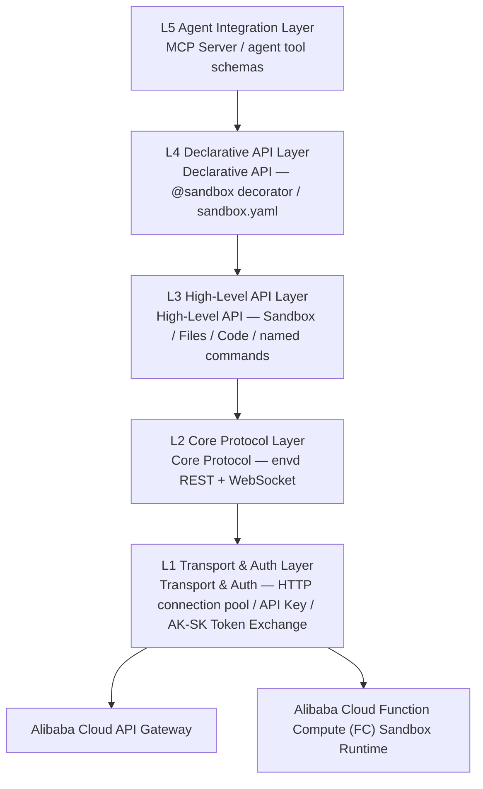
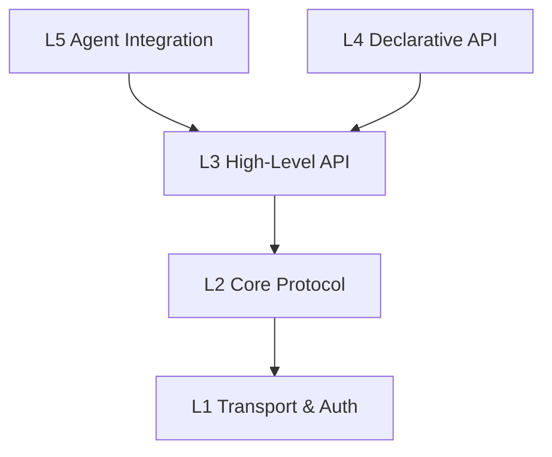

# System Architecture Design — Five-Layer Architecture

> Agent Sandbox SDK adopts a five-layer architecture, abstracting from low-level transport to high-level AI integration layer by layer. Each layer has a single responsibility with clear boundaries, and users can plug in at any layer. The SDK has zero LLM dependencies and does not depend on the E2B SDK — it talks to the envd data plane and the platform control plane directly. It is the runtime client: template build and deploy are done by `abx template build|deploy`.

---

## 1. Architecture Overview



---

## 2. Layer Responsibilities

### L1 — Transport & Auth Layer

| Module | Responsibility |
|--------|----------------|
| `transport.http` | HTTPS client based on httpx, connection pool management, timeout/retry policies |
| `transport.ws` | Long-lived connections based on websockets, heartbeat keep-alive, auto-reconnect |
| `auth.api_key` | **API Key authentication (primary path)**: passed via `X-API-KEY` header, environment variable `ABX_SANDBOX_API_KEY` |
| `auth.AkSkAuth` | Explicit application-owned custom exchange adapter; default runtime authentication requires an API key |
| `auth.config` | Multi-environment config loading (code params → env vars → .env → config.toml → defaults) |

**Dual Authentication Modes**:

| Auth Method | Scenario | Transport | Environment Variables |
|-------------|----------|-----------|----------------------|
| **API Key (primary)** | Cloud sandbox data plane operations | `X-API-KEY` header | `ABX_SANDBOX_API_KEY` |
| **AK/SK control plane** | Official template/image/ACR operations via the CLI | Official SDK | `ALICLOUD_ACCESS_KEY_ID` / `ALICLOUD_ACCESS_KEY_SECRET` |

> **Note**: The sandbox API key has one environment variable, `ABX_SANDBOX_API_KEY`. The AccessKey pair uses `ALICLOUD_ACCESS_KEY_ID` and `ALICLOUD_ACCESS_KEY_SECRET`. See [authentication.md](../guide/authentication.md) and [configuration.md](../reference/configuration.md).

**Target Users**: Infrastructure developers, advanced users who need custom authentication logic.

### L2 — Core Protocol Layer

**Self-implemented protocol clients** — no dependency on the E2B SDK, implemented directly with httpx + websockets. Two categories of APIs:

- **Platform API (REST)**: Sandbox lifecycle management (create, list, destroy), interacts with Alibaba Cloud platform via HTTP REST API
- **Sandbox envd API (Connect Protocol)**: In-sandbox operations (processes, files, terminals), communicates with sandbox envd via HTTP + WebSocket

| Module | Responsibility |
|--------|----------------|
| `protocol.sandbox` | Sandbox lifecycle management (HTTP REST API) |
| `protocol.process` | Remote process management (start, streaming output, signals, exit codes), HTTP + WebSocket streaming |
| `protocol.filesystem` | Remote filesystem operations (read, write, list directories, watch changes), HTTP REST |
| `protocol.terminal` | Virtual terminal (PTY) multiplexing, WebSocket bidirectional communication |
| `protocol.port` | Port forwarding and mapping management (HTTP REST) |

**Target Users**: Protocol-level developers, users who need fine-grained control.

### L3 — High-Level API Layer

| Module | Responsibility |
|--------|----------------|
| `api.sandbox` | Sandbox class — unified entry point for create, manage, execute, destroy; `run(name, **kwargs)` calls a server-registered command |
| `api.server_client` | `ServerClient` — typed client for every in-sandbox SandboxServer route |
| `api.files` | High-level file operations — upload/download/watch |
| `api.code` | Code execution engine — multi-language support, Rich Output |

**Target Users**: Most developers, the core layer, with E2B-shaped method names.

### L4 — Declarative API Layer

| Module | Responsibility |
|--------|----------------|
| `declarative.decorator` | `@sandbox` decorator — Modal-style remote execution |
| `declarative.config` | `sandbox.yaml` parsing and validation |
| `declarative.serializer` | Parameter/return value serialization (JSON only) |

**Target Users**: Python developers and ML engineers seeking a minimalist experience.

### L5 — Agent Integration Layer

| Module | Responsibility |
|--------|----------------|
| `agent.tools` | Agent tool set — sandbox operations wrapped as OpenAI function calling format |
| `agent.mcp` | MCP Server implementation — exposes sandbox capabilities as MCP Tools |

**Target Users**: AI application developers, Agent framework integrators.

> **Note**: The SDK has zero LLM dependencies. There is one way to run a coding agent inside a sandbox: the [Agents API](../guide/agents-api.md) (`/v1/agents/**`, served by `agent-sandbox-server`). The SDK has no agent keyword table and no `sb.agent.*` sugar.

### Server Module (In-Container Runtime Service)

| Module | Responsibility |
|--------|----------------|
| `server.app` | `SandboxServer` main class — stdlib-only HTTP server, zero third-party dependencies, runs persistently inside containers |
| `server.router` | `RouteTable` + `CapabilityGroup` — declarative route registration and capability group switches |
| `server.registry` | `CommandRegistry` — user-defined command registration and discovery |
| `server.routes` | Core built-in routes: health, commands, upload, download, shell |
| `server.routes_files` | File operation endpoints: list/stat/mkdir/delete/move/search/archive (9 endpoints) |
| `server.routes_process` | Process management endpoints: start/list/detail/signal + SSE streaming shell (5 endpoints, counted by file) |
| `server.routes_system` | System info endpoints: info/env/ports/packages/metrics + capabilities (7 endpoints, counted by file; note: server-api.md uses a different counting method by capability group) |
| `server.routes_pty` | PTY WebSocket terminal: session create/list/delete + WebSocket interactive terminal |
| `server.routes_browser` | Browser automation endpoints: navigate/screenshot/content/click/type/evaluate/pdf/console (8 endpoints) |
| `server.routes_devtools` | Dev tools endpoints: code/run, git/status, git/diff (3 endpoints) |
| `server.types` | Request/response data models: `ServerRequest`, `ServerResponse`, `SSEResponse` |

The Server module (the separate `agent-sandbox-server` distribution, import `agent_sandbox.server`) runs inside the sandbox container and has a different layering from the main SDK — it is an opt-in persistent HTTP service running inside containers. Built entirely on Python stdlib with zero third-party dependencies (the PTY terminal uses the `websockets` dependency of the `agent-sandbox-server` distribution). It provides 42 endpoints managed across 8 CapabilityGroups:

| Capability Group | Description | Default State |
|------------------|-------------|---------------|
| `CORE` | health, capabilities | Always enabled, cannot be disabled |
| `COMMANDS` | User-defined command registration and discovery | Enabled |
| `FILE_OPS` | Filesystem CRUD + archiving | Enabled |
| `PROCESS` | Process management + SSE streaming shell | Enabled |
| `SYSTEM` | System info, env vars, ports, package management, metrics | Enabled |
| `TERMINAL` | PTY WebSocket interactive terminal | Enabled |
| `DEV_TOOLS` | Code Interpreter + Git operations | Disabled (must be explicitly enabled) |
| `BROWSER` | Playwright browser automation | Disabled (must be explicitly enabled) |

**Target Users**: Sandbox template developers, advanced users who need to register custom commands inside containers.

---

## 3. Inter-Layer Dependencies



**Dependency Rules**:

1. **Strict downward dependencies**: Each layer can only depend on layers below it; reverse or cross-layer dependencies are prohibited
2. **L4 depends on L3**: Declarative API is implemented through the L3 High-Level API, not directly on L2
3. **L5 depends on L3**: Agent integration is implemented through the L3 High-Level API
4. **L1 is the foundation**: All upper layers ultimately depend on L1 for network communication and authentication

---

## 4. Project Directory Structure

```
client-sdk/src/agent_sandbox/
├── __init__.py                    # Top-level exports: Sandbox, sandbox
├── _version.py                    # Version number
│
├── transport/                     # L1 — Transport & Auth Layer
│   ├── __init__.py
│   ├── http.py                    #   httpx HTTPS client, connection pool
│   ├── ws.py                      #   websockets long-lived connection, heartbeat keep-alive
│   ├── auth.py                    #   API Key/envd auth; explicit custom token adapter
│   └── config.py                  #   Config loading (code params → env vars → .env → config.toml → defaults)
│
├── protocol/                      # L2 — Core Protocol Layer
│   ├── __init__.py
│   ├── sandbox.py                 #   Sandbox lifecycle API (HTTP REST)
│   ├── process.py                 #   Remote process management (HTTP + WebSocket streaming)
│   ├── filesystem.py              #   Remote filesystem operations (HTTP REST)
│   ├── terminal.py                #   PTY terminal multiplexing (WebSocket)
│   └── port.py                    #   Port forwarding management (HTTP REST)
│
├── api/                           # L3 — High-Level API
│   ├── __init__.py
│   ├── sandbox.py                 #   Sandbox core class
│   ├── server_client.py           #   ServerClient — typed client for the in-sandbox server
│   ├── files.py                   #   High-level file operations
│   └── code.py                    #   Code execution engine
│
├── declarative/                   # L4 — Declarative API Layer
│   ├── __init__.py
│   ├── decorator.py               #   @sandbox decorator
│   ├── config.py                  #   sandbox.yaml parsing
│   └── serializer.py              #   Parameter serialization
│
├── agent/                         # L5 — AI Integration Layer
│   ├── __init__.py
│   ├── tools.py                   #   Agent tool set (OpenAI function calling format)
│   └── mcp.py                     #   MCP Server implementation
│
├── models/                        # Data models
│   ├── __init__.py
│   ├── sandbox.py                 #   SandboxInfo, SandboxConfig
│   ├── process.py                 #   ProcessResult, ProcessConfig
│   ├── filesystem.py              #   FileInfo, WatchEvent
│   └── errors.py                  #   Exception class hierarchy
│
└── utils/                         # Utility functions
    ├── __init__.py
    ├── retry.py                   #   Retry policies
    ├── logging.py                 #   Logging utilities
    └── async_bridge.py            #   Sync/async bridge utilities
```

The in-container runtime ships as the separate `agent-sandbox-server` distribution (same `agent_sandbox` namespace, no `agent_sandbox/__init__.py` of its own, released in lockstep with the client):

```
server-sdk/src/agent_sandbox/server/   # In-container runtime HTTP Server (opt-in, stdlib-only)
├── __init__.py                #   Module exports: SandboxServer, start, CapabilityGroup, RouteTable
├── app.py                     #   SandboxServer main class, HTTP request dispatch
├── router.py                  #   RouteTable declarative routing + CapabilityGroup enum
├── registry.py                #   CommandRegistry user-defined command registration
├── routes.py                  #   Core built-in routes (health/commands/upload/download/shell)
├── routes_files.py            #   FILE_OPS capability group (9 endpoints)
├── routes_process.py          #   PROCESS capability group (5 endpoints)
├── routes_system.py           #   SYSTEM capability group + CORE/capabilities (7 endpoints)
├── routes_pty.py              #   TERMINAL capability group (REST + WebSocket PTY)
├── routes_browser.py          #   BROWSER capability group (8 endpoints, Playwright)
├── routes_devtools.py         #   DEV_TOOLS capability group (Code Interpreter + Git)
└── types.py                   #   ServerRequest/ServerResponse/SSEResponse
```

The CLI (`abx`) formerly lived in `src/agent_sandbox/cli/` (Click commands under `commands/`, `formatters.py`, `output.py`). It is now a Node.js/TypeScript project in the `cli` repository and is no longer part of this package.

---

## 5. Technology Choices

| Area | Choice | Rationale |
|------|--------|-----------|
| HTTP Client | `httpx` | Native async support, HTTP/2, core of the protocol clients |
| WebSocket | `websockets` | Mature and stable, async-native, used for PTY/streaming scenarios |
| CLI Framework | _(moved)_ | The CLI is a separate Node.js/TypeScript project in the `cli` repository; the former `click` + `rich` implementation is no longer part of this package |
| Serialization | JSON (`json` stdlib) | Safe cross-language serialization for `@sandbox` decorator |
| Configuration | `pydantic` | Type-safe configuration validation |
| Testing | `pytest` + `pytest-asyncio` | Standard async testing solution |
| Package Management | `hatch` / `pdm` | Modern Python project management |

---

## 6. Design Principles

1. **E2B-shaped, not E2B-compatible**: L3 uses E2B-shaped method names and ships a small migration helper (`agent_sandbox.compat`); L2 implements the protocol independently without depending on the E2B SDK
2. **Progressive Complexity**: Users start at L3 and explore downward or use advanced features upward as needed
3. **Zero-Config Defaults**: Works out of the box with sensible defaults; just set the `ABX_SANDBOX_API_KEY` environment variable to get started
4. **Alibaba Cloud Native**: Built for the Alibaba Cloud FC sandbox service
5. **AI First**: Built-in AI CLI tools in sandboxes and MCP Server are first-class citizens; SDK has zero LLM dependencies
6. **Type Safety**: Comprehensive use of Python Type Hints + Pydantic validation

- [Provider implementation boundaries](provider-isolation.md)

Provider configuration discovery is assembled lazily by the package composition root. Transport consumes a low-level `ProviderSchema` value and an injected resolver from `_provider_schema.py`; it does not import the provider registry. Builtin configuration resolves without provider discovery. Registered, entry-point and installed providers retain the registry selection and derive/default/inheritance rules. The existing `transport.config.ProviderSchema` import remains an alias of the same schema class.

Builtin platform/envd HTTP uses one transport attempt. Legacy retry fields are compatibility data, with the exact boundary in [configuration](../reference/configuration.md#legacy-retry-compatibility); engine recovery remains separate.
