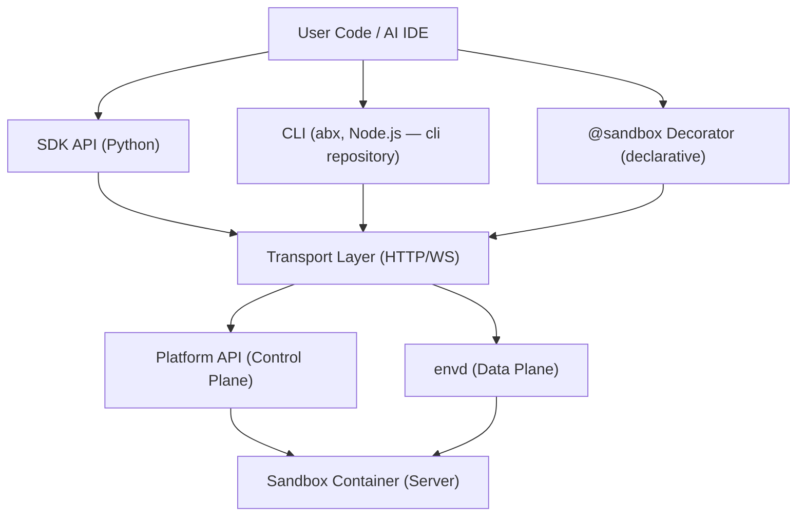
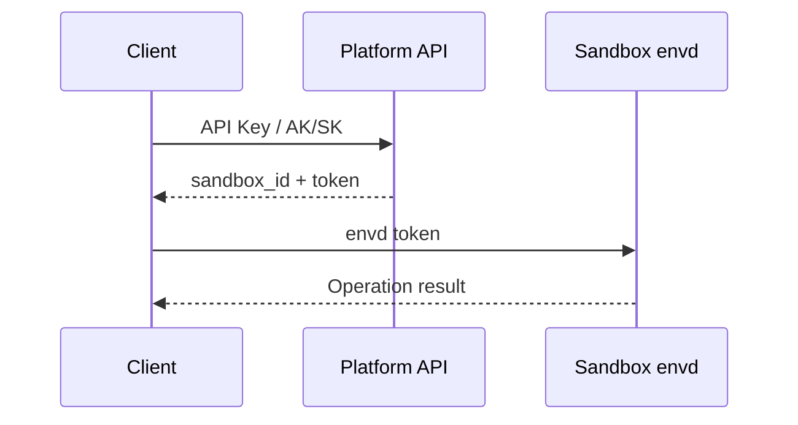
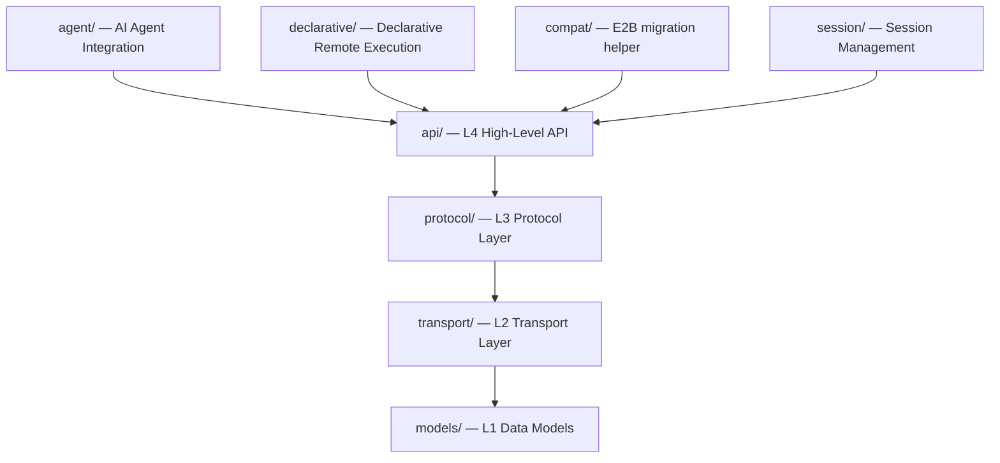

# Architecture Overview

This document provides a brief overview of the Agent Sandbox architecture to help you understand the relationships between the SDK, CLI, and Server.

---

## Three-Layer Architecture

Agent Sandbox consists of three core layers:

### SDK Layer (Client)

- **Sandbox class**: Core entry point for managing sandbox lifecycle
- **Submodules**: `commands` (shell commands), `files` (filesystem), `network` (networking), `code` (code interpreter)
- **Named commands**: `sandbox.run(name, **kwargs)` calls a command registered in the sandbox server
- **Declarative decorator**: `@sandbox` for remote function execution

### CLI Layer

The `abx` CLI (command groups, shortcuts, internals) is a separate Node.js/TypeScript project; see [CLI Architecture](https://github.com/alibaba-agent-sandbox/agent-sandbox/blob/main/docs/en/design/architecture.md) in the `cli` repository.

### Server Layer (Inside Sandbox)

- **HTTP Server**: Runs inside the sandbox on port 9000
- **Capability groups**: 8 capability groups controlling endpoint access
- **Registered commands**: Registered via `@sandbox.register` and exposed through HTTP routes

---

## Communication Architecture

### Control Plane (Platform API)

The client communicates with the Platform API over HTTPS for:
- Creating/listing/destroying sandboxes
- Template query (templates are built and deployed with `abx template build|deploy`)
- Authentication (API Key / AK/SK token exchange)

URL format: `https://api.{region}.e2b.fc.aliyuncs.com`

### Data Plane (envd)

After sandbox creation, the SDK communicates directly with the envd service inside the sandbox over HTTPS/WSS:
- Command execution (HTTP POST)
- File operations (HTTP)
- Code execution (RPC over HTTP)
- Terminal sessions (WebSocket)

URL format: `https://49983-{sandbox_id}.{domain}`

Where `49983` is the fixed envd port.

### Authentication Flow

---

## Server-Side Capability Groups

The sandbox Server declares 118 endpoints in one table (`agent_sandbox.server.endpoints.ENDPOINTS`). A capability group is a name for the endpoints that declare it:

| Capability Group | Endpoints | Default State | Description |
|------------------|-----------|---------------|-------------|
| CORE | 3 | Always enabled | Health check and discovery (`/health`, `/capabilities`, `/capabilities/check`) |
| COMMANDS | 2 | Enabled | Registered command routing |
| FILE_OPS | 12 | Enabled | File CRUD operations and transfer |
| PROCESS | 8 | Enabled | Shell and process management |
| TERMINAL | 6 | Enabled | PTY terminal |
| SYSTEM | 6 | Enabled | System information queries |
| DEV_TOOLS | 3 | **Disabled** | Code run, git status and diff |
| BROWSER | 8 | **Disabled** | Browser automation |
| AGENTS | 70 | **Disabled** | Agents API (`/v1/agents/*`, `/v1/vaults`, `/v1/responses`, ...) |

The endpoint rule is the only switch. A group is turned on or off by the template policy (`server.groups`, a list or a map), by `enable_group()` in `commands.py`, or on with `ABX_SERVER_ENABLED_GROUPS` (it only turns groups on). See [Server API](../design/server-api.md#2-capability-groups).

---

## SDK Internal Layering

Files contained in each module:

- **api/**: sandbox.py, files.py, commands.py, network.py, code.py, server_client.py
- **protocol/**: sandbox.py, process.py, filesystem.py, code_interpreter.py, terminal.py
- **transport/**: http.py, auth.py, config.py, streaming.py
- **models/**: sandbox.py, process.py, errors.py, template.py, session.py, filesystem.py
- **declarative/**: decorator.py, serializer.py, config.py
- **agent/**: mcp.py, tools.py
- **session/**: local.py, base.py
- **compat/**: sandbox.py

---

## Next Steps

- [Sandbox Lifecycle](sandbox-lifecycle.md) — State transitions and timeout mechanisms
- [E2B Compatibility](e2b-compatibility.md) — What is and is not shared with E2B
- [API Reference](../reference/api-reference.md) — Complete API documentation
