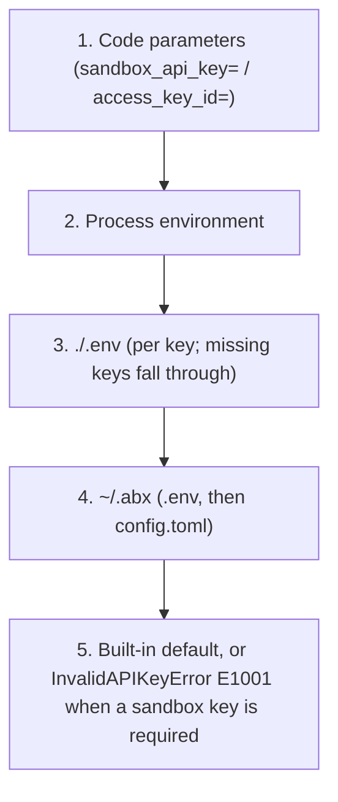

# Authentication

> **Note:** The `abx` commands shown on this page are provided by the Node.js CLI in the `cli` repository (`npm install -g @agent-sandbox/cli`). CLI-specific documentation (CLI design, tutorial, reference) lives there too; this repository documents the Python SDK (`agent-sandbox-client`) and the container-side runtime (`agent-sandbox-server`).

Sandbox runtime requests require an **API Key**. **AK/SK (Alibaba Cloud AccessKey)** is configured separately for official control-plane operations.

Credentials belong to a [provider](providers.md). The built-in provider is **Alibaba Cloud Express Edition (阿里云极速版)**, id `alicloud-express`, and it is the default. The sandbox key is `ABX_SANDBOX_API_KEY`. Alibaba Cloud access keys use the official names `ALICLOUD_ACCESS_KEY_ID` and `ALICLOUD_ACCESS_KEY_SECRET`. The region is `ALIBABA_CLOUD_REGION_ID`. Each key has one name.

> **Historical note**: the `abx auth` CLI command group (`login`/`logout`/`status`/`switch`) was removed before the first stable release (`0.1.0`). Credentials are configured with the environment variables and `abx config set sandbox_api_key` shown below; check the effective state with `abx config list`.

---

## Authentication Overview

Agent Sandbox provides three authentication paths for different scenarios:

- **API Key mode**: The most common approach. Accesses the platform API via the `Authorization: Bearer {api_key}` header. Suitable for personal development, CI/CD, SDK calls, and most other scenarios.
- **AK/SK control plane**: Used by official template/image/ACR operations. It does not automatically create or exchange a sandbox API key.
- **envd internal authentication**: After sandbox creation, the SDK communicates with the in-sandbox envd service using `envdAccessToken` (obtained from the creation response). This is an internal mechanism managed automatically by the SDK — no manual handling required.

---

## API Key Authentication

API Key is the most common authentication method, sent to the platform API via the `Authorization: Bearer {api_key}` header.

### Configuration Methods

#### 1. Environment variable (wins over `~/.abx`)

```bash
export ABX_SANDBOX_API_KEY="your-api-key"
```

Set `ABX_SANDBOX_API_KEY`. That is the only environment variable for the sandbox API key.

#### 2. Persisted file (`~/.abx/.env`)

The SDK also reads `~/.abx/.env`, which the `abx` CLI writes (`abx config set sandbox_api_key ...`, file mode 600; see the [CLI Authentication guide](https://github.com/alibaba-agent-sandbox/agent-sandbox/blob/main/docs/en/guide/authentication.md)). The key is stored as `ABX_SANDBOX_API_KEY`. Access keys are stored as `ALICLOUD_ACCESS_KEY_ID` and `ALICLOUD_ACCESS_KEY_SECRET`.

#### 3. .env file

Create a `.env` file in the project root directory:

```dotenv
ABX_SANDBOX_API_KEY=your-api-key
```

The SDK reads both `.env` files as separate layers. `./.env` wins for a key it sets. A key it omits still comes from `~/.abx/.env`.

1. `.env` in the current directory
2. `~/.abx/.env`

#### 4. config.toml file

Prefer `~/.abx/.env` (mode 600) for the sandbox API key. `abx config set sandbox_api_key` writes `ABX_SANDBOX_API_KEY` there. Non-secret connection settings belong in `~/.abx/config.toml`:

```toml
[transport]
sandbox_base_url = "https://api.cn-hangzhou.e2b.fc.aliyuncs.com"
sandbox_domain = "cn-hangzhou.e2b.fc.aliyuncs.com"
```

#### 5. Code parameter (wins over the environment and over `~/.abx`)

```python
from agent_sandbox.api.sandbox import Sandbox

# Pass directly when creating
sandbox = await Sandbox.create(sandbox_api_key="your-api-key")

# Pass directly when connecting
sandbox = await Sandbox.connect("sbx-xxxx", sandbox_api_key="your-api-key")
```

---

<a id="aksk-alibaba-cloud-extended-authentication-"></a>
## AK/SK control plane and migration

The previous automatic AK/SK-to-sandbox-key exchange has been removed. With only
AccessKey credentials, sandbox authentication now raises `InvalidAPIKeyError`
(E1001) locally, before any exchange/network request. Configure
`ABX_SANDBOX_API_KEY` or pass `sandbox_api_key=` / `api_key=` explicitly for
sandbox create/connect/list and data-plane requests.

Keep `ALICLOUD_ACCESS_KEY_ID`, `ALICLOUD_ACCESS_KEY_SECRET` and the configured
region for official template/image and ACR control-plane operations. These
operations have their own clients and credentials; their supported endpoints
are unchanged. API key and AccessKey credentials may be configured together for
a workflow that needs both runtime and template deployment.

The locked official FCSandbox SDK has a `CreateApiKey` operation, but models it
as `POST /pop/2026-05-09/api-keys` with a structured `apiKey.apiKeyValue` response.
That credential-resource API does not establish an STS-style one-hour exchange
or safe automatic refresh lifecycle. The old guessed RPC GET/signing/parser
implementation is retired; the runtime never mints credentials implicitly.

For an application-owned custom token service, the exported `AkSkAuth` adapter
still supports an explicitly supplied `set_exchange_func()` callback. It must
return a non-empty string; objects/empty values fail without being cached.
The application owns endpoint, credential lifecycle and documented TTL. Legacy
cache constants are a local policy, not a claim about Alibaba token validity.
The default factory never injects a callback. Direct imports of the removed
private exchange/signing helpers must migrate to their own documented service.

---

## Configuration Priority Chain

Credentials are resolved in the following priority order (highest to lowest):



The GitHub token and the region use this same chain. A blank or whitespace-only value is skipped. Each key has one environment variable. The names and defaults are listed in [Credential resolution](../reference/configuration.md#credential-resolution).

### Credentials and providers

The generic sandbox key (`sandbox_api_key`, environment variable `ABX_SANDBOX_API_KEY`) and the Alibaba Cloud AK/SK belong to the built-in provider. If you switch to a [provider plugin](providers.md), the plugin does **not** receive them unless its manifest asks for them and you consented at install time. A plugin has its own scoped credential keys, for example `ABX_MY_CLOUD_API_KEY` for a provider `my-cloud`. This prevents a key for one cloud from being sent to another.

Every plugin option follows one rule: the canonical name is `ABX_<PROVIDER_ID>_<FIELD>` (dashes become underscores), and a manifest may add the vendor's own variable as an alias with `env = [...]`. Secret fields (`secret = true`) live only in the environment or `.env` files (mode 0600) and are refused on the command line; other fields can also live under `[providers.<id>]` in `config.toml`. Verified with OpenSandbox on 2026-10-13: `ABX_OPENSANDBOX_API_KEY` and `ABX_OPENSANDBOX_BASE_URL` were enough to drive a real server from both the CLI and the SDK; `OPEN_SANDBOX_API_KEY` and `OPEN_SANDBOX_DOMAIN` are its declared native aliases, and the canonical name wins when both are set. A plugin that declares `[core] inherit = ["sandbox_api_key"]` receives the generic key only after you consent at install time, and `abx provider info <id>` shows that list under "Inherits".

The sandbox API key is never derived from AK/SK. When both are configured, runtime calls use the API key:
- If both `sandbox_api_key` and `access_key_id` are provided, API Key is used
- If both `ABX_SANDBOX_API_KEY` and `ALICLOUD_ACCESS_KEY_ID` are set, `ABX_SANDBOX_API_KEY` is used

---

## Secret Storage (File-Based)

Secrets are stored in `~/.abx/secrets.json`, a plaintext JSON file protected by `chmod 600` file permissions. This is suitable for local development only.

> **⚠️ Warning**: `secrets.json` stores secrets in **plaintext**. It relies solely on POSIX file permissions (`chmod 600`) for access control. For production environments, use a dedicated secrets management service.

Manage secrets via environment variables or the `.env` files, or pass `envs={"MY_TOKEN": "..."}` to `Sandbox.create()` to inject secrets into one sandbox:

```bash
# Set API Key via environment variable (recommended)
export ABX_SANDBOX_API_KEY="your-api-key"
```

The CLI equivalents (`abx config set`, `abx create --env`) are in the [CLI Authentication guide](https://github.com/alibaba-agent-sandbox/agent-sandbox/blob/main/docs/en/guide/authentication.md).

> **Historical note**: macOS Keychain integration was removed in the overdesign cleanup (ADR 2026-09-23). The `abx secret` CLI command group has also been removed. All secret management is now done through environment variables, `.env` files, or `abx config set` (a CLI command).

---

## envd Authentication (In-Sandbox Communication)

After sandbox creation, communication with the in-sandbox envd service uses `envdAccessToken` (obtained from the creation response). This is an internal mechanism managed automatically by the SDK — no manual handling required.

envd authentication requires the following HTTP headers (set automatically by the SDK):

| Header | Value |
|--------|-------|
| `X-Access-Token` | envdAccessToken |
| `E2b-Sandbox-Id` | Sandbox ID |
| `E2b-Sandbox-Port` | `49983` |
| `Authorization` | `Basic dXNlcjo=` (base64 of "user:") |

---

## Common Issues

### InvalidAPIKeyError (E1001)

```text
[E1001] API key cannot be empty
  Suggestion: Check your ABX_SANDBOX_API_KEY environment variable or pass sandbox_api_key.
```

**Solution**: Ensure a valid API Key is configured via any of the methods above.

### InvalidCredentialsError (E1003)

```text
[E1003] AccessKey ID and Secret cannot be empty
  Suggestion: Check ALICLOUD_ACCESS_KEY_ID and ALICLOUD_ACCESS_KEY_SECRET environment variables.
```

**Solution**: Ensure both AK ID and AK Secret are set.

### TokenExpiredError (E1002)

```text
[E1002] envdAccessToken not available. Sandbox may not be created or connected.
```

**Solution**: Check that the system clock is accurate. Reconnect to obtain a valid envd token, or inspect an explicitly configured custom exchange. API keys are not automatically minted or refreshed.

---

## Related: the abx CLI

Setting credentials from the command line (`abx config set` / `list` / `get`, `abx create --env`) is documented in the CLI repository: [CLI Authentication](https://github.com/alibaba-agent-sandbox/agent-sandbox/blob/main/docs/en/guide/authentication.md).
