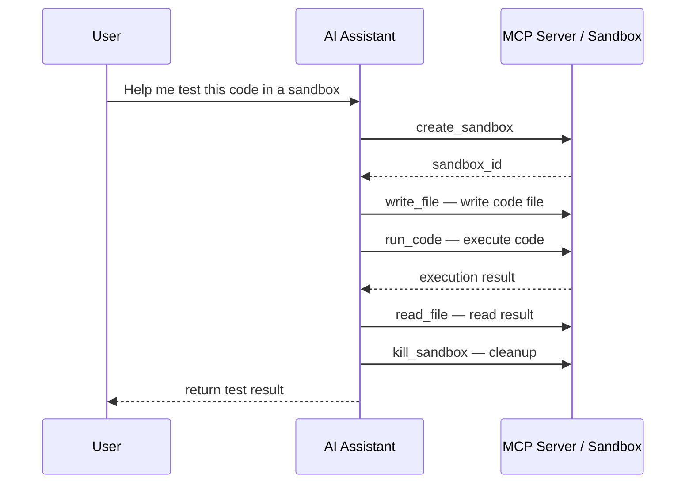

# MCP Integration

> **Note:** The `abx` commands shown on this page are provided by the Node.js CLI in the `cli` repository (`npm install -g @agent-sandbox/cli`). CLI-specific documentation (CLI design, tutorial, reference) lives there too; this repository documents the Python SDK (`agent-sandbox`) and the container-side runtime (`agent-sandbox-server`).

Agent Sandbox provides an MCP (Model Context Protocol) Server, enabling AI IDEs and tools to operate sandboxes directly.

---

## What Is MCP

MCP (Model Context Protocol) is an open protocol that allows AI models to interact with external tools and services. The Agent Sandbox MCP Server runs over STDIO transport with JSON-RPC 2.0 protocol, providing sandbox operation capabilities to AI assistants. A Streamable HTTP transport is also available for remote deployments (see below).

### Requirements

```bash
pip install agent-sandbox            # the SDK's own MCP STDIO server: python -m agent_sandbox.agent.mcp
export ABX_SANDBOX_API_KEY=your-api-key
```

The Node.js `abx` CLI ships a second implementation of the same server (`abx mcp ...`, installed with `npm install -g @agent-sandbox/cli`); see [Related: the abx CLI](#related-the-abx-cli).

## Configure an IDE

Point the IDE's MCP configuration at the Python server. For example, in Cursor's `~/.cursor/mcp.json`, Claude Desktop's `claude_desktop_config.json`, or a VS Code workspace `.vscode/mcp.json` (`type: stdio`):

```json
{
  "mcpServers": {
    "agent-sandbox": {
      "command": "python",
      "args": ["-m", "agent_sandbox.agent.mcp"],
      "env": { "ABX_SANDBOX_API_KEY": "your-api-key" }
    }
  }
}
```

`python -m agent_sandbox.agent.mcp` reads `ABX_SANDBOX_API_KEY`, `ABX_SANDBOX_BASE_URL`, `ABX_SANDBOX_DOMAIN`, and the default template from `ABX_DEFAULT_TEMPLATE` (default `base`). Restart the IDE after editing its configuration. The server speaks the same tools over STDIO, so the [Available Tools](#available-tools) below apply unchanged.

The `abx mcp install --target cursor|claude|vscode` and `abx mcp status` commands write and inspect these files for you; see [Related: the abx CLI](#related-the-abx-cli).

## Available Tools

The MCP Server provides 7 tools:

| Tool | Description | Parameters |
|------|-------------|------------|
| `create_sandbox` | Create a sandbox and make it the default | `template` (optional; omitted means the server template), `timeout` (optional, default 300), `envs` (optional) |
| `run_code` | Execute code in the sandbox | `code` (required), `sandbox_id` (optional), `language` (optional, default python), `timeout` (optional, default 30) |
| `run_command` | Run a command via `sh -c` (pipes, `&&`, `$VAR`, `cd`) | `command` (required), `sandbox_id` (optional), `cwd` (optional; omitted uses the image workdir), `timeout` (optional, default 60; a non-zero exit is a tool error) |
| `read_file` | Read a file from the sandbox | `path` (required), `sandbox_id` (optional), `encoding` (optional, default utf-8) |
| `write_file` | Write a file to the sandbox | `path`, `content` (required), `sandbox_id` (optional) |
| `list_files` | List directory contents in the sandbox | `path` (optional, default `/`), `sandbox_id` (optional) |
| `kill_sandbox` | Destroy a sandbox | `sandbox_id` (optional; destroys the default sandbox when omitted. An error is returned when there is no default) |

> **Naming clarification**: The MCP tool `run_command` runs the command via `sh -c` (`sandbox.commands.run(..., shell=True)` in the SDK). It is not named-command dispatch; to call a command registered on the sandbox's server, use `Sandbox.run(name, **kwargs)`.
>
> **Default sandbox**: `create_sandbox` makes that sandbox the default, so a later `write_file` / `run_code` / `kill_sandbox` that omits `sandbox_id` uses the sandbox just created. If there is no default yet, the first tool call that omits `sandbox_id` lazily creates one. An omitted `template` uses the server template (`base` for the Python server, `code-interpreter-v1` for the CLI's `abx mcp start`). Each use extends the sandbox lifetime by the timeout it was created with. Every sandbox in the session is destroyed when the IDE closes the server (STDIO) or on `DELETE /mcp` / idle timeout (HTTP).

---

## Manually Start the MCP Server (STDIO)

The MCP Server is usually started automatically by the IDE. A manual process sits on stdin waiting for JSON-RPC; that wait is the running state:

```bash
python -m agent_sandbox.agent.mcp
```

In STDIO mode the server speaks newline-delimited JSON-RPC 2.0 on stdin/stdout. You can smoke-test it without an IDE:

```bash
# initialize + tools/list over a pipe; the server replies on stdout
printf '%s\n' \
  '{"jsonrpc":"2.0","id":1,"method":"initialize","params":{}}' \
  '{"jsonrpc":"2.0","id":2,"method":"tools/list","params":{}}' \
  | python -m agent_sandbox.agent.mcp | head -n 2
```

The `abx mcp start` / `stop` commands (options, background HTTP mode, pid and log files) belong to the CLI server; see [Related: the abx CLI](#related-the-abx-cli).

## Remote Server (Streamable HTTP)

For team sharing or remote access, run the MCP Server as a Streamable HTTP service instead of STDIO.

### Run Locally with uvicorn

```bash
pip install "agent-sandbox[mcp]"

export ABX_MCP_AUTH_TOKEN=replace_me   # Bearer token (omit to disable auth)
export ABX_SANDBOX_API_KEY=your-api-key

uvicorn agent_sandbox.agent.mcp_http:asgi_app --host 0.0.0.0 --port 9000
```

Endpoints: `POST /mcp` (JSON-RPC), `DELETE /mcp` (session termination), `GET /health` (health check). `GET /mcp` returns 405 (SSE notifications are not implemented; the Streamable HTTP spec uses 405 rather than 501). A request that sends `Origin` from anywhere other than localhost or `ABX_MCP_ALLOWED_ORIGINS` is rejected with 403.

You can also build the app programmatically:

```python
from agent_sandbox.agent.mcp_http import create_mcp_app

app = create_mcp_app(
    auth_token="replace_me",   # None disables client auth
    api_key="your-api-key",
    template="base",
)
```

### Bearer Token Authentication

The entry points use different credentials:

| Entry | Client authentication | How to configure |
|-------|----------------------|------------------|
| `python -m agent_sandbox.agent.mcp` (STDIO) | No Bearer token. The IDE starts a local process; it does not listen on the network | Sandbox calls use `ABX_SANDBOX_API_KEY` |
| `uvicorn agent_sandbox.agent.mcp_http:asgi_app` / `create_mcp_app()` | Bearer token. Loopback may omit it (the process warns) | `ABX_MCP_AUTH_TOKEN` or `auth_token=` |
| Remote function on Alibaba Cloud FC | Bearer token is required. The artifact `app.py` refuses to start when the token is empty, so a remote process cannot boot with authentication disabled | The token goes into the function environment as `ABX_MCP_AUTH_TOKEN`. The FC HTTP trigger uses `anonymous` so an MCP client does not need an Alibaba Cloud signature; the application Bearer token is the check. `GET /health` returns status and protocol only, with no token check and no secrets |

When `ABX_MCP_AUTH_TOKEN` (or `auth_token`) is set, every `/mcp` request must carry:

```
Authorization: Bearer <token>
```

- Loopback with the token unset → authentication disabled, and the process warns
- Token set but empty → **fails closed**: every request is rejected with 401
- FC artifact with the token unset or empty → the process refuses to start

Tokens are compared with constant-time comparison. Generate one with `openssl rand -base64 32`. The CLI's `abx mcp start --http` (`--auth-token`) and `abx mcp deploy --generate-token` accept or generate one for you; see [Related: the abx CLI](#related-the-abx-cli).

### Client Configuration (Remote)

```json
{
  "mcpServers": {
    "agent-sandbox-remote": {
      "url": "http://your-server:9000/mcp",
      "headers": {
        "Authorization": "Bearer replace_me"
      }
    }
  }
}
```

---

## FC Deployment Artifact

The deployment artifact for Alibaba Cloud Function Compute is generated by the `abx mcp deploy` command (see [Related: the abx CLI](#related-the-abx-cli)); the generated Python application is what this SDK provides. It does **not** call the FC API — you create the function manually via the console or SDK.

The artifact directory contains:

| File | Content |
|------|---------|
| `requirements.txt` | `agent-sandbox[mcp]`, `uvicorn>=0.29` |
| `app.py` | ASGI entry point reading FC env vars (`ABX_MCP_AUTH_TOKEN`, `ABX_SANDBOX_API_KEY`, `ABX_SANDBOX_BASE_URL`, `ABX_SANDBOX_DOMAIN`, `ABX_DEFAULT_TEMPLATE`) |
| `config.yaml` | YAML manifest with function name, region, runtime `python3.10`, handler `app.app`, memory/timeout, env vars, HTTP trigger (POST/GET/DELETE), session affinity |

The deployment steps are: package → create function → create HTTP trigger → enable `Mcp-Session-Id` affinity if supported.

> **Security**: `config.yaml` contains your API key and Bearer token. Do not commit it to version control.

After deployment, configure clients with the trigger URL:

```json
{
  "mcpServers": {
    "agent-sandbox-remote": {
      "url": "https://<FC_HTTP_TRIGGER_URL>/mcp",
      "headers": { "Authorization": "Bearer <BEARER_TOKEN>" }
    }
  }
}
```

## Usage Examples

### Using in Cursor

After installing MCP, the model can automatically invoke Agent Sandbox tools in Cursor's AI chat:

1. **Code execution**: "Run this Python code in a sandbox and show me the output"
2. **Environment setup**: "Create a sandbox, install flask and sqlalchemy, then run my project"
3. **File operations**: "Write this file to the /app directory in the sandbox"
4. **Debug assistance**: "Run pip list in the sandbox to see what packages are installed"

### Typical Workflow



### Run a Quick Code Snippet (HTTP, curl)

```bash
# 1. initialize (creates a session; capture Mcp-Session-Id)
curl -s http://localhost:9000/mcp \
  -H "Content-Type: application/json" \
  -H "Authorization: Bearer replace_me" \
  -d '{"jsonrpc":"2.0","id":1,"method":"initialize","params":{}}'

# 2. call a tool with the session header
curl -s http://localhost:9000/mcp \
  -H "Content-Type: application/json" \
  -H "Authorization: Bearer replace_me" \
  -H "Mcp-Session-Id: <SESSION_ID_FROM_STEP_1>" \
  -d '{"jsonrpc":"2.0","id":2,"method":"tools/call",
       "params":{"name":"run_code","arguments":{"code":"print(1+1)"}}}'

# 3. terminate the session (destroys its sandboxes)
curl -s -X DELETE http://localhost:9000/mcp \
  -H "Authorization: Bearer replace_me" \
  -H "Mcp-Session-Id: <SESSION_ID_FROM_STEP_1>"
```

---

## Troubleshooting

| Symptom | Likely cause | Fix |
|---------|--------------|-----|
| IDE shows the server as failed / no tools | `python` on the IDE's `PATH` is not the interpreter that has `agent-sandbox` installed | Use an absolute interpreter path in the IDE config's `command` |
| Tools list works but every call errors | API key missing or invalid | Set `ABX_SANDBOX_API_KEY` in the server's `env` block |
| `create_sandbox` fails after IDE restart | Backend API URL/region mismatch | Set `ABX_SANDBOX_BASE_URL` in the server's `env` block |
| HTTP 401 on every request | Empty `ABX_MCP_AUTH_TOKEN` (fails closed) | Set a non-empty token. A local loopback server can omit the variable to disable auth. The FC artifact will not start without a token |
| HTTP 404 Unknown session | `Mcp-Session-Id` expired (idle TTL 3600 s) or instance restarted | Re-send `initialize` to create a new session |
| HTTP 503 session limit | More than 100 concurrent sessions in the process | Close idle sessions (`DELETE /mcp`) or raise `max_sessions` via `create_mcp_app()` |
| HTTP 405 on `GET /mcp` | SSE notifications not implemented | Expected — use `POST /mcp` only |

Problems specific to the CLI server (`abx` not on the IDE's `PATH`, `abx mcp status`) are in the CLI's [MCP Integration guide](https://github.com/alibaba-agent-sandbox/agent-sandbox/blob/main/docs/en/guide/mcp-integration.md#troubleshooting). More general issues: see the [Troubleshooting guide](troubleshooting.md) and [error codes](../reference/error-codes.md).

## Technical Details

- **Transport protocols**: STDIO (newline-delimited JSON-RPC 2.0, protocol version 2024-11-05) and Streamable HTTP (spec 2025-06-18). `initialize` negotiates each transport's supported version — a supported requested `protocolVersion` is echoed back; missing or unsupported requests fall back to the transport's own version (so HTTP health and initialize both report 2025-06-18)
- **Sandbox management**: the server internally maintains a `SandboxManager` per session that manages the lifecycle of multiple sandbox instances
- **Default template**: `base` for the Python STDIO server, the HTTP app and `abx mcp deploy` artifacts (the CLI's own `abx mcp start` uses `code-interpreter-v1`). `create_sandbox` uses that server template when `template` is omitted
- **STDIO**: one message may be up to 8 MiB. A longer line is rejected and the process keeps serving. `ping` is answered while a tool call is still running
- **HTTP sessions**: idle TTL 3600 s, max 100 concurrent sessions per process, capacity exhaustion returns 503

---

## Next Steps

- [SDK Usage Guide](sdk-usage.md) — Use the SDK directly
- [MCP Server Design](../design/mcp-server.md) — Tools, transports, and FC deployment architecture

---

## Related: the abx CLI

The Node.js `abx` CLI provides its own MCP server and the commands around it. They are documented in the CLI repository: [MCP Integration (CLI)](https://github.com/alibaba-agent-sandbox/agent-sandbox/blob/main/docs/en/guide/mcp-integration.md) (`abx mcp install|start|stop|status|deploy`, IDE install targets, background HTTP mode, pid and log files) and the CLI's [MCP Server design](https://github.com/alibaba-agent-sandbox/agent-sandbox/blob/main/docs/en/design/mcp-server.md).
