# Error Codes Reference

> **Note:** The `abx` commands shown on this page are provided by the Node.js CLI in the `cli` repository (`npm install -g @agent-sandbox/cli`). CLI-specific documentation (CLI design, tutorial, reference) lives there too; this repository documents the Python SDK (`agent-sandbox-client`) and the container-side runtime (`agent-sandbox-server`).

All SDK errors inherit from `SandboxError` and carry `code` (error code), `message`, `suggestion`, and `docs_url` attributes.

```python
from agent_sandbox.models.errors import SandboxError

try:
    sandbox = await Sandbox.create(template="nonexistent")
except SandboxError as e:
    print(f"[{e.code}] {e.message}")
    print(f"Suggestion: {e.suggestion}")
```

---

## E1xxx — Authentication Errors (AuthenticationError)

| Error Code | Exception Class | Meaning | Suggestion | Trigger Scenario |
|------------|----------------|---------|------------|------------------|
| E1000 | `AuthenticationError` | Authentication failed (base class) | — | General authentication errors |
| E1001 | `InvalidAPIKeyError` | Invalid or missing API Key | Check the `ABX_SANDBOX_API_KEY` environment variable or pass the `sandbox_api_key` parameter | Called an authenticated API without configuring any API Key |
| E1002 | `TokenExpiredError` | Authentication token expired | SDK should auto-refresh tokens; if persistent, check system clock synchronization | AK/SK temporary token expired and auto-refresh failed |
| E1003 | `InvalidCredentialsError` | Invalid AK/SK credentials | Check `ALICLOUD_ACCESS_KEY_ID` and `ALICLOUD_ACCESS_KEY_SECRET` environment variables | AK/SK is empty or malformed |

### Troubleshooting Steps

1. Run `abx config get sandbox_api_key` to confirm authentication status
2. Verify environment variables are correctly set
3. Confirm the API Key has not expired or been revoked
4. For E1002, check if the system clock is accurate (`date` command)

---

## E2xxx — Creation Errors (SandboxCreationError)

| Error Code | Exception Class | Meaning | Suggestion | Trigger Scenario |
|------------|----------------|---------|------------|------------------|
| E2000 | `SandboxCreationError` | Creation failed (base class) | — | General sandbox creation errors |
| E2001 | `TemplateNotFoundError` | Template does not exist | Run `abx template list` to view available templates | Specified a non-existent template name |
| E2002 | `QuotaExceededError` | Quota exceeded | Destroy idle sandboxes or request a quota increase | Number of running sandboxes exceeds account quota |
| E2003 | `RegionUnavailableError` | Region unavailable | Try another region or check service availability | Requested region is temporarily unavailable or does not exist |
| E2004 | `TemplateParseError` | Template parse failure | Fix template.yaml (see validation errors); capabilities will not be granted until the template parses successfully | template.yaml has format errors or invalid fields |
| E2009 | `SandboxNotFoundError` | No sandbox with this ID exists | Run `abx list` to see the running sandboxes; a killed or expired sandbox cannot be reconnected | `Sandbox.connect()` / `get_info()` / `set_timeout()` / `pause()` / `resume()` on an ID the platform answers with HTTP 404 (`kill` stays idempotent) |

### Troubleshooting Steps

1. Verify the template name is correct (`abx template list`)
2. For E2002, check `abx list` for idle sandboxes
3. For E2004, check template.yaml YAML syntax and field values
4. E2005–E2008 (AI template generation) and the E7xxx build and deploy codes belong to the `abx` CLI; see the CLI's error-codes reference. The Python SDK no longer defines them

---

## E3xxx — Execution Errors (ExecutionError)

| Error Code | Exception Class | Meaning | Suggestion | Trigger Scenario |
|------------|----------------|---------|------------|------------------|
| E3000 | `ExecutionError` | Execution failed (base class) | — | General command/code execution errors |
| E3001 | `CommandTimeoutError` | Command execution timeout | Increase the `timeout` parameter or check if the command is hanging | `commands.run()` or `run_code()` exceeded timeout |
| E3002 | `ProcessError` | Non-zero exit code | — | Command returned a non-zero exit code (carries `exit_code`, `stdout`, `stderr` attributes) |
| E3003 | `CodeExecutionError` | Code execution failed | Check code syntax and runtime dependencies | Code Interpreter failed to execute code |
| E3004 | `CapabilityNotSupportedError` | Capability not enabled | Declare the required capability in the template's `capabilities` list, or use a template that supports it | Called a capability that is runtime-gated without it being declared (e.g., calling `run_code()` on a template without the `code` capability). Also raised during `resolve_capabilities()` at template parse time |
| E3005 | `CommandNotFoundError` | Named command not found | Check the command name with `sandbox.list_commands()`, and make sure the SandboxServer is running in the sandbox (`sandbox.start_server()`) | `Sandbox.run(name)` / `abx run <id> <name>` names a command the in-sandbox SandboxServer does not have (HTTP 404). Carries the `command_name` attribute |
| E3006 | `EnvdRpcError` | envd rejected an RPC call (HTTP >= 400) | Check the command and arguments, or run with `abx -v` for the raw error response | Sandbox envd returned HTTP >= 400 (e.g., a `process.Process/Start` 500 for an unknown executable). Carries `status_code`, `rpc_path`, `envd_error` (parsed JSON body) and `body_text`; the message never includes the full sandbox URL. `abx connect` maps it to a single friendly notice (e.g., `Command not found: <cmd>`) |

### E3004 Details

> **Note (ADR 2026-09-23)**: The runtime `check_capability()` gate has been removed from most modules. `CommandsModule`, `FilesModule`, and `NetworkModule` no longer raise E3004 at call time. **Exception:** `CodeContextModule` retains the `code` capability gate — all its methods (`run`, `create_context`, `list_contexts`, `restart_context`, `remove_context`) still raise `CapabilityNotSupportedError` (E3004) when the `code` capability is missing (fail-closed). E3004 is also still raised during template resolution / model validation (e.g., `resolve_capabilities()`).

`CapabilityNotSupportedError` carries a `capability` attribute indicating the missing capability name.

```python
try:
    result = await sandbox.run_code("print(1)")
except CapabilityNotSupportedError as e:
    print(f"Missing capability: {e.capability}")  # "code"
```

**Standard capabilities**: `shell`, `files`, `code`, `terminal`, `ports`

**Default capability set**: `{shell, files, code}` (automatically granted when `capabilities` is not declared)

---

## E4xxx — Filesystem Errors (FileOperationError)

| Error Code | Exception Class | Meaning | Suggestion | Trigger Scenario |
|------------|----------------|---------|------------|------------------|
| E4000 | `FileOperationError` | File operation failed (base class) | — | General filesystem errors |
| E4001 | `FileNotFoundError_` | File or directory not found | Use `files.list()` to check available files, or `files.exists()` to verify the path | Reading/deleting a non-existent path |
| E4002 | `PermissionDeniedError` | Permission denied | Check file permissions in the sandbox | Operating on a file without permission |
| E4003 | `FileSizeLimitError` (`limit`) | Streamed file download exceeded caller byte limit | Use a smaller file or explicitly change `max_bytes` | `files.read_bytes(..., max_bytes=...)` overflow; response closed |

> **Note**: The `FileNotFoundError_` class name has a trailing underscore to avoid shadowing Python's built-in `FileNotFoundError`.

---

## E5xxx — Network Errors (NetworkError)

| Error Code | Exception Class | Meaning | Suggestion | Trigger Scenario |
|------------|----------------|---------|------------|------------------|
| E5000 | `NetworkError` | Network error (base class) | — | General network connection errors |
| E5000 | `GitHubRateLimitError` | GitHub anonymous API rate limit hit while fetching templates | Run `abx config set github_token` (masked input; the CLI offers this interactively and retries once), or inject `GITHUB_TOKEN` in CI | `abx template install` / `abx install` / `abx template search` without a token configured |
| E5001 | `ConnectionError_` | Connection failed | Check network connectivity and firewall rules | Unable to connect to the sandbox service |

> **Note**: The `ConnectionError_` class name has a trailing underscore to avoid shadowing Python's built-in `ConnectionError`.

> **Note**: `GitHubRateLimitError` deliberately shares the E5000 code with `NetworkError` — it stays a plain network error to callers, while the CLI detects the subtype to offer one-shot interactive `github_token` onboarding.

---

## E6xxx — Session Errors (SessionError)

| Error Code | Exception Class | Meaning | Suggestion | Trigger Scenario |
|------------|----------------|---------|------------|------------------|
| E6000 | `SessionError` | Session error (base class) | — | General session management errors |
| E6001 | `SessionNotFoundError` | Session not found | Verify the session name is correct | Connecting/stopping a non-existent session |
| E6002 | `SessionAlreadyExistsError` | Session name already exists | Use a different name, or stop the existing session first | Creating a session with a duplicate name |

---

## E8xxx — Provider Errors (ProviderError)

Raised by the provider layer ([Providers guide](../guide/providers.md)). All subclass `SandboxError`. The CLI exit code is the same for every provider.

| Error Code | Exception Class | Meaning | Trigger Scenario | CLI exit |
|------------|----------------|---------|------------------|----------|
| E8000 | `ProviderError` | Provider failure (base class) | A plugin reported a failure with no more specific class | 1 |
| E8001 | `ProviderNotFoundError` | Provider id unknown or not installed | `provider="x"` / `ABX_PROVIDER=x` names nothing registered or installed | 4 |
| E8002 | `ProviderConfigError` | Invalid or unknown provider option | `provider_options` key not in the plugin schema; wrong type; plugin reports `-32006` | 2 |
| E8003 | `ProviderConflictError` | Duplicate or reserved provider id | Installing over an existing id without `--force`; registering a reserved id | 1 |
| E8004 | `ProviderFeatureNotSupportedError` | The provider lacks the feature (also a `CapabilityNotSupportedError`) | Calling `pause()` on a provider that does not declare `sandbox.pause` | 1 |
| E8005 | `ProviderResourceNotFoundError` | A sandbox, file or template was not found by the plugin | Plugin reports `-32002` without a more specific `sdk_code` | 4 |
| E8010 | `ProviderInstallError` | Install could not complete | Source unreachable; symlink, path or size limits; store locked | 1 |
| E8011 | `ProviderIntegrityError` | Digest or pin mismatch | Installed files changed since install; `--sha256` does not match | 1 |
| E8012 | `ProviderTrustError` | Consent, pin or transport policy not satisfied | Non-interactive install without `--yes`; unpinned source without `--allow-unpinned`; insecure URL | 2 |
| E8013 | `ProviderVersionError` | Incompatible SDK/CLI or protocol version | Manifest `requires` or `protocol` not supported by this host | 1 |
| E8014 | `ProviderManifestError` | Invalid `abx-provider.toml` | Failed validation rule | 1 |
| E8020 | `ProviderProtocolError` | Malformed or oversized EPP message, handshake failure | Bad JSON line, line over 8 MiB, wrong protocol version | 1 |
| E8021 | `ProviderProcessError` | Plugin process failed to start or crashed | Missing interpreter; exit during a call (stderr tail attached) | 1 |
| E8022 | `ProviderTimeoutError` | Plugin start-up or call timed out | No `initialize` reply within the start-up timeout; call exceeds `call_timeout` | 5 |
| E8030 | `ProviderMismatchError` | A sandbox belongs to another provider | `provider="a"` with a reference `b:sbx-1` | 2 |

Missing *credential* fields of a plugin raise the existing `InvalidCredentialsError` (E1003, exit 3) and name the provider key and every environment variable that would satisfy it.

### Troubleshooting Steps

1. `python -m agent_sandbox.providers list` (or `abx provider list`) shows what is installed and which is the default.
2. `python -m agent_sandbox.providers doctor <id>` checks the manifest, the digest, the handshake and the credentials.
3. For E8011, run `provider update <id>` or reinstall; do not edit installed files (edit your source and reinstall, or use `--link` while developing).
4. For E8021, run the plugin command by hand from its directory to see the error; the SDK shows only the last 64 KiB of stderr.

---

## E9xxx — In-sandbox Server API Errors (ServerAPIError)

Raised by `ServerClient` (`Sandbox.server`) for responses of the template's SandboxServer.
`ServerAPIError` carries `status_code`, `error_type`, `error_code` (the server's machine `code`) and `endpoint`.
Existing exception classes are reused where they already fit: HTTP 404 `FileNotFoundError` becomes
`FileNotFoundError_` (E4xxx), server `TimeoutError` becomes `CommandTimeoutError`, an unreachable server `ConnectionError_`.

| Code | Exception | Meaning | HTTP / server `code` | CLI exit |
|------|-----------|---------|----------------------|:--------:|
| E9000 | `ServerAPIError` | Any other server error (base class) | other 4xx/5xx | 1 |
| E9001 | `ServerAuthError` (also `AuthenticationError`) | Missing or wrong server token | 401 `unauthorized`, 400 `ambiguous_credentials` | 3 |
| E9002 | `PolicyDeniedError` (`scope`) | The server policy refuses the call | 403 `missing_scope`, `command_not_allowed`, `url_denied`, ... | 1 |
| E9002 | `FilePolicyDeniedError` (also `PermissionDeniedError`) | A path rule refuses the call | 403 `path_not_allowed`, `path_denied`, `read_only`, `symlink_denied`, 409 `file_exists` | 1 |
| E9003 | `EndpointNotAvailableError` (also `CapabilityNotSupportedError`; `capability` = endpoint) | Endpoint disabled (the body's `rule` names the layer that turned it off), or unknown to the server | 404 `endpoint_disabled` | 1 |
| E9004 | `PayloadTooLargeError` (`limit`) | Body or file exceeds the endpoint limit (also raised client-side after discovery) | 413 `payload_too_large` | 1 |
| E9005 | `RateLimitedError` (`retry_after`) | Rate or concurrency limit exhausted | 429 `rate_limited`, `concurrency_limited` | 1 |

### Troubleshooting Steps

1. `await sandbox.server.discover()` then `caps.info("<endpoint>")` / `caps.denial("<endpoint>")` shows why an endpoint is unavailable (disabled, missing scope, path rules).
2. `await caps.check_path("files_download_stream", "/some/path", op="read")` asks the server for the authoritative path decision without touching the filesystem.
3. For E9001, pass `Sandbox.server_at(port, token=...)`. That token is `ABX_SERVER_TOKEN`, sent as `Authorization: Bearer`. Do not send the sandbox access token to port 9000.
4. Validate a policy before shipping: `agent-sandbox-server check-config --policy server-policy.json --explain files_download_stream --path /home/user/out/a.txt`.

---

## Exception Hierarchy

```mermaid
classDiagram
    SandboxError <|-- AuthenticationError
    SandboxError <|-- SandboxCreationError
    SandboxError <|-- ExecutionError
    SandboxError <|-- FileOperationError
    SandboxError <|-- NetworkError
    SandboxError <|-- SessionError
    SandboxError <|-- ProviderError
    ProviderError <|-- ProviderNotFoundError
    ProviderError <|-- ProviderConfigError
    ProviderError <|-- ProviderConflictError
    ProviderError <|-- ProviderFeatureNotSupportedError
    ProviderError <|-- ProviderResourceNotFoundError
    ProviderError <|-- ProviderInstallError
    ProviderError <|-- ProviderIntegrityError
    ProviderError <|-- ProviderTrustError
    ProviderError <|-- ProviderVersionError
    ProviderError <|-- ProviderManifestError
    ProviderError <|-- ProviderProtocolError
    ProviderError <|-- ProviderProcessError
    ProviderError <|-- ProviderTimeoutError
    ProviderError <|-- ProviderMismatchError
    CapabilityNotSupportedError <|-- ProviderFeatureNotSupportedError

    AuthenticationError <|-- InvalidAPIKeyError
    AuthenticationError <|-- TokenExpiredError
    AuthenticationError <|-- InvalidCredentialsError

    SandboxCreationError <|-- TemplateNotFoundError
    SandboxCreationError <|-- QuotaExceededError
    SandboxCreationError <|-- RegionUnavailableError
    SandboxCreationError <|-- TemplateParseError

    ExecutionError <|-- CommandTimeoutError
    ExecutionError <|-- ProcessError
    ExecutionError <|-- CodeExecutionError
    ExecutionError <|-- CapabilityNotSupportedError

    FileOperationError <|-- FileNotFoundError_
    FileOperationError <|-- PermissionDeniedError
    FileOperationError <|-- FileSizeLimitError

    NetworkError <|-- ConnectionError_
    NetworkError <|-- GitHubRateLimitError

    SessionError <|-- SessionNotFoundError
    SessionError <|-- SessionAlreadyExistsError


    class SandboxError { E0000 }
    class AuthenticationError { E1000 }
    class InvalidAPIKeyError { E1001 }
    class TokenExpiredError { E1002 }
    class InvalidCredentialsError { E1003 }
    class SandboxCreationError { E2000 }
    class TemplateNotFoundError { E2001 }
    class QuotaExceededError { E2002 }
    class RegionUnavailableError { E2003 }
    class TemplateParseError { E2004 }
    class SandboxNotFoundError { E2009 }
    class ExecutionError { E3000 }
    class CommandTimeoutError { E3001 }
    class ProcessError { E3002 }
    class CodeExecutionError { E3003 }
    class CapabilityNotSupportedError { E3004 }
    class FileOperationError { E4000 }
    class FileNotFoundError_ { E4001 }
    class PermissionDeniedError { E4002 }
    class FileSizeLimitError { E4003 }
    class NetworkError { E5000 }
    class ConnectionError_ { E5001 }
    class GitHubRateLimitError { E5000 }
    class SessionError { E6000 }
    class SessionNotFoundError { E6001 }
    class SessionAlreadyExistsError { E6002 }
    class ProviderError { E8000 }
    class ProviderNotFoundError { E8001 }
    class ProviderConfigError { E8002 }
    class ProviderConflictError { E8003 }
    class ProviderFeatureNotSupportedError { E8004 }
    class ProviderResourceNotFoundError { E8005 }
    class ProviderInstallError { E8010 }
    class ProviderIntegrityError { E8011 }
    class ProviderTrustError { E8012 }
    class ProviderVersionError { E8013 }
    class ProviderManifestError { E8014 }
    class ProviderProtocolError { E8020 }
    class ProviderProcessError { E8021 }
    class ProviderTimeoutError { E8022 }
    class ProviderMismatchError { E8030 }
```



---

## Imports

```python
from agent_sandbox.models.errors import (
    SandboxError,
    AuthenticationError,
    InvalidAPIKeyError,
    TokenExpiredError,
    InvalidCredentialsError,
    SandboxCreationError,
    TemplateNotFoundError,
    QuotaExceededError,
    RegionUnavailableError,
    TemplateParseError,
    ExecutionError,
    CommandTimeoutError,
    ProcessError,
    CodeExecutionError,
    CapabilityNotSupportedError,
    FileOperationError,
    FileSizeLimitError,
    FileNotFoundError_,
    PermissionDeniedError,
    NetworkError,
    ConnectionError_,
    GitHubRateLimitError,
    SessionError,
    SessionNotFoundError,
    SessionAlreadyExistsError,
    ProviderError,
    ProviderNotFoundError,
    ProviderConfigError,
    ProviderConflictError,
    ProviderFeatureNotSupportedError,
    ProviderResourceNotFoundError,
    ProviderInstallError,
    ProviderIntegrityError,
    ProviderTrustError,
    ProviderVersionError,
    ProviderManifestError,
    ProviderProtocolError,
    ProviderProcessError,
    ProviderTimeoutError,
    ProviderMismatchError,
)
```
