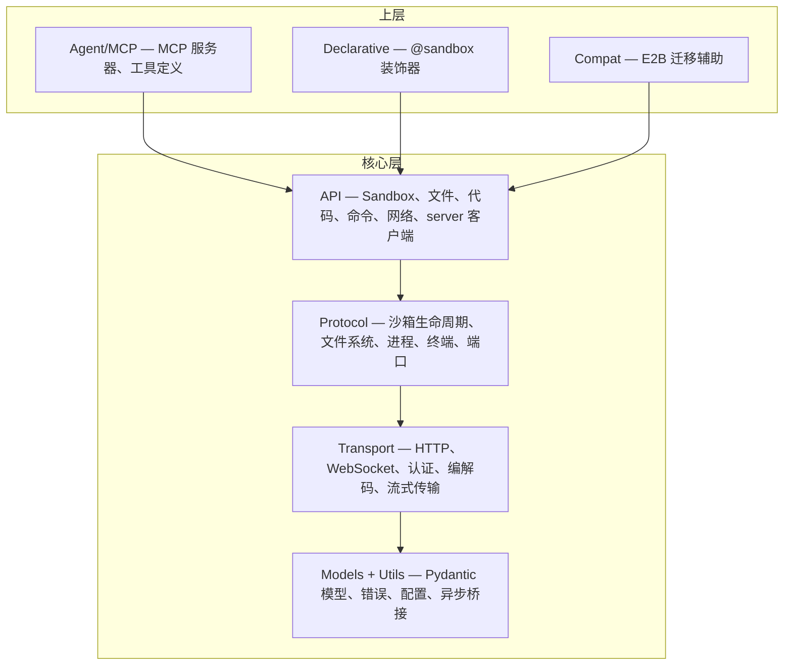

# Agent Sandbox — 设计文档索引

> **版本**：v2.0 | **最后更新**：2026-09-24
>
> 本文档是 Agent Sandbox 所有设计文档的入口和索引。详细设计位于 [`design/`](design/) 目录下的各专题文档中。

---

## 项目概述

**Agent Sandbox**（PyPI 包名 `agent-sandbox-client`）是面向阿里云 FC Agent 沙箱服务的 Python SDK。它是运行时客户端：创建、使用、销毁沙箱；模板用 `abx template build|deploy` 构建和部署。方法名参考了 E2B，方便迁移，标准公开接口遵循阿里云支持的 E2B 行为契约（见[从 E2B 迁移](guide/migrate-from-e2b.md)）。

本仓库包含 Python SDK，以两个版本同步发布的 PyPI 分发包提供——`agent-sandbox-client`（`client-sdk/`，导入 `agent_sandbox`）与 `agent-sandbox-server`（`server-sdk/`，导入 `agent_sandbox.server`，容器侧运行时）。`abx` CLI 是 `cli` 仓库中的 Node.js/TypeScript 项目，CLI 自己的设计与指南文档也在该仓库（见[相关：abx CLI](#相关abx-cli)）。

### 核心设计原则

1. **方法名参考 E2B，但不兼容 E2B** — E2B 风格的方法名加一个小的迁移辅助 (`from agent_sandbox.compat import Sandbox`) 方便现有 E2B 用户迁移；线上协议和配置是平台自己的
2. **AI-First** — MCP Server 是一等公民，编码 Agent 通过 Agents API 托管
3. **零配置默认** — 开箱即用；从安装到第一个沙箱运行不超过 3 行代码

### 快速上手

```bash
pip install agent-sandbox-client
export E2B_API_KEY=your-api-key
```

```python
from agent_sandbox import ProviderSandbox as Sandbox

async with await Sandbox.create(template="base") as sb:
    result = await sb.run_code("print('Hello, Agent Sandbox!')")
    print(result.text)
```

---

## 架构概览

SDK 采用严格分层架构 — 低层绝不导入高层：



完整架构分解详见[架构设计](design/architecture.md)。

---

## 设计专题索引

每个专题都有独立的设计文档，包含完整规范。

### 核心设计

| 专题 | 文档 | 摘要 |
|------|------|------|
| **系统架构** | [architecture.md](design/architecture.md) | 五层架构、层间依赖、双 API 层（Platform API vs Sandbox envd API） |
| **SDK API 设计** | [sdk-api-design.md](design/sdk-api-design.md) | Sandbox 类、文件操作、代码执行、命令、网络、会话管理 |
| **沙箱类型体系** | [sandbox-types.md](design/sandbox-types.md) | 临时沙箱（已实现）、持久沙箱（远期）、沙箱生命周期 |
| **提供方与凭证** | [providers-and-credentials.md](design/providers-and-credentials.md) | 每个配置键一个环境变量、优先级、提供方插件（`abx provider ...`）、安装与信任模型、EPP/1 协议、E8xxx 错误；评审记录见 [providers-and-credentials-review.md](archive/providers-and-credentials-review.md) |

### 模板

| 专题 | 文档 | 摘要 |
|------|------|------|
| **模板体系** | [template-system.md](design/template-system.md) | 模板分层、GitHub tarball 分发、`template.yaml` 规范、版本管理、模板市场架构 |

### AI 与 Agent 集成

| 专题 | 文档 | 摘要 |
|------|------|------|
| **MCP Server** | [mcp-server.md](design/mcp-server.md) | 7 个 P0 工具、STDIO 与 Streamable HTTP 传输、FC 部署产物、会话绑定 |
| **Agents API** | [guide/agents-api.md](guide/agents-api.md) | 在沙箱里运行 Agent 的唯一方式：`/v1/agents/**`。基础镜像不预装 CLI |

### 服务器与基础设施

| 专题 | 文档 | 摘要 |
|------|------|------|
| **Server API** | [server-api.md](design/server-api.md) | Sandbox Server SDK 路由、能力组、Browser 实例架构 |

### 维护者设计文档

这些页面有中文副本，就在本目录。只有仓库布局仍是英文。

| 专题 | 文档 | 摘要 |
|------|------|------|
| **Agents API** | [agents-api.md](design/agents-api.md)、[评审](archive/agents-api-review.md) | 在 Agent Sandbox 中托管编码 Agent |
| **细粒度 capability** | [fine-grained-capabilities.md](design/fine-grained-capabilities.md)、[评审](archive/fine-grained-capabilities-review.md) | `agent-sandbox-server` 与 `template.yaml` 中的 capability 范围与权限 |
| **客户端 / 服务端对齐** | [client-server-alignment.md](design/client-server-alignment.md) | 每条服务端路由与客户端的差距矩阵 |
| **基础镜像与 Server SDK** | [base-image-and-server-sdk.md](design/base-image-and-server-sdk.md)、[CLI 跟进项](archive/cli-followups.md) | 官方 FC Agent 沙箱基础镜像与 Server SDK；对 `abx` CLI 的确切修改规格 |
| **Server SDK v2** | [server-sdk-v2/](archive/server-sdk-v2/README.md) | Server SDK 的目标操作模型设计（首页列出已实现与未实现部分） |
| **OpenSandbox provider** | [provider-opensandbox-mapping.md](design/provider-opensandbox-mapping.md) | 现行的 `node` 目录提供方和真实调用对照表 |
| **容器版** | [provider-alicloud-container.md](design/provider-alicloud-container.md) | ACS/ACK sandbox-manager，E2B 形状的 HTTP，不是极速版 |
| **CubeSandbox** | [provider-cubesandbox.md](design/provider-cubesandbox.md) | CubeAPI 控制面 |
| **E2B** | [provider-e2b.md](design/provider-e2b.md) | E2B 云 API，api.e2b.app |
| **提供方可用性** | [provider-readiness.md](design/provider-readiness.md) | CubeSandbox、E2B、容器版在没有真实后端之前的逻辑审查 |
| **仓库布局** | [repository-layout.md](../en/design/repository-layout.md) | `python-sdk` 与 `cli` 仓库的布局评审 |

---

## 实现状态

| 功能 | 状态 | 备注 |
|------|------|------|
| SDK 核心（Sandbox、文件、命令、代码） | **已实现** | |
| MCP Server（STDIO） | **已实现** | 7 个 P0 工具 |
| MCP Server（Streamable HTTP） | **已实现** | `mcp_http.py` |
| FC 部署产物应用 | **已实现** | `agent_sandbox.agent.mcp_http:asgi_app`；产物由 CLI 的 `abx mcp deploy` 生成。见 [mcp-server.md](design/mcp-server.md#7-fc-部署) |
| 模板 build/push/deploy | **在 CLI 中** | `abx template build` 与 `abx template deploy`；SDK 不构建模板 |
| E2B 迁移辅助 | **已实现（部分）** | `agent_sandbox.compat` |
| 每个配置键一个环境变量（SDK） | **已实现** | 见[配置参考](reference/configuration.md)；CLI 规格见 `cli/docs/zh/design/providers-and-credentials-cli.md` |
| 提供方插件（SDK，`python -m agent_sandbox.providers`） | **已实现** | 见[提供方](guide/providers.md)。CLI 加载已安装的 `node`、`exec` 和 `rest` 插件（`abx provider`、`abx --provider`） |
| 持久沙箱 | **远期** | 需底层平台支持 |
| SandboxPool（预热池） | **远期** | 需底层平台支持 |

---

## 相关资源

| 资源 | 位置 |
|------|------|
| 架构决策记录 (ADR) | [`.agents/notes/`](../../.agents/notes/README.md) |
| 用户指南 | [`docs/zh/guide/`](guide/) |
| API 参考 | [`docs/zh/reference/`](reference/) |
| English design index | [`docs/en/DESIGN.md`](../en/DESIGN.md) |

## 相关：abx CLI

`abx` CLI（Node.js / TypeScript，npm 包 `@agent-sandbox/cli`）的文档位于 [`cli` 仓库](https://github.com/alibaba-agent-sandbox/agent-sandbox)，其设计索引是 [DESIGN.md](https://github.com/alibaba-agent-sandbox/agent-sandbox/blob/main/docs/zh/DESIGN.md)。与 SDK 读者最相关的是：[CLI 架构](https://github.com/alibaba-agent-sandbox/agent-sandbox/blob/main/docs/zh/design/architecture.md)、[CLI 命令体系](https://github.com/alibaba-agent-sandbox/agent-sandbox/blob/main/docs/zh/design/cli-design.md)与[模板目录](https://github.com/alibaba-agent-sandbox/agent-sandbox/blob/main/docs/zh/design/templates-catalog.md)。
