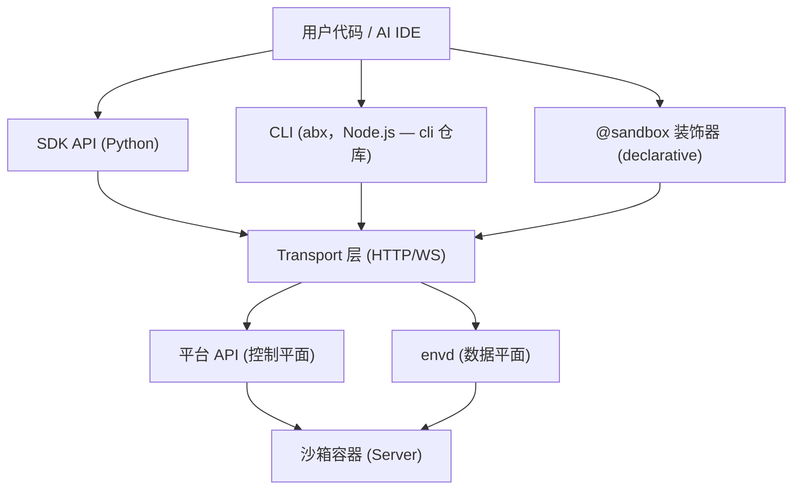
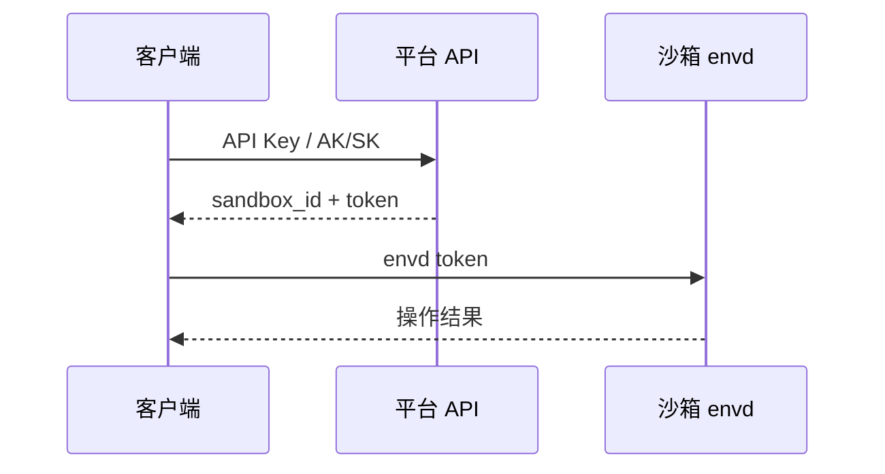
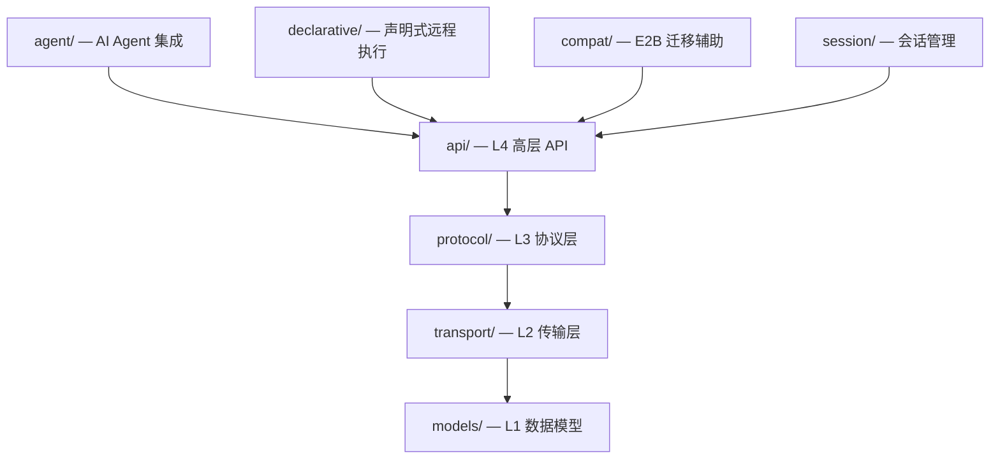

# 架构概览

本文档简述 Agent Sandbox 的整体架构，帮助理解 SDK、CLI、Server 之间的关系。

---

## 三层架构

Agent Sandbox 由三个核心层组成：

### SDK 层（客户端）

- **Sandbox 类**：核心入口，管理沙箱生命周期
- **子模块**：`commands`（命令）、`files`（文件）、`network`（网络）、`code`（代码解释器）
- **命名命令**：`sandbox.run(name, **kwargs)` 调用注册在沙箱 server 里的命令
- **声明式装饰器**：`@sandbox` 远程执行函数

### CLI 层

`abx` CLI（命令组、快捷命令、内部实现）是独立的 Node.js/TypeScript 项目；见 `cli` 仓库的 [CLI 架构](https://github.com/alibaba-agent-sandbox/agent-sandbox/blob/main/docs/zh/design/architecture.md)。

### Server 层（沙箱内部）

- **HTTP Server**：运行在沙箱内，端口 9000
- **能力组**：8 个能力组控制端点访问
- **注册命令**：通过 `@sandbox.register` 注册并通过 HTTP 路由暴露

---

## 通信架构

### 控制平面（Platform API）

客户端通过 HTTPS 与平台 API 通信，用于：
- 创建/列出/销毁沙箱
- 模板查询（模板用 `abx template build|deploy` 构建和部署）
- 认证（API Key / AK/SK token 交换）

URL 格式：`https://api.{region}.e2b.fc.aliyuncs.com`

### 数据平面（envd）

沙箱创建后，SDK 通过 HTTPS/WSS 直接与沙箱内的 envd 服务通信：
- 执行命令（HTTP POST）
- 文件操作（HTTP）
- 代码执行（RPC over HTTP）
- 终端会话（WebSocket）

URL 格式：`https://49983-{sandbox_id}.{domain}`

其中 `49983` 是 envd 的固定端口。

### 认证流程

---

## Server 端能力组

沙箱内 Server 在一张表里声明了 118 个端点（`agent_sandbox.server.endpoints.ENDPOINTS`）。能力组是声明了它的那些端点的名字：

| 能力组 | 端点数 | 默认状态 | 说明 |
|--------|--------|----------|------|
| CORE | 3 | 始终启用 | 健康检查与发现（`/health`、`/capabilities`、`/capabilities/check`） |
| COMMANDS | 2 | 启用 | 注册命令路由 |
| FILE_OPS | 12 | 启用 | 文件 CRUD 与传输 |
| PROCESS | 8 | 启用 | Shell 与进程管理 |
| TERMINAL | 6 | 启用 | PTY 终端 |
| SYSTEM | 6 | 启用 | 系统信息查询 |
| DEV_TOOLS | 3 | **禁用** | 代码运行、git status 与 diff |
| BROWSER | 8 | **禁用** | 浏览器自动化 |
| AGENTS | 70 | **禁用** | Agents API（`/v1/agents/*`、`/v1/vaults`、`/v1/responses` 等） |

端点规则是唯一的开关。组由模板策略（`server.groups`，列表或映射）、`commands.py` 里的 `enable_group()` 打开或关闭，也可用 `ABX_SERVER_ENABLED_GROUPS` 打开（它只能打开）。见 [Server API](../design/server-api.md#2-能力组capability-groups)。

---

## SDK 内部分层

各模块包含的文件：

- **api/**: sandbox.py, files.py, commands.py, network.py, code.py, server_client.py
- **protocol/**: sandbox.py, process.py, filesystem.py, code_interpreter.py, terminal.py
- **transport/**: http.py, auth.py, config.py, streaming.py
- **models/**: sandbox.py, process.py, errors.py, template.py, session.py, filesystem.py
- **declarative/**: decorator.py, serializer.py, config.py
- **agent/**: mcp.py, tools.py
- **session/**: local.py, base.py
- **compat/**: sandbox.py

---

## 下一步

- [沙箱生命周期](sandbox-lifecycle.md) — 状态转换和超时机制
- [E2B 兼容性](e2b-compatibility.md) — 与 E2B 的共同点和差异
- [API 参考](../reference/api-reference.md) — 完整 API 文档
