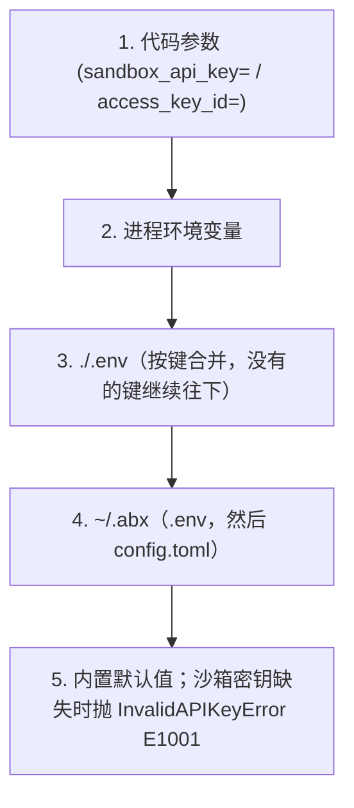

# 认证详解

本指南描述异步 `ProviderSandbox` 扩展；根级 `Sandbox` 和 `AsyncSandbox` 遵循固定版本的标准迁移契约，详见[从 E2B 迁移](migrate-from-e2b.md)。

当前 SDK 安装使用[安装指南](install-python.md)。

> **说明：** 本页出现的 `abx` 命令由 `cli` 仓库中的 Node.js CLI 提供（[CLI binary installation](https://github.com/Alibaba-Agent-Sandbox/agent-sandbox/blob/main/docs/en/guide/binary-installation.md)）。CLI 专属文档（CLI 设计、教程、参考）也在该仓库；本仓库记录 Python SDK（`agent-sandbox-client`）与容器侧运行时（`agent-sandbox-server`）。

沙箱运行时请求需要 **API Key**；**AK/SK（阿里云 AccessKey）**经明确确认后可为极速版准备该 Key，也用于原生控制面操作；见[功能与权限](permissions.md)。

凭证属于某个[提供方](providers.md)。内置提供方是**阿里云极速版（Alibaba Cloud Express Edition）**，id 为 `alicloud-express`，也是默认提供方。沙箱密钥是 `ABX_SANDBOX_API_KEY`。阿里云 AccessKey 使用官方名字 `ALICLOUD_ACCESS_KEY_ID` 和 `ALICLOUD_ACCESS_KEY_SECRET`。地域是 `ALIBABA_CLOUD_REGION_ID`。每个键只有一个名字。

> **历史说明**：`abx auth` CLI 命令组（`login`/`logout`/`status`/`switch`）已在首个正式版 `0.1.0` 之前移除。凭证通过下方介绍的环境变量与 `abx config set sandbox_api_key` 配置；用 `abx config list` 查看生效状态。

---

## 认证方式总览

Agent Sandbox 存在三条认证路径，适用于不同场景：

- **API Key 模式**：最常用。通过 `Authorization: Bearer {api_key}` 请求头访问平台 API。适用于个人开发、CI/CD、SDK 调用等绝大多数场景。
- **AK/SK 控制面**：用于官方模板、镜像与 ACR 操作，显式确认后可准备管理 Key，见[权限](permissions.md)。
- **envd 内部认证**：沙箱创建后，SDK 与沙箱内部 envd 服务之间的通信认证。使用 `envdAccessToken`（从创建响应中获取），由 SDK 自动管理，用户无需手动处理。

---

## API Key 认证

API Key 是最常用的认证方式，通过 `Authorization: Bearer {api_key}` 请求头发送到平台 API。

### 配置方式

#### 1. 环境变量（优先于 `~/.abx`）

```bash
export ABX_SANDBOX_API_KEY="your-api-key"
```

设置 `ABX_SANDBOX_API_KEY`。这是沙箱 API Key 唯一的环境变量。

#### 2. 持久化文件（`~/.abx/.env`）

SDK 同样会读取 `~/.abx/.env`，该文件由 `abx` CLI 写入（`abx config set sandbox_api_key ...`，文件权限 600；见 [CLI 认证配置指南](https://github.com/alibaba-agent-sandbox/agent-sandbox/blob/main/docs/zh/guide/authentication.md)）。密钥存储为 `ABX_SANDBOX_API_KEY`。AccessKey 存储为 `ALICLOUD_ACCESS_KEY_ID` 和 `ALICLOUD_ACCESS_KEY_SECRET`。

#### 3. .env 文件

在项目根目录创建 `.env` 文件：

```dotenv
ABX_SANDBOX_API_KEY=your-api-key
```

SDK 把两个 `.env` 当作各自独立的层读取。`./.env` 写了该键时优先；没写的键仍然来自 `~/.abx/.env`。

1. 当前目录下的 `.env`
2. `~/.abx/.env`

#### 4. config.toml 文件

沙箱 API Key 放在 `~/.abx/.env`（权限 600）。`abx config set sandbox_api_key` 把 `ABX_SANDBOX_API_KEY` 写在那里。非密钥的连接设置放在 `~/.abx/config.toml`：

```toml
[transport]
sandbox_base_url = "https://api.cn-hangzhou.e2b.fc.aliyuncs.com"
sandbox_domain = "cn-hangzhou.e2b.fc.aliyuncs.com"
```

#### 5. 代码参数（高于环境变量和 `~/.abx`）

```python
from agent_sandbox import ProviderSandbox as Sandbox

# 创建时直接传入
sandbox = await Sandbox.create(sandbox_api_key="your-api-key")

# 连接时直接传入
sandbox = await Sandbox.connect("sbx-xxxx", sandbox_api_key="your-api-key")
```

---

<a id="aksk-阿里云扩展认证-"></a>
## AK/SK 管理式认证

极速版只有 AK/SK 时使用共享 Provider 引擎准备的 Key。首次使用或续期前，显式调用 `prepare_api_key(confirm=True)` 或 `prepare_api_key_sync(confirm=True)`。SDK 不弹交互提示，也不静默创建凭据。[权限策略及示例](permissions.md)。

## 配置优先级链

认证凭证按以下优先级解析（从高到低）：



GitHub token 和区域走同一条链。空白或只含空格的值会被跳过。每个键只有一个环境变量。变量名和默认值见 [凭证解析](../reference/configuration.md#凭证解析)。

### 凭证与提供方

通用沙箱密钥（`sandbox_api_key`，环境变量 `ABX_SANDBOX_API_KEY`）和阿里云 AK/SK 属于内置提供方。切换到[提供方插件](providers.md)后，除非插件的清单申请了它们且你在安装时同意，否则插件**不会**收到。插件有自己作用域的凭证键，例如提供方 `my-cloud` 的 `ABX_MY_CLOUD_API_KEY`。这样可以避免把一个云的密钥发给另一个云。

插件的每个选项都遵循同一条规则：规范名是 `ABX_<PROVIDER_ID>_<FIELD>`（连字符变下划线），清单可以用 `env = [...]` 把厂商自己的变量加为别名。密钥字段（`secret = true`）只存在于环境变量或 `.env` 文件（权限 0600），命令行上会被拒绝；其他字段也可以放在 `config.toml` 的 `[providers.<id>]` 下。2026-10-13 用 OpenSandbox 验证：只要 `ABX_OPENSANDBOX_API_KEY` 和 `ABX_OPENSANDBOX_BASE_URL`，CLI 和 SDK 都能驱动真实服务器；`OPEN_SANDBOX_API_KEY` 与 `OPEN_SANDBOX_DOMAIN` 是它声明的原生别名，两者同时设置时规范名优先。声明了 `[core] inherit = ["sandbox_api_key"]` 的插件，只有在你于安装时同意之后才会收到通用密钥；`abx provider info <id>` 会在「Inherits」下显示这份清单。

AK/SK 管理 Key 需要显式准备确认。同时配置时，运行时使用 API Key：
- 若同时提供了 `sandbox_api_key` 和 `access_key_id`，使用 API Key
- 若同时设置了 `ABX_SANDBOX_API_KEY` 和 `ALICLOUD_ACCESS_KEY_ID`，使用 `ABX_SANDBOX_API_KEY`

---

## 密钥存储（基于文件）

密钥存储在 `~/.abx/secrets.json` 中，这是一个明文 JSON 文件，通过 `chmod 600` 文件权限保护。仅适合本地开发使用。

> **⚠️ 警告**：`secrets.json` 以**明文**存储密钥。仅依赖 POSIX 文件权限（`chmod 600`）控制访问。生产环境请使用专用密钥管理服务。

通过环境变量或 `.env` 文件管理密钥，或向 `Sandbox.create()` 传入 `envs={"MY_TOKEN": "..."}` 为单个沙箱注入密钥：

```bash
# 通过环境变量设置 API Key（推荐）
export ABX_SANDBOX_API_KEY="your-api-key"
```

对应的 CLI 用法（`abx config set`、`abx create --env`）见 [CLI 认证配置指南](https://github.com/alibaba-agent-sandbox/agent-sandbox/blob/main/docs/zh/guide/authentication.md)。

> **历史说明**：macOS Keychain 集成已在过度设计清理中移除（ADR 2026-09-23）。`abx secret` CLI 命令组也已被移除。所有密钥管理现通过环境变量、`.env` 文件或 `abx config set`（CLI 命令）完成。

---

## envd 认证（沙箱内部通信）

沙箱创建后，与沙箱内部 envd 服务的通信使用 `envdAccessToken`（从创建响应中获取）。这是由 SDK 自动管理的内部机制，用户无需手动处理。

envd 认证需要以下 HTTP 头（已由 SDK 自动设置）：

| Header | 值 |
|--------|-----|
| `X-Access-Token` | envdAccessToken |
| `E2b-Sandbox-Id` | 沙箱 ID |
| `E2b-Sandbox-Port` | `49983` |
| `Authorization` | `Basic dXNlcjo=` (base64 of "user:") |

---

## 常见问题

### InvalidAPIKeyError (E1001)

```text
[E1001] API key cannot be empty
  Suggestion: Check your ABX_SANDBOX_API_KEY environment variable or pass sandbox_api_key.
```

**解决**：确保通过上述任一方式配置了有效的 API Key。

### InvalidCredentialsError (E1003)

```text
[E1003] AccessKey ID and Secret cannot be empty
  Suggestion: Check ALICLOUD_ACCESS_KEY_ID and ALICLOUD_ACCESS_KEY_SECRET environment variables.
```

**解决**：确保同时设置了 AK ID 和 AK Secret。

### TokenExpiredError (E1002)

```text
[E1002] envdAccessToken not available. Sandbox may not be created or connected.
```

**解决**：重新连接以获得有效 envd token。管理 API Key 的创建和续期需要单独确认，见[权限指南](permissions.md)。

---

## 相关：abx CLI

通过命令行设置凭证（`abx config set` / `list` / `get`、`abx create --env`）的说明位于 CLI 仓库：[CLI 认证配置](https://github.com/alibaba-agent-sandbox/agent-sandbox/blob/main/docs/zh/guide/authentication.md)。
