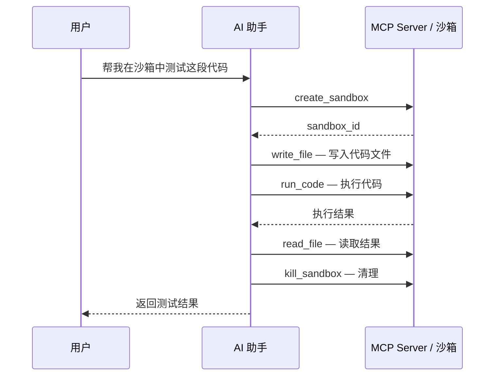

# MCP 集成

> **说明：** 本页出现的 `abx` 命令由 `cli` 仓库中的 Node.js CLI 提供（`npm install -g @agent-sandbox/cli`）。CLI 专属文档（CLI 设计、教程、参考）也在该仓库；本仓库记录 Python SDK（`agent-sandbox`）与容器侧运行时（`agent-sandbox-server`）。

Agent Sandbox 提供 MCP（Model Context Protocol）Server，使 AI IDE 和工具能够直接操作沙箱。

---

## 什么是 MCP

MCP（Model Context Protocol）是一个开放协议，允许 AI 模型与外部工具和服务交互。Agent Sandbox 的 MCP Server 以 STDIO 传输、JSON-RPC 2.0 协议运行，为 AI 助手提供沙箱操作能力；远程部署也可使用 Streamable HTTP 传输（见下文）。

### 环境要求

```bash
pip install agent-sandbox            # SDK 自带的 MCP STDIO server：python -m agent_sandbox.agent.mcp
export ABX_SANDBOX_API_KEY=your-api-key
```

Node.js `abx` CLI 提供同一服务器的另一套实现（`abx mcp ...`，用 `npm install -g @agent-sandbox/cli` 安装）；见[相关：abx CLI](#相关abx-cli)。

## 配置 IDE

把 IDE 的 MCP 配置指向 Python server。例如 Cursor 的 `~/.cursor/mcp.json`、Claude Desktop 的 `claude_desktop_config.json`，或 VS Code 工作区的 `.vscode/mcp.json`（`type: stdio`）：

```json
{
  "mcpServers": {
    "agent-sandbox": {
      "command": "python",
      "args": ["-m", "agent_sandbox.agent.mcp"],
      "env": { "ABX_SANDBOX_API_KEY": "your-api-key" }
    }
  }
}
```

`python -m agent_sandbox.agent.mcp` 读取 `ABX_SANDBOX_API_KEY`、`ABX_SANDBOX_BASE_URL`、`ABX_SANDBOX_DOMAIN`，默认模板取自 `ABX_DEFAULT_TEMPLATE`（默认 `base`）。修改 IDE 配置后重启 IDE。该 server 通过 STDIO 提供同一组工具，因此下文的[可用工具](#可用工具)完全适用。

`abx mcp install --target cursor|claude|vscode` 与 `abx mcp status` 命令会替你写入并检查这些文件；见[相关：abx CLI](#相关abx-cli)。

## 可用工具

MCP Server 提供 7 个工具：

| 工具名 | 说明 | 参数 |
|--------|------|------|
| `create_sandbox` | 创建新沙箱，并把它设为默认沙箱 | `template`（可选，省略时用 server 配置的模板）、`timeout`（可选，默认 300）、`envs`（可选） |
| `run_code` | 在沙箱中执行代码 | `code`（必填）、`sandbox_id`（可选）、`language`（可选，默认 python）、`timeout`（可选，默认 30） |
| `run_command` | 通过 `sh -c` 执行命令（支持管道、`&&`、`$VAR`、`cd`） | `command`（必填）、`sandbox_id`（可选）、`cwd`（可选，省略时用镜像工作目录）、`timeout`（可选，默认 60，非零退出码视为工具错误） |
| `read_file` | 读取沙箱中的文件 | `path`（必填）、`sandbox_id`（可选）、`encoding`（可选，默认 utf-8） |
| `write_file` | 写入文件到沙箱 | `path`、`content`（必填）、`sandbox_id`（可选） |
| `list_files` | 列出沙箱中的目录内容 | `path`（可选，默认 `/`）、`sandbox_id`（可选） |
| `kill_sandbox` | 销毁沙箱 | `sandbox_id`（可选；省略时销毁默认沙箱。没有默认沙箱时返回错误） |

> **命名说明**：MCP 工具 `run_command` 通过 `sh -c` 执行命令（SDK 中 `sandbox.commands.run(..., shell=True)`），它不是命名命令调度；要调用注册在沙箱 server 上的命令，请使用 `Sandbox.run(name, **kwargs)`。
>
> **默认沙箱**：`create_sandbox` 的结果会成为默认沙箱，所以随后省略 `sandbox_id` 的 `write_file` / `run_code` / `kill_sandbox` 都作用在刚创建的那只沙箱上。还没有默认沙箱时，第一次省略 `sandbox_id` 的工具调用会懒创建一只。省略 `template` 时使用 server 配置的模板（Python server 默认为 `base`，CLI 的 `abx mcp start` 默认为 `code-interpreter-v1`）。每次使用沙箱前会按创建时的 `timeout` 延长存活时间。IDE 关闭 server（STDIO）或 `DELETE /mcp` / 空闲超时（HTTP）时会销毁会话里的全部沙箱。

---

## 手动启动 MCP Server（STDIO）

MCP Server 通常由 IDE 自动启动。手动启动的进程会在 stdin 上等待 JSON-RPC，这个等待就是运行状态：

```bash
python -m agent_sandbox.agent.mcp
```

STDIO 模式下，server 在 stdin/stdout 上使用换行分隔的 JSON-RPC 2.0。无需 IDE 也可冒烟测试：

```bash
# 通过管道发送 initialize + tools/list；server 在 stdout 上回复
printf '%s\n' \
  '{"jsonrpc":"2.0","id":1,"method":"initialize","params":{}}' \
  '{"jsonrpc":"2.0","id":2,"method":"tools/list","params":{}}' \
  | python -m agent_sandbox.agent.mcp | head -n 2
```

`abx mcp start` / `stop` 命令（选项、后台 HTTP 模式、pid 与日志文件）属于 CLI 的 server；见[相关：abx CLI](#相关abx-cli)。

## 远程服务（Streamable HTTP）

团队共享或远程访问时，将 MCP Server 作为 Streamable HTTP 服务运行，而不是 STDIO。

### 本地以 uvicorn 运行

```bash
pip install "agent-sandbox[mcp]"

export ABX_MCP_AUTH_TOKEN=replace_me   # Bearer token（省略则关闭认证）
export ABX_SANDBOX_API_KEY=your-api-key

uvicorn agent_sandbox.agent.mcp_http:asgi_app --host 0.0.0.0 --port 9000
```

端点：`POST /mcp`（JSON-RPC）、`DELETE /mcp`（会话终止）、`GET /health`（健康检查）。`GET /mcp` 返回 405（SSE 通知尚未实现，按 Streamable HTTP 规范用 405 而不是 501）。远程产物必须带非空 Bearer token（`--generate-token` 或 `--auth-token-file`）。带 `Origin` 且不是本机、也不在 `ABX_MCP_ALLOWED_ORIGINS` 里的请求返回 403。

也可以编程式构建应用：

```python
from agent_sandbox.agent.mcp_http import create_mcp_app

app = create_mcp_app(
    auth_token="replace_me",   # None 关闭客户端认证
    api_key="your-api-key",
    template="base",
)
```

### Bearer Token 认证

各入口使用不同的凭证：

| 入口 | 客户端认证 | 如何配置 |
|------|-----------|----------|
| `python -m agent_sandbox.agent.mcp`（STDIO） | 没有 Bearer。进程由本机 IDE 拉起，不对外监听 | 沙箱调用用 `ABX_SANDBOX_API_KEY` |
| `uvicorn agent_sandbox.agent.mcp_http:asgi_app` / `create_mcp_app()` | Bearer。回环地址可以不配 token（启动时会警告） | `ABX_MCP_AUTH_TOKEN` 或 `auth_token=` |
| 阿里云 FC 上的远程函数 | Bearer 必填。产物里的 `app.py` 在 token 为空时拒绝启动，不会变成“免认证” | token 作为函数环境变量 `ABX_MCP_AUTH_TOKEN` 写入。FC HTTP 触发器使用 `anonymous`，MCP 客户端不需要阿里云签名；真正的校验是应用层 Bearer。`GET /health` 只返回状态与协议，不校验 token，也不含任何密钥 |

设置了 `ABX_MCP_AUTH_TOKEN`（或 `auth_token`）后，每个 `/mcp` 请求都必须携带：

```
Authorization: Bearer <token>
```

- 回环地址且未设置 token → 认证关闭，进程会警告
- token 已设置但为空 → **fail-closed**：所有请求被拒绝并返回 401
- FC 产物 token 未设置或为空 → 进程拒绝启动

token 比较使用常量时间算法。可用 `openssl rand -base64 32` 生成。CLI 的 `abx mcp start --http`（`--auth-token`）与 `abx mcp deploy --generate-token` 可接受或为你生成 token；见[相关：abx CLI](#相关abx-cli)。

### 客户端配置（远程）

```json
{
  "mcpServers": {
    "agent-sandbox-remote": {
      "url": "http://your-server:9000/mcp",
      "headers": {
        "Authorization": "Bearer replace_me"
      }
    }
  }
}
```

---

## FC 部署产物

阿里云函数计算的部署产物由 `abx mcp deploy` 命令生成（见[相关：abx CLI](#相关abx-cli)）；生成的 Python 应用由本 SDK 提供。它**不**调用 FC API —— 需要通过控制台或 SDK 手动创建函数。

产物目录包含：

| 文件 | 内容 |
|------|------|
| `requirements.txt` | `agent-sandbox[mcp]`、`uvicorn>=0.29` |
| `app.py` | ASGI 入口，读取 FC 环境变量（`ABX_MCP_AUTH_TOKEN`、`ABX_SANDBOX_API_KEY`、`ABX_SANDBOX_BASE_URL`、`ABX_SANDBOX_DOMAIN`、`ABX_DEFAULT_TEMPLATE`） |
| `config.yaml` | YAML 清单：函数名、地域、运行时 `python3.10`、handler `app.app`、内存/超时、环境变量、HTTP 触发器（POST/GET/DELETE）、会话亲和 |

部署步骤：打包 → 创建函数 → 创建 HTTP 触发器 → 若支持则启用 `Mcp-Session-Id` 亲和。

> **安全**：`config.yaml` 含有 API key 与 Bearer token，请勿提交到版本控制。

部署后用触发器 URL 配置客户端：

```json
{
  "mcpServers": {
    "agent-sandbox-remote": {
      "url": "https://<FC_HTTP_TRIGGER_URL>/mcp",
      "headers": { "Authorization": "Bearer <BEARER_TOKEN>" }
    }
  }
}
```

## 场景示例

### 在 Cursor 中使用

安装 MCP 后，在 Cursor 的 AI 对话中，模型可以自动调用 Agent Sandbox 工具：

1. **代码执行**：「在沙箱中运行这段 Python 代码，看看输出是什么」
2. **环境搭建**：「创建一个沙箱，安装 flask 和 sqlalchemy，然后运行我的项目」
3. **文件操作**：「把这个文件写入沙箱的 /app 目录」
4. **调试辅助**：「在沙箱里执行 pip list 看看装了哪些包」

### 典型工作流



### 快速执行一段代码（HTTP，curl）

```bash
# 1. initialize（创建会话；记下 Mcp-Session-Id）
curl -s http://localhost:9000/mcp \
  -H "Content-Type: application/json" \
  -H "Authorization: Bearer replace_me" \
  -d '{"jsonrpc":"2.0","id":1,"method":"initialize","params":{}}'

# 2. 携带会话头调用工具
curl -s http://localhost:9000/mcp \
  -H "Content-Type: application/json" \
  -H "Authorization: Bearer replace_me" \
  -H "Mcp-Session-Id: <步骤1的会话ID>" \
  -d '{"jsonrpc":"2.0","id":2,"method":"tools/call",
       "params":{"name":"run_code","arguments":{"code":"print(1+1)"}}}'

# 3. 终止会话（销毁其沙箱）
curl -s -X DELETE http://localhost:9000/mcp \
  -H "Authorization: Bearer replace_me" \
  -H "Mcp-Session-Id: <步骤1的会话ID>"
```

---

## 故障排查

| 症状 | 可能原因 | 解决方法 |
|------|----------|----------|
| IDE 显示 server 失败 / 无工具 | IDE `PATH` 中的 `python` 不是安装了 `agent-sandbox` 的解释器 | 在 IDE 配置的 `command` 中使用解释器的绝对路径 |
| 工具列表正常但每次调用报错 | API key 缺失或无效 | 在 server 的 `env` 块中设置 `ABX_SANDBOX_API_KEY` |
| IDE 重启后 `create_sandbox` 失败 | 后端 API URL/地域不匹配 | 在 server 的 `env` 块中设置 `ABX_SANDBOX_BASE_URL` |
| HTTP 每个请求都 401 | `ABX_MCP_AUTH_TOKEN` 为空（fail-closed） | 设置非空 token。本机回环可以删掉该变量来关闭认证。FC 产物没有 token 时不会启动 |
| HTTP 404 Unknown session | `Mcp-Session-Id` 已过期（空闲 TTL 3600 秒）或实例重启 | 重新发送 `initialize` 创建新会话 |
| HTTP 503 会话上限 | 进程内并发会话超过 100 | 关闭空闲会话（`DELETE /mcp`）或经 `create_mcp_app()` 调高 `max_sessions` |
| `GET /mcp` 返回 405 | SSE 通知尚未实现 | 预期行为 — 只使用 `POST /mcp` |

CLI server 特有的问题（`abx` 不在 IDE 的 `PATH`、`abx mcp status`）见 CLI 的 [MCP 集成指南](https://github.com/alibaba-agent-sandbox/agent-sandbox/blob/main/docs/zh/guide/mcp-integration.md#故障排查)。更普遍的问题：见[故障排查指南](troubleshooting.md)与[错误码](../reference/error-codes.md)。

## 技术细节

- **传输协议**：STDIO（换行分隔 JSON-RPC 2.0，协议版本 2024-11-05）与 Streamable HTTP（规范 2025-06-18）。`initialize` 按 transport 协商支持版本 —— 请求版本受支持时原样回显，缺失或不支持时回退到该 transport 自己的版本（因此 HTTP 的 /health 与 initialize 均报告 2025-06-18）
- **沙箱管理**：MCP Server 为每个会话内部维护 `SandboxManager`，管理多个沙箱实例的生命周期
- **默认模板**：Python STDIO server、HTTP 应用与 `abx mcp deploy` 产物为 `base`（CLI 自己的 `abx mcp start` 使用 `code-interpreter-v1`）。`create_sandbox` 省略 `template` 时用的就是这个 server 模板
- **STDIO**：单条消息上限 8 MiB；超限的一行会被拒绝，进程继续服务下一条。`ping` 在工具调用进行中也会返回
- **HTTP 会话**：空闲 TTL 3600 秒、每进程最多 100 个并发会话，容量满返回 503

---

## 下一步

- [SDK 使用指南](sdk-usage.md) — 直接使用 SDK
- [MCP Server 设计](../design/mcp-server.md) — 工具、传输与 FC 部署架构

---

## 相关：abx CLI

Node.js `abx` CLI 提供自己的 MCP server 及相关命令，记录在 CLI 仓库：[MCP 集成（CLI）](https://github.com/alibaba-agent-sandbox/agent-sandbox/blob/main/docs/zh/guide/mcp-integration.md)（`abx mcp install|start|stop|status|deploy`、IDE 安装目标、后台 HTTP 模式、pid 与日志文件）以及 CLI 的 [MCP Server 设计](https://github.com/alibaba-agent-sandbox/agent-sandbox/blob/main/docs/zh/design/mcp-server.md)。
