# 错误码参考

本指南描述异步 `ProviderSandbox` 扩展；根级 `Sandbox` 和 `AsyncSandbox` 遵循固定版本的标准迁移契约，详见[从 E2B 迁移](../guide/migrate-from-e2b.md)。

> **说明：** 本页出现的 `abx` 命令由 `cli` 仓库中的 Node.js CLI 提供（`npm install -g @agent-sandbox/cli`）。CLI 专属文档（CLI 设计、教程、参考）也在该仓库；本仓库记录 Python SDK（`agent-sandbox-client`）与容器侧运行时（`agent-sandbox-server`）。

所有 SDK 错误都继承自 `SandboxError`，携带 `code`（错误码）、`message`（消息）、`suggestion`（建议）、`docs_url`（文档 URL）属性。

```python
from agent_sandbox.models.errors import SandboxError

try:
    sandbox = await Sandbox.create(template="nonexistent")
except SandboxError as e:
    print(f"[{e.code}] {e.message}")
    print(f"建议: {e.suggestion}")
```

---

## E1xxx — 认证错误（AuthenticationError）

| 错误码 | 异常类 | 含义 | 建议 | 触发场景 |
|--------|--------|------|------|----------|
| E1000 | `AuthenticationError` | 认证失败（基类） | — | 认证相关通用错误 |
| E1001 | `InvalidAPIKeyError` | API Key 无效或缺失 | 检查 `ABX_SANDBOX_API_KEY` 环境变量，或传入 `sandbox_api_key` 参数 | 未配置任何 API Key 即调用需认证的 API |
| E1002 | `TokenExpiredError` | 认证令牌已过期 | 重新连接获取 envd token，或检查自定义交换 | envd token 缺失/失效，或显式配置的自定义交换失败 |
| E1003 | `InvalidCredentialsError` | AK/SK 凭证无效 | 检查 `ALICLOUD_ACCESS_KEY_ID` 和 `ALICLOUD_ACCESS_KEY_SECRET` 环境变量 | AK/SK 为空或格式错误 |

### 排查步骤

1. 运行 `abx config get sandbox_api_key` 确认认证状态
2. 检查环境变量是否正确设置
3. 确认 API Key 未过期或被吊销
4. 对于 E1002，检查系统时钟是否准确（`date` 命令）

---

## E2xxx — 创建错误（SandboxCreationError）

| 错误码 | 异常类 | 含义 | 建议 | 触发场景 |
|--------|--------|------|------|----------|
| E2000 | `SandboxCreationError` | 创建失败（基类） | — | 沙箱创建相关通用错误 |
| E2001 | `TemplateNotFoundError` | 模板不存在 | 运行 `abx template list` 查看可用模板 | 指定了不存在的模板名称 |
| E2002 | `QuotaExceededError` | 配额超限 | 销毁空闲沙箱或申请提升配额 | 运行中的沙箱数量超过账户配额 |
| E2003 | `RegionUnavailableError` | 区域不可用 | 尝试其他区域或检查服务可用性 | 请求的区域暂时不可用或不存在 |
| E2004 | `TemplateParseError` | 模板解析失败 | 修复 template.yaml（见校验错误）；能力不会被授予直到模板解析成功 | template.yaml 格式错误或字段无效 |
| E2009 | `SandboxNotFoundError` | 该 ID 的沙箱不存在 | 运行 `abx list` 查看运行中的沙箱；已销毁或已过期的沙箱无法重新连接 | 对平台返回 HTTP 404 的 ID 调用 `Sandbox.connect()` / `get_info()` / `set_timeout()` / `pause()` / `resume()`（`kill` 仍保持幂等） |

### 排查步骤

1. 确认模板名称正确（`abx template list`）
2. 对于 E2002，检查 `abx list` 是否有大量闲置沙箱
3. 对于 E2004，检查 template.yaml 的 YAML 语法和字段值
4. E2005–E2008（AI 生成模板）和 E7xxx 构建、部署错误码属于 `abx` CLI，见 CLI 的错误码参考。Python SDK 不再定义它们

---

## E3xxx — 执行错误（ExecutionError）

| 错误码 | 异常类 | 含义 | 建议 | 触发场景 |
|--------|--------|------|------|----------|
| E3000 | `ExecutionError` | 执行失败（基类） | — | 命令/代码执行相关通用错误 |
| E3001 | `CommandTimeoutError` | 命令执行超时 | 增加 `timeout` 参数或检查命令是否卡死 | `commands.run()` 或 `run_code()` 超过 timeout |
| E3002 | `ProcessError` | 进程非零退出码 | — | 命令返回非零退出码（携带 `exit_code`、`stdout`、`stderr` 属性） |
| E3003 | `CodeExecutionError` | 代码执行失败 | 检查代码语法和运行时依赖 | Code Interpreter 执行代码失败 |
| E3004 | `CapabilityNotSupportedError` | 能力未启用 | 在模板的 `capabilities` 列表中声明所需能力，或使用支持该能力的模板 | 调用了运行时门控能力但未声明（如在无 `code` 能力的模板上调用 `run_code()`）。也会在模板解析时由 `resolve_capabilities()` 抛出 |
| E3005 | `CommandNotFoundError` | 命名命令未找到 | 用 `sandbox.list_commands()` 检查命令名，并确认沙箱里的 SandboxServer 在运行（`sandbox.start_server()`） | `Sandbox.run(name)` / `abx run <id> <名称>` 指定的命令在沙箱内 SandboxServer 中不存在（HTTP 404）。携带 `command_name` 属性 |
| E3006 | `EnvdRpcError` | envd 拒绝了 RPC 调用（HTTP >= 400） | 检查命令与参数，或用 `abx -v` 查看原始错误响应 | 沙箱 envd 返回 HTTP >= 400（例如未知可执行文件触发 `process.Process/Start` 500）。携带 `status_code`、`rpc_path`、`envd_error`（解析后的 JSON 体）与 `body_text`；消息不包含完整沙箱 URL。`abx connect` 会将其映射为单条友好提示（如 `Command not found: <cmd>`） |

### E3004 详细说明

> **说明（ADR 2026-09-23）**：大多数模块的运行时 `check_capability()` 门控已移除。`CommandsModule`、`FilesModule`、`NetworkModule` 不再在调用时抛出 E3004。**例外：`CodeContextModule` 保留了 `code` 能力门控**——其所有方法（`run`、`create_context`、`list_contexts`、`restart_context`、`remove_context`）在 `code` 能力缺失时仍会抛出 `CapabilityNotSupportedError`（E3004，fail-closed）。E3004 也仍在模板解析/模型校验时抛出（如 `resolve_capabilities()`）。

`CapabilityNotSupportedError` 携带 `capability` 属性，指示缺少的能力名。

```python
try:
    result = await sandbox.run_code("print(1)")
except CapabilityNotSupportedError as e:
    print(f"缺少能力: {e.capability}")  # "code"
```

**标准能力**：`shell`、`files`、`code`、`terminal`、`ports`

**默认能力集**：`{shell, files, code}`（不声明 `capabilities` 时自动获得）

---

## E4xxx — 文件系统错误（FileOperationError）

| 错误码 | 异常类 | 含义 | 建议 | 触发场景 |
|--------|--------|------|------|----------|
| E4000 | `FileOperationError` | 文件操作失败（基类） | — | 文件系统相关通用错误 |
| E4001 | `FileNotFoundError_` | 文件或目录未找到 | 使用 `files.list()` 检查可用文件，或 `files.exists()` 验证路径 | 读取/删除不存在的路径 |
| E4002 | `PermissionDeniedError` | 权限被拒绝 | 检查沙箱中的文件权限 | 操作无权限的文件 |
| E4003 | `FileSizeLimitError`（`limit`） | 流式下载超过调用者字节限额 | 使用更小文件或明确调整 `max_bytes` | `files.read_bytes(..., max_bytes=...)` 超限并关闭响应 |

> **注意**：`FileNotFoundError_` 类名带下划线后缀，以避免遮蔽 Python 内置 `FileNotFoundError`。

---

## E5xxx — 网络错误（NetworkError）

| 错误码 | 异常类 | 含义 | 建议 | 触发场景 |
|--------|--------|------|------|----------|
| E5000 | `NetworkError` | 网络错误（基类） | — | 网络连接相关通用错误 |
| E5000 | `GitHubRateLimitError` | GitHub 匿名 API 限流（拉取模板时触发） | 执行 `abx config set github_token`（星号脱敏输入；交互终端下 CLI 会主动引导并只重试一次），CI 中注入 `GITHUB_TOKEN` | 未配置 token 时执行 `abx template install` / `abx install` / `abx template search` |
| E5001 | `ConnectionError_` | 连接失败 | 检查网络连通性和防火墙规则 | 无法连接到沙箱服务 |

> **注意**：`ConnectionError_` 类名带下划线后缀，以避免遮蔽 Python 内置 `ConnectionError`。

> **注意**：`GitHubRateLimitError` 与 `NetworkError` 共享 E5000 错误码——对调用方仍是普通网络错误，CLI 通过该子类识别限流并提供一次性交互式 `github_token` 引导。

---

## E6xxx — 会话错误（SessionError）

| 错误码 | 异常类 | 含义 | 建议 | 触发场景 |
|--------|--------|------|------|----------|
| E6000 | `SessionError` | 会话错误（基类） | — | 会话管理相关通用错误 |
| E6001 | `SessionNotFoundError` | 会话未找到 | 检查会话名称是否正确 | 连接/停止不存在的会话 |
| E6002 | `SessionAlreadyExistsError` | 会话名已存在 | 使用其他名称，或先停止已有会话 | 创建同名会话 |

---

## E8xxx — 提供方错误（ProviderError）

由提供方层抛出（见[提供方指南](../guide/providers.md)）。全部继承 `SandboxError`。无论哪个提供方，CLI 退出码都相同。

| 错误码 | 异常类 | 含义 | 触发场景 | CLI 退出码 |
|--------|--------|------|----------|-----------|
| E8000 | `ProviderError` | 提供方失败（基类） | 插件报告了失败，但没有更具体的类 | 1 |
| E8001 | `ProviderNotFoundError` | 提供方 id 未知或未安装 | `provider="x"` / `ABX_PROVIDER=x` 指向了未注册也未安装的提供方 | 4 |
| E8002 | `ProviderConfigError` | 提供方选项无效或未知 | `provider_options` 的键不在插件 schema 里；类型错误；插件返回 `-32006` | 2 |
| E8003 | `ProviderConflictError` | 提供方 id 重复或被保留 | 未加 `--force` 覆盖已有 id；注册保留 id | 1 |
| E8004 | `ProviderFeatureNotSupportedError` | 提供方缺少该特性（同时是 `CapabilityNotSupportedError`） | 对未声明 `sandbox.pause` 的提供方调用 `pause()` | 1 |
| E8005 | `ProviderResourceNotFoundError` | 插件找不到沙箱、文件或模板 | 插件返回 `-32002` 且没有更具体的 `sdk_code` | 4 |
| E8010 | `ProviderInstallError` | 安装无法完成 | 来源不可达；符号链接、路径或大小限制；存储被锁定 | 1 |
| E8011 | `ProviderIntegrityError` | 摘要或固定提交不匹配 | 已安装文件在安装后被改动；`--sha256` 不匹配 | 1 |
| E8012 | `ProviderTrustError` | 未满足同意、固定或传输策略 | 非交互安装未加 `--yes`；未固定来源未加 `--allow-unpinned`；不安全的 URL | 2 |
| E8013 | `ProviderVersionError` | SDK/CLI 或协议版本不兼容 | 清单的 `requires` 或 `protocol` 不被当前宿主支持 | 1 |
| E8014 | `ProviderManifestError` | `abx-provider.toml` 无效 | 未通过某条校验规则 | 1 |
| E8020 | `ProviderProtocolError` | EPP 消息格式错误或过大，握手失败 | JSON 行非法、单行超过 8 MiB、协议版本错误 | 1 |
| E8021 | `ProviderProcessError` | 插件进程无法启动或崩溃 | 缺少解释器；调用期间退出（附带 stderr 末尾内容） | 1 |
| E8022 | `ProviderTimeoutError` | 插件启动或调用超时 | 启动超时内没有 `initialize` 回复；调用超过 `call_timeout` | 5 |
| E8030 | `ProviderMismatchError` | 沙箱属于另一个提供方 | `provider="a"` 搭配引用 `b:sbx-1` | 2 |

插件缺少*凭证*字段时，抛出已有的 `InvalidCredentialsError`（E1003，退出码 3），并指出提供方键和所有能满足它的环境变量。

### 排查步骤

1. `python -m agent_sandbox.providers list`（或 `abx provider list`）显示已安装的内容和默认提供方。
2. `python -m agent_sandbox.providers doctor <id>` 检查清单、摘要、握手和凭证。
3. E8011：运行 `provider update <id>` 或重新安装；不要直接编辑已安装的文件（改你的源码后重新安装，开发期可用 `--link`）。
4. E8021：到插件目录里手工运行插件命令查看报错；SDK 只显示 stderr 的最后 64 KiB。

---

## E9xxx — 沙箱内服务端 API 错误（ServerAPIError）

由 `ServerClient`（`Sandbox.server`）在处理模板内 SandboxServer 的响应时抛出。
`ServerAPIError` 带有 `status_code`、`error_type`、`error_code`（服务端的机器可读 `code`）和 `endpoint`。
已有异常类在语义吻合时被复用：HTTP 404 `FileNotFoundError` 映射为 `FileNotFoundError_`（E4xxx），
服务端 `TimeoutError` 映射为 `CommandTimeoutError`，服务端不可达为 `ConnectionError_`。

| 错误码 | 异常 | 含义 | HTTP / 服务端 `code` | CLI 退出码 |
|--------|------|------|----------------------|:----------:|
| E9000 | `ServerAPIError` | 其他服务端错误（基类） | 其他 4xx/5xx | 1 |
| E9001 | `ServerAuthError`（同时是 `AuthenticationError`） | 缺少或错误的服务端令牌 | 401 `unauthorized`、400 `ambiguous_credentials` | 3 |
| E9002 | `PolicyDeniedError`（`scope`） | 服务端策略拒绝该调用 | 403 `missing_scope`、`command_not_allowed`、`url_denied` 等 | 1 |
| E9002 | `FilePolicyDeniedError`（同时是 `PermissionDeniedError`） | 路径规则拒绝该调用 | 403 `path_not_allowed`、`path_denied`、`read_only`、`symlink_denied`，409 `file_exists` | 1 |
| E9003 | `EndpointNotAvailableError`（同时是 `CapabilityNotSupportedError`；`capability` 为端点名） | 端点被禁用（响应体的 `rule` 指出是哪一层关的），或服务端不认识该端点 | 404 `endpoint_disabled` | 1 |
| E9004 | `PayloadTooLargeError`（`limit`） | 请求体或文件超过端点限制（发现之后客户端也会提前抛出） | 413 `payload_too_large` | 1 |
| E9005 | `RateLimitedError`（`retry_after`） | 速率或并发限制已用尽 | 429 `rate_limited`、`concurrency_limited` | 1 |

### 排查步骤

1. 先 `await sandbox.server.discover()`，再用 `caps.info("<endpoint>")` / `caps.denial("<endpoint>")` 查看端点不可用的原因（被禁用、缺少 scope、路径规则）。
2. `await caps.check_path("files_download_stream", "/some/path", op="read")` 向服务端询问权威的路径判定，不会触碰文件系统。
3. E9001：使用 `Sandbox.server_at(port, token=...)`。该令牌是 `ABX_SERVER_TOKEN`，以 `Authorization: Bearer` 发送。不要把沙箱访问令牌发到端口 9000。
4. 发布前校验策略：`agent-sandbox-server check-config --policy server-policy.json --explain files_download_stream --path /home/user/out/a.txt`。

---

## 异常层级结构

```mermaid
classDiagram
    SandboxError <|-- AuthenticationError
    SandboxError <|-- SandboxCreationError
    SandboxError <|-- ExecutionError
    SandboxError <|-- FileOperationError
    SandboxError <|-- NetworkError
    SandboxError <|-- SessionError
    SandboxError <|-- ProviderError
    ProviderError <|-- ProviderNotFoundError
    ProviderError <|-- ProviderConfigError
    ProviderError <|-- ProviderConflictError
    ProviderError <|-- ProviderFeatureNotSupportedError
    ProviderError <|-- ProviderResourceNotFoundError
    ProviderError <|-- ProviderInstallError
    ProviderError <|-- ProviderIntegrityError
    ProviderError <|-- ProviderTrustError
    ProviderError <|-- ProviderVersionError
    ProviderError <|-- ProviderManifestError
    ProviderError <|-- ProviderProtocolError
    ProviderError <|-- ProviderProcessError
    ProviderError <|-- ProviderTimeoutError
    ProviderError <|-- ProviderMismatchError
    CapabilityNotSupportedError <|-- ProviderFeatureNotSupportedError

    AuthenticationError <|-- InvalidAPIKeyError
    AuthenticationError <|-- TokenExpiredError
    AuthenticationError <|-- InvalidCredentialsError

    SandboxCreationError <|-- TemplateNotFoundError
    SandboxCreationError <|-- QuotaExceededError
    SandboxCreationError <|-- RegionUnavailableError
    SandboxCreationError <|-- TemplateParseError

    ExecutionError <|-- CommandTimeoutError
    ExecutionError <|-- ProcessError
    ExecutionError <|-- CodeExecutionError
    ExecutionError <|-- CapabilityNotSupportedError

    FileOperationError <|-- FileNotFoundError_
    FileOperationError <|-- PermissionDeniedError
    FileOperationError <|-- FileSizeLimitError

    NetworkError <|-- ConnectionError_
    NetworkError <|-- GitHubRateLimitError

    SessionError <|-- SessionNotFoundError
    SessionError <|-- SessionAlreadyExistsError


    class SandboxError { E0000 }
    class AuthenticationError { E1000 }
    class InvalidAPIKeyError { E1001 }
    class TokenExpiredError { E1002 }
    class InvalidCredentialsError { E1003 }
    class SandboxCreationError { E2000 }
    class TemplateNotFoundError { E2001 }
    class QuotaExceededError { E2002 }
    class RegionUnavailableError { E2003 }
    class TemplateParseError { E2004 }
    class SandboxNotFoundError { E2009 }
    class ExecutionError { E3000 }
    class CommandTimeoutError { E3001 }
    class ProcessError { E3002 }
    class CodeExecutionError { E3003 }
    class CapabilityNotSupportedError { E3004 }
    class FileOperationError { E4000 }
    class FileNotFoundError_ { E4001 }
    class PermissionDeniedError { E4002 }
    class FileSizeLimitError { E4003 }
    class NetworkError { E5000 }
    class ConnectionError_ { E5001 }
    class GitHubRateLimitError { E5000 }
    class SessionError { E6000 }
    class SessionNotFoundError { E6001 }
    class SessionAlreadyExistsError { E6002 }
    class ProviderError { E8000 }
    class ProviderNotFoundError { E8001 }
    class ProviderConfigError { E8002 }
    class ProviderConflictError { E8003 }
    class ProviderFeatureNotSupportedError { E8004 }
    class ProviderResourceNotFoundError { E8005 }
    class ProviderInstallError { E8010 }
    class ProviderIntegrityError { E8011 }
    class ProviderTrustError { E8012 }
    class ProviderVersionError { E8013 }
    class ProviderManifestError { E8014 }
    class ProviderProtocolError { E8020 }
    class ProviderProcessError { E8021 }
    class ProviderTimeoutError { E8022 }
    class ProviderMismatchError { E8030 }
```



---

## 导入

```python
from agent_sandbox.models.errors import (
    SandboxError,
    AuthenticationError,
    InvalidAPIKeyError,
    TokenExpiredError,
    InvalidCredentialsError,
    SandboxCreationError,
    TemplateNotFoundError,
    QuotaExceededError,
    RegionUnavailableError,
    TemplateParseError,
    ExecutionError,
    CommandTimeoutError,
    ProcessError,
    CodeExecutionError,
    CapabilityNotSupportedError,
    FileOperationError,
    FileSizeLimitError,
    FileNotFoundError_,
    PermissionDeniedError,
    NetworkError,
    ConnectionError_,
    GitHubRateLimitError,
    SessionError,
    SessionNotFoundError,
    SessionAlreadyExistsError,
    ProviderError,
    ProviderNotFoundError,
    ProviderConfigError,
    ProviderConflictError,
    ProviderFeatureNotSupportedError,
    ProviderResourceNotFoundError,
    ProviderInstallError,
    ProviderIntegrityError,
    ProviderTrustError,
    ProviderVersionError,
    ProviderManifestError,
    ProviderProtocolError,
    ProviderProcessError,
    ProviderTimeoutError,
    ProviderMismatchError,
)
```
